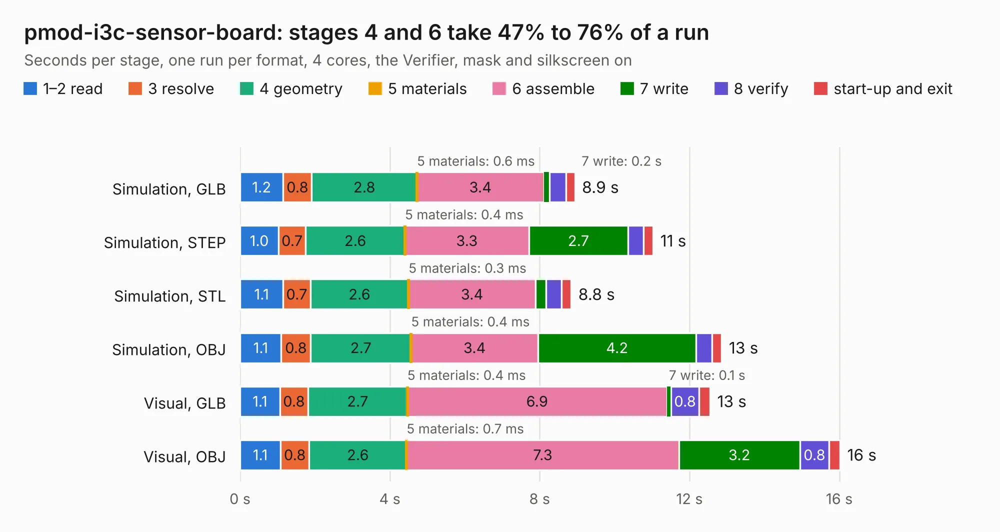

# 392. pmod-i3c-sensor-board

Board 392 of the 3,112 of [Corpus Testing](../Corpus-Testing.md), on [Corpus Page 4](../CorpusTestingPages/Corpus-Testing-04.md#392-pmod-i3c-sensor-board).

| Mode and format | 1–2 read | 3 resolve | 4 geometry | 5 materials | 6 assemble | 7 write | 8 verify | start-up and exit | Total |
|---|---:|---:|---:|---:|---:|---:|---:|---:|---:|
| Simulation, GLB | 1.2 | 0.8 | 2.8 | 0.6&nbsp;ms | 3.4 | 0.2 | 0.4 | 0.2 | 8.9 |
| Simulation, STEP | 1.0 | 0.7 | 2.6 | 0.4&nbsp;ms | 3.3 | 2.7 | 0.4 | 0.3 | 11.0 |
| Simulation, STL | 1.1 | 0.7 | 2.6 | 0.3&nbsp;ms | 3.4 | 0.3 | 0.4 | 0.3 | 8.8 |
| Simulation, OBJ | 1.1 | 0.8 | 2.7 | 0.4&nbsp;ms | 3.4 | 4.2 | 0.4 | 0.3 | 12.9 |
| Visual, GLB | 1.1 | 0.8 | 2.7 | 0.4&nbsp;ms | 6.9 | 0.1 | 0.8 | 0.3 | 12.5 |
| Visual, OBJ | 1.1 | 0.8 | 2.6 | 0.7&nbsp;ms | 7.3 | 3.2 | 0.8 | 0.3 | 16.0 |

<table align="center"><tr><td valign="top">

| Board | Repo: [antmicro/pmod-i3c-sensor-board](https://github.com/antmicro/pmod-i3c-sensor-board) Board: `pmod-i3c-sensor-board.kicad_pcb` |
|---|---|
| Complexity | 311&nbsp;/&nbsp;1000 (size&nbsp;191, features&nbsp;120) |
| KESE&nbsp;features | through vias, rounded, trapezoid or chamfered pads, arc tracks, filled zones, copper text, knockout text, stack-up, dielectric εr and tanδ, mask and silkscreen colours |
| Tested | 9th November 2026 |
| Copper&nbsp;layers | 4 |
| File&nbsp;format | KiCad 9 (20241229) |
| Parts,&nbsp;tracks,&nbsp;vias | 75, 642, 71 |
| Triangles,&nbsp;simulation | 825,250 in 62 parts |
| Verifier | PASS in all six runs |

</td><td valign="top">

<table>
<tr><th>File type</th><th>File size</th><th>Peak memory used</th></tr>
<tr><th colspan="3" align="left">Simulation</th></tr>
<tr><td>GLB</td><td align="right">28&nbsp;MB</td><td align="right">415&nbsp;MB</td></tr>
<tr><td>STEP</td><td align="right">135&nbsp;MB</td><td align="right">499&nbsp;MB</td></tr>
<tr><td>STL</td><td align="right">41&nbsp;MB</td><td align="right">419&nbsp;MB</td></tr>
<tr><td>OBJ</td><td align="right">84&nbsp;MB</td><td align="right">651&nbsp;MB</td></tr>
<tr><th colspan="3" align="left">Visual</th></tr>
<tr><td>GLB</td><td align="right">21&nbsp;MB</td><td align="right">562&nbsp;MB</td></tr>
<tr><td>OBJ</td><td align="right">62&nbsp;MB</td><td align="right">558&nbsp;MB</td></tr>
</table>

</td></tr></table>

| Previous | Next |
|:---|---:|
| [391. pmod-i3c-driver](b0391b_pmod-i3c-driver_pmod-i3c-driver.md) | [393. antmicro-poe-to-usbc-pd-adapter](b0393b_poe-usb-c-pd-converter_antmicro-poe-to-usbc-pd-adapter.md) |
