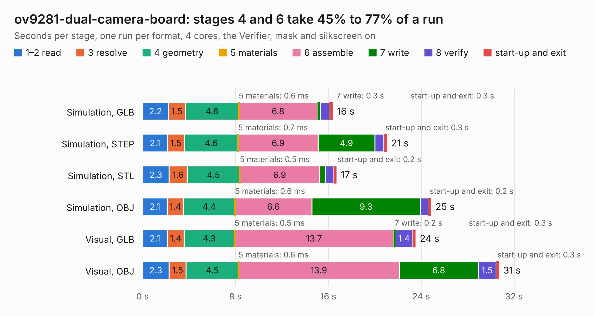

# 394. ov9281-dual-camera-board

Board 394 of the 3,139 of [Corpus Testing](../Corpus-Testing.md), on [Corpus Page 4](../CorpusTestingPages/Corpus-Testing-04.md#394-ov9281-dual-camera-board).

| Mode and format | 1–2 read | 3 resolve | 4 geometry | 5 materials | 6 assemble | 7 write | 8 verify | start-up and exit | Total |
|---|---:|---:|---:|---:|---:|---:|---:|---:|---:|
| Simulation, GLB | 2.2 | 1.5 | 4.6 | 0.6&nbsp;ms | 6.8 | 0.3 | 0.8 | 0.3 | 16.4 |
| Simulation, STEP | 2.1 | 1.5 | 4.6 | 0.7&nbsp;ms | 6.9 | 4.9 | 0.8 | 0.3 | 21.1 |
| Simulation, STL | 2.3 | 1.6 | 4.5 | 0.5&nbsp;ms | 6.9 | 0.5 | 0.7 | 0.2 | 16.7 |
| Simulation, OBJ | 2.1 | 1.4 | 4.4 | 0.6&nbsp;ms | 6.6 | 9.3 | 0.7 | 0.2 | 24.9 |
| Visual, GLB | 2.1 | 1.4 | 4.3 | 0.5&nbsp;ms | 13.7 | 0.2 | 1.4 | 0.3 | 23.5 |
| Visual, OBJ | 2.3 | 1.5 | 4.5 | 0.6&nbsp;ms | 13.9 | 6.8 | 1.5 | 0.3 | 30.7 |

<table align="center"><tr><td valign="top">

| Board | Repo: [antmicro/ov9281-camera-board](https://github.com/antmicro/ov9281-camera-board) Board: `ov9281-dual-camera-board.kicad_pcb` |
|---|---|
| Complexity | 329&nbsp;/&nbsp;1000 (size&nbsp;204, features&nbsp;125) |
| KESE&nbsp;features | through vias, custom pads, rounded, trapezoid or chamfered pads, arc tracks, filled zones, copper drawings, copper text, stack-up, dielectric εr and tanδ |
| Tested | 9th November 2026 |
| Copper&nbsp;layers | 4 |
| File&nbsp;format | KiCad 9 (20241229) |
| Parts,&nbsp;tracks,&nbsp;vias | 77, 1,196, 233 |
| Triangles,&nbsp;simulation | 1,594,572 in 138 parts |
| Verifier | PASS in all six runs |

</td><td valign="top">

<table>
<tr><th>File type</th><th>File size</th><th>Peak memory used</th></tr>
<tr><th colspan="3" align="left">Simulation</th></tr>
<tr><td>GLB</td><td align="right">54&nbsp;MB</td><td align="right">770&nbsp;MB</td></tr>
<tr><td>STEP</td><td align="right">244&nbsp;MB</td><td align="right">842&nbsp;MB</td></tr>
<tr><td>STL</td><td align="right">80&nbsp;MB</td><td align="right">752&nbsp;MB</td></tr>
<tr><td>OBJ</td><td align="right">164&nbsp;MB</td><td align="right">1.2&nbsp;GB</td></tr>
<tr><th colspan="3" align="left">Visual</th></tr>
<tr><td>GLB</td><td align="right">39&nbsp;MB</td><td align="right">849&nbsp;MB</td></tr>
<tr><td>OBJ</td><td align="right">119&nbsp;MB</td><td align="right">917&nbsp;MB</td></tr>
</table>

</td></tr></table>

| Previous | Next |
|:---|---:|
| [393. OV5640-dual-camera-board](b0393b_ov5640-dual-camera-board_OV5640-dual-camera-board.md) | [395. pmod-i3c-driver](b0395b_pmod-i3c-driver_pmod-i3c-driver.md) |
