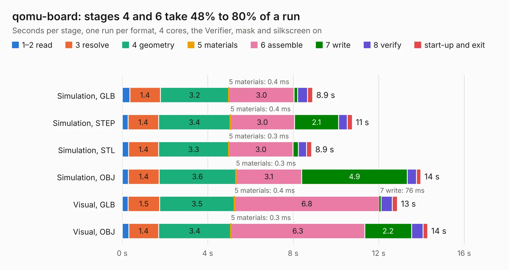

# 395. qomu-board

Board 395 of the 3,106 of [Corpus Testing](../Corpus-Testing.md), on [Corpus Page 4](../CorpusTestingPages/Corpus-Testing-04.md#395-qomu-board).

| Mode and format | 1–2 read | 3 resolve | 4 geometry | 5 materials | 6 assemble | 7 write | 8 verify | start-up and exit | Total |
|---|---:|---:|---:|---:|---:|---:|---:|---:|---:|
| Simulation, GLB | 0.4 | 1.4 | 3.2 | 0.4&nbsp;ms | 3.0 | 0.2 | 0.5 | 0.2 | 8.9 |
| Simulation, STEP | 0.3 | 1.4 | 3.4 | 0.4&nbsp;ms | 3.0 | 2.1 | 0.4 | 0.2 | 10.8 |
| Simulation, STL | 0.3 | 1.4 | 3.3 | 0.3&nbsp;ms | 3.0 | 0.2 | 0.4 | 0.2 | 8.9 |
| Simulation, OBJ | 0.3 | 1.4 | 3.6 | 0.3&nbsp;ms | 3.1 | 4.9 | 0.4 | 0.2 | 14.0 |
| Visual, GLB | 0.3 | 1.5 | 3.5 | 0.4&nbsp;ms | 6.8 | 76&nbsp;ms | 0.5 | 0.2 | 12.9 |
| Visual, OBJ | 0.3 | 1.4 | 3.4 | 0.3&nbsp;ms | 6.3 | 2.2 | 0.5 | 0.2 | 14.3 |

<table align="center"><tr><td valign="top">

| Board | Repo: [antmicro/qomu-dev-board](https://github.com/antmicro/qomu-dev-board) Board: `qomu-board.kicad_pcb` |
|---|---|
| Complexity | 418&nbsp;/&nbsp;1000 (size&nbsp;258, features&nbsp;160) |
| KESE&nbsp;features | through vias, blind and buried vias, microvias, custom pads, rounded, trapezoid or chamfered pads, filled zones, copper text, curved board outline |
| Tested | 9th November 2026 |
| Copper&nbsp;layers | 6 |
| File&nbsp;format | KiCad 5 (20171130) |
| Parts,&nbsp;tracks,&nbsp;vias | 56, 853, 194 |
| Triangles,&nbsp;simulation | 866,700 in 66 parts |
| Verifier | PASS in all six runs |

</td><td valign="top">

<table>
<tr><th>File type</th><th>File size</th><th>Peak memory used</th></tr>
<tr><th colspan="3" align="left">Simulation</th></tr>
<tr><td>GLB</td><td align="right">30&nbsp;MB</td><td align="right">353&nbsp;MB</td></tr>
<tr><td>STEP</td><td align="right">118&nbsp;MB</td><td align="right">411&nbsp;MB</td></tr>
<tr><td>STL</td><td align="right">43&nbsp;MB</td><td align="right">349&nbsp;MB</td></tr>
<tr><td>OBJ</td><td align="right">89&nbsp;MB</td><td align="right">615&nbsp;MB</td></tr>
<tr><th colspan="3" align="left">Visual</th></tr>
<tr><td>GLB</td><td align="right">15&nbsp;MB</td><td align="right">412&nbsp;MB</td></tr>
<tr><td>OBJ</td><td align="right">44&nbsp;MB</td><td align="right">405&nbsp;MB</td></tr>
</table>

</td></tr></table>

| Previous | Next |
|:---|---:|
| [394. led-panel](b0394b_programmable-led-panel_led-panel.md) | [396. quickfeather-board](b0396b_quickfeather-dev-board_quickfeather-board.md) |
