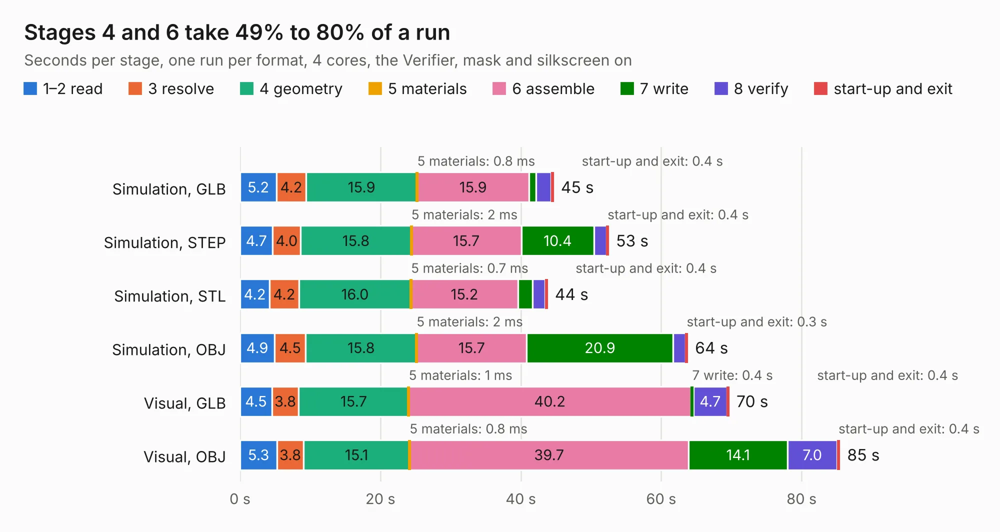

# 396. antmicro-poe-to-usbc-pd-adapter

Board 396 of the 3,121 of [Corpus Testing](../Corpus-Testing.md), on [Corpus Page 4](../CorpusTestingPages/Corpus-Testing-04.md#396-antmicro-poe-to-usbc-pd-adapter).

| Mode and format | 1–2 read | 3 resolve | 4 geometry | 5 materials | 6 assemble | 7 write | 8 verify | start-up and exit | Total |
|---|---:|---:|---:|---:|---:|---:|---:|---:|---:|
| Simulation, GLB | 5.2 | 4.2 | 15.9 | 0.8&nbsp;ms | 15.9 | 1.0 | 2.1 | 0.4 | 44.7 |
| Simulation, STEP | 4.7 | 4.0 | 15.8 | 2&nbsp;ms | 15.7 | 10.4 | 1.7 | 0.4 | 52.5 |
| Simulation, STL | 4.2 | 4.2 | 16.0 | 0.7&nbsp;ms | 15.2 | 2.1 | 1.8 | 0.4 | 43.8 |
| Simulation, OBJ | 4.9 | 4.5 | 15.8 | 2&nbsp;ms | 15.7 | 20.9 | 1.8 | 0.3 | 63.8 |
| Visual, GLB | 4.5 | 3.8 | 15.7 | 1&nbsp;ms | 40.2 | 0.4 | 4.7 | 0.4 | 69.7 |
| Visual, OBJ | 5.3 | 3.8 | 15.1 | 0.8&nbsp;ms | 39.7 | 14.1 | 7.0 | 0.4 | 85.5 |

<table align="center"><tr><td valign="top">

| Board | Repo: [antmicro/poe-usb-c-pd-converter](https://github.com/antmicro/poe-usb-c-pd-converter) Board: `antmicro-poe-to-usbc-pd-adapter.kicad_pcb` |
|---|---|
| Complexity | 394&nbsp;/&nbsp;1000 (size&nbsp;269, features&nbsp;125) |
| KESE&nbsp;features | through vias, slotted holes, rounded, trapezoid or chamfered pads, arc tracks, filled zones, copper text, knockout text, stack-up, dielectric εr and tanδ |
| Tested | 9th November 2026 |
| Copper&nbsp;layers | 4 |
| File&nbsp;format | KiCad 9 (20241229) |
| Parts,&nbsp;tracks,&nbsp;vias | 230, 1,786, 767 |
| Triangles,&nbsp;simulation | 3,931,522 in 244 parts |
| Verifier | PASS in all six runs |

</td><td valign="top">

<table>
<tr><th>File type</th><th>File size</th><th>Peak memory used</th></tr>
<tr><th colspan="3" align="left">Simulation</th></tr>
<tr><td>GLB</td><td align="right">133&nbsp;MB</td><td align="right">1.3&nbsp;GB</td></tr>
<tr><td>STEP</td><td align="right">481&nbsp;MB</td><td align="right">1.5&nbsp;GB</td></tr>
<tr><td>STL</td><td align="right">197&nbsp;MB</td><td align="right">1.3&nbsp;GB</td></tr>
<tr><td>OBJ</td><td align="right">411&nbsp;MB</td><td align="right">2.6&nbsp;GB</td></tr>
<tr><th colspan="3" align="left">Visual</th></tr>
<tr><td>GLB</td><td align="right">83&nbsp;MB</td><td align="right">1.5&nbsp;GB</td></tr>
<tr><td>OBJ</td><td align="right">261&nbsp;MB</td><td align="right">1.8&nbsp;GB</td></tr>
</table>

</td></tr></table>

| Previous | Next |
|:---|---:|
| [395. pmod-i3c-sensor-board](b0395b_pmod-i3c-sensor-board_pmod-i3c-sensor-board.md) | [397. polarfire-som](b0397b_polarfire-som_polarfire-som.md) |
