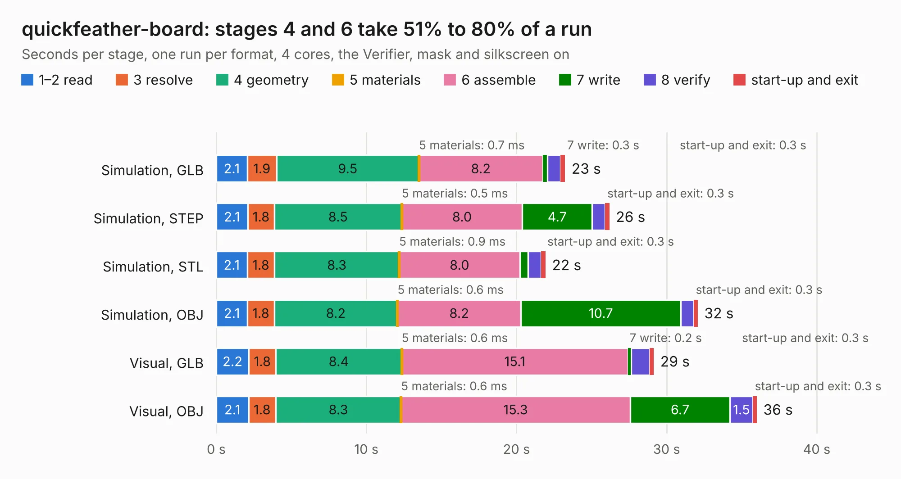

# 396. quickfeather-board

Board 396 of the 3,107 of [Corpus Testing](../Corpus-Testing.md), on [Corpus Page 4](../CorpusTestingPages/Corpus-Testing-04.md#396-quickfeather-board).

| Mode and format | 1–2 read | 3 resolve | 4 geometry | 5 materials | 6 assemble | 7 write | 8 verify | start-up and exit | Total |
|---|---:|---:|---:|---:|---:|---:|---:|---:|---:|
| Simulation, GLB | 2.1 | 1.9 | 9.5 | 0.7&nbsp;ms | 8.2 | 0.3 | 0.9 | 0.3 | 23.2 |
| Simulation, STEP | 2.1 | 1.8 | 8.5 | 0.5&nbsp;ms | 8.0 | 4.7 | 0.9 | 0.3 | 26.2 |
| Simulation, STL | 2.1 | 1.8 | 8.3 | 0.9&nbsp;ms | 8.0 | 0.5 | 0.9 | 0.3 | 21.9 |
| Simulation, OBJ | 2.1 | 1.8 | 8.2 | 0.6&nbsp;ms | 8.2 | 10.7 | 0.9 | 0.3 | 32.1 |
| Visual, GLB | 2.2 | 1.8 | 8.4 | 0.6&nbsp;ms | 15.1 | 0.2 | 1.2 | 0.3 | 29.2 |
| Visual, OBJ | 2.1 | 1.8 | 8.3 | 0.6&nbsp;ms | 15.3 | 6.7 | 1.5 | 0.3 | 36.0 |

<table align="center"><tr><td valign="top">

| Board | Repo: [antmicro/quickfeather-dev-board](https://github.com/antmicro/quickfeather-dev-board) Board: `quickfeather-board.kicad_pcb` |
|---|---|
| Complexity | 334&nbsp;/&nbsp;1000 (size&nbsp;249, features&nbsp;85) |
| KESE&nbsp;features | through vias, rounded, trapezoid or chamfered pads, filled zones, curved board outline, stack-up, dielectric εr and tanδ |
| Tested | 9th November 2026 |
| Copper&nbsp;layers | 4 |
| File&nbsp;format | KiCad 7 (20221018) |
| Parts,&nbsp;tracks,&nbsp;vias | 90, 1,689, 224 |
| Triangles,&nbsp;simulation | 1,752,598 in 158 parts |
| Verifier | PASS in all six runs |

</td><td valign="top">

<table>
<tr><th>File type</th><th>File size</th><th>Peak memory used</th></tr>
<tr><th colspan="3" align="left">Simulation</th></tr>
<tr><td>GLB</td><td align="right">60&nbsp;MB</td><td align="right">666&nbsp;MB</td></tr>
<tr><td>STEP</td><td align="right">263&nbsp;MB</td><td align="right">799&nbsp;MB</td></tr>
<tr><td>STL</td><td align="right">88&nbsp;MB</td><td align="right">674&nbsp;MB</td></tr>
<tr><td>OBJ</td><td align="right">185&nbsp;MB</td><td align="right">1.3&nbsp;GB</td></tr>
<tr><th colspan="3" align="left">Visual</th></tr>
<tr><td>GLB</td><td align="right">35&nbsp;MB</td><td align="right">796&nbsp;MB</td></tr>
<tr><td>OBJ</td><td align="right">107&nbsp;MB</td><td align="right">906&nbsp;MB</td></tr>
</table>

</td></tr></table>

| Previous | Next |
|:---|---:|
| [395. qomu-board](b0395b_qomu-dev-board_qomu-board_1290.md) | [397. rpi-cm4-csi-adapter](b0397b_raspberry-pi-cm4-csi-adapter_rpi-cm4-csi-adapter.md) |
