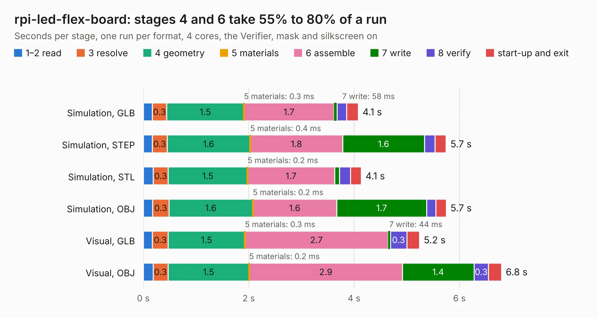

# 396. rpi-led-flex-board

Board 396 of the 3,102 of [Corpus Testing](../Corpus-Testing.md), on [Corpus Page 4](../CorpusTestingPages/Corpus-Testing-04.md#396-rpi-led-flex-board).

| Mode and format | 1–2 read | 3 resolve | 4 geometry | 5 materials | 6 assemble | 7 write | 8 verify | start-up and exit | Total |
|---|---:|---:|---:|---:|---:|---:|---:|---:|---:|
| Simulation, GLB | 0.2 | 0.3 | 1.5 | 0.3&nbsp;ms | 1.7 | 58&nbsp;ms | 0.2 | 0.2 | 4.1 |
| Simulation, STEP | 0.2 | 0.3 | 1.6 | 0.4&nbsp;ms | 1.8 | 1.6 | 0.2 | 0.2 | 5.7 |
| Simulation, STL | 0.2 | 0.3 | 1.5 | 0.2&nbsp;ms | 1.7 | 90&nbsp;ms | 0.2 | 0.2 | 4.1 |
| Simulation, OBJ | 0.2 | 0.3 | 1.6 | 0.2&nbsp;ms | 1.6 | 1.7 | 0.2 | 0.2 | 5.7 |
| Visual, GLB | 0.2 | 0.3 | 1.5 | 0.3&nbsp;ms | 2.7 | 44&nbsp;ms | 0.3 | 0.2 | 5.2 |
| Visual, OBJ | 0.2 | 0.3 | 1.5 | 0.2&nbsp;ms | 2.9 | 1.4 | 0.3 | 0.2 | 6.8 |

<table align="center"><tr><td valign="top">

| Board | Repo: [antmicro/rpi-led-flex-board](https://github.com/antmicro/rpi-led-flex-board) Board: `rpi-led-flex-board.kicad_pcb` |
|---|---|
| Complexity | 245&nbsp;/&nbsp;1000 (size&nbsp;190, features&nbsp;55) |
| KESE&nbsp;features | through vias, rounded, trapezoid or chamfered pads, filled zones, curved board outline |
| Tested | 9th November 2026 |
| Copper&nbsp;layers | 2 |
| File&nbsp;format | KiCad 5 (20171130) |
| Parts,&nbsp;tracks,&nbsp;vias | 27, 252, 43 |
| Triangles,&nbsp;simulation | 351,834 in 50 parts |
| Verifier | PASS in all six runs |

</td><td valign="top">

<table>
<tr><th>File type</th><th>File size</th><th>Peak memory used</th></tr>
<tr><th colspan="3" align="left">Simulation</th></tr>
<tr><td>GLB</td><td align="right">12&nbsp;MB</td><td align="right">272&nbsp;MB</td></tr>
<tr><td>STEP</td><td align="right">64&nbsp;MB</td><td align="right">316&nbsp;MB</td></tr>
<tr><td>STL</td><td align="right">18&nbsp;MB</td><td align="right">271&nbsp;MB</td></tr>
<tr><td>OBJ</td><td align="right">35&nbsp;MB</td><td align="right">282&nbsp;MB</td></tr>
<tr><th colspan="3" align="left">Visual</th></tr>
<tr><td>GLB</td><td align="right">9.5&nbsp;MB</td><td align="right">305&nbsp;MB</td></tr>
<tr><td>OBJ</td><td align="right">27&nbsp;MB</td><td align="right">302&nbsp;MB</td></tr>
</table>

</td></tr></table>

| Previous | Next |
|:---|---:|
| [395. rpi-cm4-csi-adapter](b0395b_raspberry-pi-cm4-csi-adapter_rpi-cm4-csi-adapter.md) | [397. scalenode-adapter](b0397b_scalenode-adapter_scalenode-adapter.md) |
