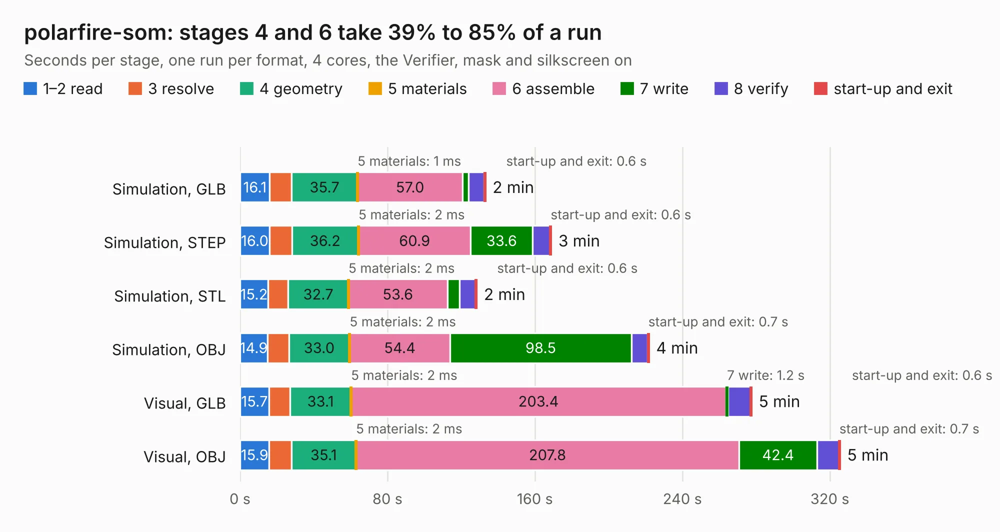

# 397. polarfire-som

Board 397 of the 3,119 of [Corpus Testing](../Corpus-Testing.md), on [Corpus Page 4](../CorpusTestingPages/Corpus-Testing-04.md#397-polarfire-som).

| Mode and format | 1–2 read | 3 resolve | 4 geometry | 5 materials | 6 assemble | 7 write | 8 verify | start-up and exit | Total |
|---|---:|---:|---:|---:|---:|---:|---:|---:|---:|
| Simulation, GLB | 16.1 | 11.9 | 35.7 | 1&nbsp;ms | 57.0 | 3.3 | 8.5 | 0.6 | 133.1 |
| Simulation, STEP | 16.0 | 12.1 | 36.2 | 2&nbsp;ms | 60.9 | 33.6 | 9.5 | 0.6 | 168.8 |
| Simulation, STL | 15.2 | 11.0 | 32.7 | 2&nbsp;ms | 53.6 | 6.7 | 8.6 | 0.6 | 128.4 |
| Simulation, OBJ | 14.9 | 11.5 | 33.0 | 2&nbsp;ms | 54.4 | 98.5 | 8.8 | 0.7 | 221.9 |
| Visual, GLB | 15.7 | 11.4 | 33.1 | 2&nbsp;ms | 203.4 | 1.2 | 12.1 | 0.6 | 277.5 |
| Visual, OBJ | 15.9 | 12.0 | 35.1 | 2&nbsp;ms | 207.8 | 42.4 | 11.7 | 0.7 | 325.5 |

<table align="center"><tr><td valign="top">

| Board | Repo: [antmicro/polarfire-som](https://github.com/antmicro/polarfire-som) Board: `polarfire-som.kicad_pcb` |
|---|---|
| Complexity | 517&nbsp;/&nbsp;1000 (size&nbsp;357, features&nbsp;160) |
| KESE&nbsp;features | through vias, custom pads, rounded, trapezoid or chamfered pads, arc tracks, filled zones, copper drawings, curved board outline, knockout text, TrueType text, stack-up, dielectric εr and tanδ, mask and silkscreen colours |
| Tested | 9th November 2026 |
| Copper&nbsp;layers | 14 |
| File&nbsp;format | KiCad 9 (20241229) |
| Parts,&nbsp;tracks,&nbsp;vias | 421, 13,972, 1,565 |
| Triangles,&nbsp;simulation | 15,008,058 in 793 parts |
| Verifier | PASS in all six runs |

</td><td valign="top">

<table>
<tr><th>File type</th><th>File size</th><th>Peak memory used</th></tr>
<tr><th colspan="3" align="left">Simulation</th></tr>
<tr><td>GLB</td><td align="right">476&nbsp;MB</td><td align="right">3.5&nbsp;GB</td></tr>
<tr><td>STEP</td><td align="right">1.6&nbsp;GB</td><td align="right">4.7&nbsp;GB</td></tr>
<tr><td>STL</td><td align="right">750&nbsp;MB</td><td align="right">3.4&nbsp;GB</td></tr>
<tr><td>OBJ</td><td align="right">1.6&nbsp;GB</td><td align="right">9.4&nbsp;GB</td></tr>
<tr><th colspan="3" align="left">Visual</th></tr>
<tr><td>GLB</td><td align="right">226&nbsp;MB</td><td align="right">4.3&nbsp;GB</td></tr>
<tr><td>OBJ</td><td align="right">760&nbsp;MB</td><td align="right">4.9&nbsp;GB</td></tr>
</table>

</td></tr></table>

| Previous | Next |
|:---|---:|
| [396. antmicro-poe-to-usbc-pd-adapter](b0396b_poe-usb-c-pd-converter_antmicro-poe-to-usbc-pd-adapter.md) | [398. led-panel](b0398b_programmable-led-panel_led-panel.md) |
