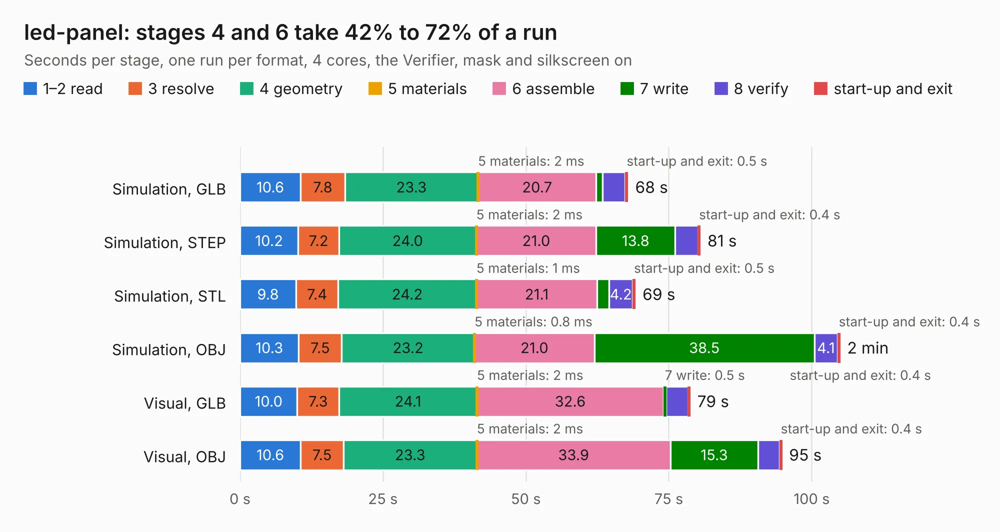

# 399 led-panel

Board 399 of the 3,138 of [Corpus Testing](../Corpus-Testing.md), on [Corpus Page 4](../CorpusTestingPages/Corpus-Testing-04.md#399-led-panel).

| Mode and format | 1–2 read | 3 resolve | 4 geometry | 5 materials | 6 assemble | 7 write | 8 verify | start-up and exit | Total |
|---|---:|---:|---:|---:|---:|---:|---:|---:|---:|
| Simulation, GLB | 10.6 | 7.8 | 23.3 | 2&nbsp;ms | 20.7 | 1.1 | 3.9 | 0.5 | 67.9 |
| Simulation, STEP | 10.2 | 7.2 | 24.0 | 2&nbsp;ms | 21.0 | 13.8 | 4.0 | 0.4 | 80.5 |
| Simulation, STL | 9.8 | 7.4 | 24.2 | 1&nbsp;ms | 21.1 | 2.1 | 4.2 | 0.5 | 69.2 |
| Simulation, OBJ | 10.3 | 7.5 | 23.2 | 0.8&nbsp;ms | 21.0 | 38.5 | 4.1 | 0.4 | 105.0 |
| Visual, GLB | 10.0 | 7.3 | 24.1 | 2&nbsp;ms | 32.6 | 0.5 | 3.8 | 0.4 | 78.7 |
| Visual, OBJ | 10.6 | 7.5 | 23.3 | 2&nbsp;ms | 33.9 | 15.3 | 3.8 | 0.4 | 94.8 |

<table align="center"><tr><td valign="top">

| Board | Repo: [antmicro/programmable-led-panel](https://github.com/antmicro/programmable-led-panel) Board: `led-panel.kicad_pcb` |
|---|---|
| Complexity | 441&nbsp;/&nbsp;1000 (size&nbsp;296, features&nbsp;145) |
| KESE&nbsp;features | through vias, slotted holes, custom pads, rounded, trapezoid or chamfered pads, filled zones, copper drawings, knockout text, TrueType text, stack-up, dielectric εr and tanδ, mask and silkscreen colours |
| Tested | 9th November 2026 |
| Copper&nbsp;layers | 6 |
| File&nbsp;format | KiCad 8 (20240108) |
| Parts,&nbsp;tracks,&nbsp;vias | 294, 3,031, 741 |
| Triangles,&nbsp;simulation | 5,718,302 in 275 parts |
| Note | panel |
| Verifier | PASS in all six runs |

</td><td valign="top">

<table>
<tr><th>File type</th><th>File size</th><th>Peak memory used</th></tr>
<tr><th colspan="3" align="left">Simulation</th></tr>
<tr><td>GLB</td><td align="right">194&nbsp;MB</td><td align="right">2.2&nbsp;GB</td></tr>
<tr><td>STEP</td><td align="right">538&nbsp;MB</td><td align="right">2.4&nbsp;GB</td></tr>
<tr><td>STL</td><td align="right">286&nbsp;MB</td><td align="right">2.1&nbsp;GB</td></tr>
<tr><td>OBJ</td><td align="right">611&nbsp;MB</td><td align="right">3.9&nbsp;GB</td></tr>
<tr><th colspan="3" align="left">Visual</th></tr>
<tr><td>GLB</td><td align="right">87&nbsp;MB</td><td align="right">1.6&nbsp;GB</td></tr>
<tr><td>OBJ</td><td align="right">273&nbsp;MB</td><td align="right">2.1&nbsp;GB</td></tr>
</table>

</td></tr></table>

| Previous | Next |
|:---|---:|
| [398 polarfire-som](b0398b_polarfire-som_polarfire-som.md) | [400 qomu-board](b0400b_qomu-dev-board_qomu-board_1290.md) |
