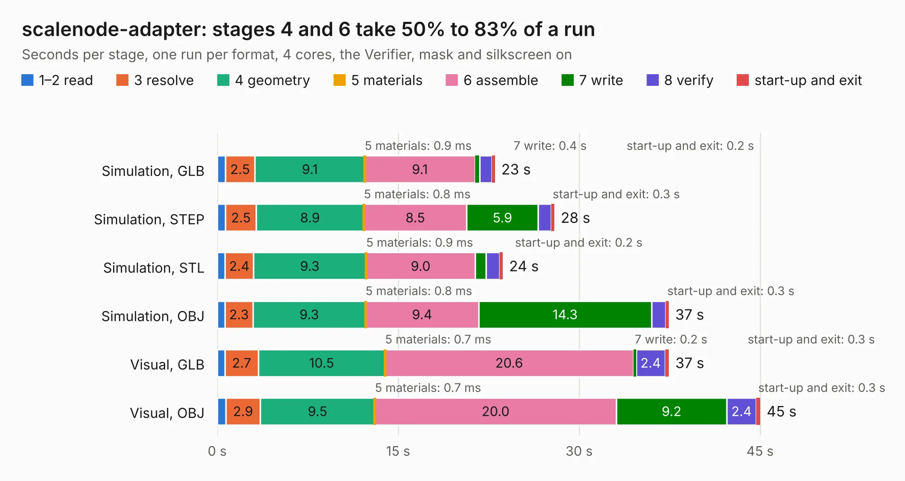

# 399. scalenode-adapter

Board 399 of the 3,111 of [Corpus Testing](../Corpus-Testing.md), on [Corpus Page 4](../CorpusTestingPages/Corpus-Testing-04.md#399-scalenode-adapter).

| Mode and format | 1–2 read | 3 resolve | 4 geometry | 5 materials | 6 assemble | 7 write | 8 verify | start-up and exit | Total |
|---|---:|---:|---:|---:|---:|---:|---:|---:|---:|
| Simulation, GLB | 0.7 | 2.5 | 9.1 | 0.9&nbsp;ms | 9.1 | 0.4 | 1.0 | 0.2 | 23.0 |
| Simulation, STEP | 0.7 | 2.5 | 8.9 | 0.8&nbsp;ms | 8.5 | 5.9 | 1.1 | 0.3 | 27.9 |
| Simulation, STL | 0.7 | 2.4 | 9.3 | 0.9&nbsp;ms | 9.0 | 0.9 | 1.1 | 0.2 | 23.7 |
| Simulation, OBJ | 0.6 | 2.3 | 9.3 | 0.8&nbsp;ms | 9.4 | 14.3 | 1.2 | 0.3 | 37.4 |
| Visual, GLB | 0.7 | 2.7 | 10.5 | 0.7&nbsp;ms | 20.6 | 0.2 | 2.4 | 0.3 | 37.4 |
| Visual, OBJ | 0.7 | 2.9 | 9.5 | 0.7&nbsp;ms | 20.0 | 9.2 | 2.4 | 0.3 | 45.0 |

<table align="center"><tr><td valign="top">

| Board | Repo: [antmicro/scalenode-adapter](https://github.com/antmicro/scalenode-adapter) Board: `scalenode-adapter.kicad_pcb` |
|---|---|
| Complexity | 356&nbsp;/&nbsp;1000 (size&nbsp;266, features&nbsp;90) |
| KESE&nbsp;features | through vias, slotted holes, custom pads, rounded, trapezoid or chamfered pads, filled zones, copper drawings, copper text |
| Tested | 9th November 2026 |
| Copper&nbsp;layers | 4 |
| File&nbsp;format | KiCad 5 (20171130) |
| Parts,&nbsp;tracks,&nbsp;vias | 152, 2,106, 319 |
| Triangles,&nbsp;simulation | 2,397,452 in 181 parts |
| Verifier | PASS in all six runs |

</td><td valign="top">

<table>
<tr><th>File type</th><th>File size</th><th>Peak memory used</th></tr>
<tr><th colspan="3" align="left">Simulation</th></tr>
<tr><td>GLB</td><td align="right">84&nbsp;MB</td><td align="right">883&nbsp;MB</td></tr>
<tr><td>STEP</td><td align="right">361&nbsp;MB</td><td align="right">985&nbsp;MB</td></tr>
<tr><td>STL</td><td align="right">120&nbsp;MB</td><td align="right">888&nbsp;MB</td></tr>
<tr><td>OBJ</td><td align="right">256&nbsp;MB</td><td align="right">1.6&nbsp;GB</td></tr>
<tr><th colspan="3" align="left">Visual</th></tr>
<tr><td>GLB</td><td align="right">51&nbsp;MB</td><td align="right">944&nbsp;MB</td></tr>
<tr><td>OBJ</td><td align="right">157&nbsp;MB</td><td align="right">1.1&nbsp;GB</td></tr>
</table>

</td></tr></table>

| Previous | Next |
|:---|---:|
| [398. rpi-led-flex-board](b0398b_rpi-led-flex-board_rpi-led-flex-board.md) | [400. scalenode-cm4-baseboard](b0400b_scalenode-cm4-baseboard_scalenode-cm4-baseboard.md) |
