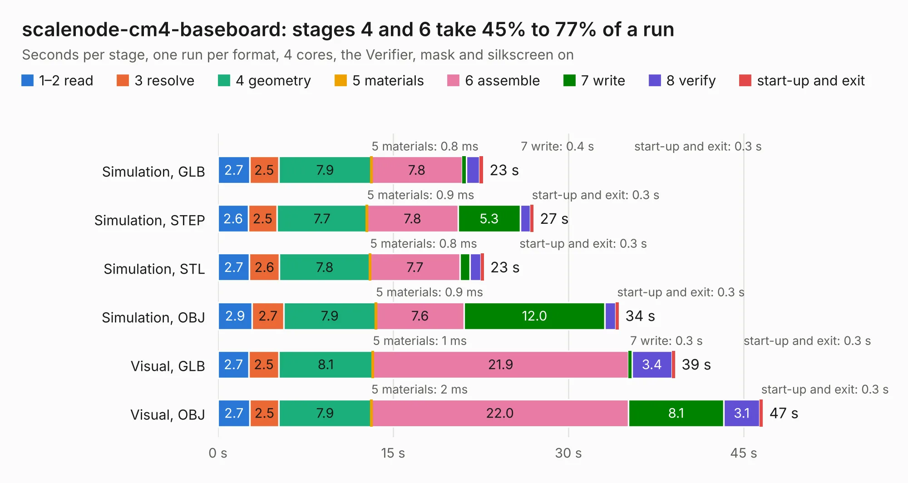

# 400. scalenode-cm4-baseboard

Board 400 of the 3,108 of [Corpus Testing](../Corpus-Testing.md), on [Corpus Page 4](../CorpusTestingPages/Corpus-Testing-04.md#400-scalenode-cm4-baseboard).

| Mode and format | 1–2 read | 3 resolve | 4 geometry | 5 materials | 6 assemble | 7 write | 8 verify | start-up and exit | Total |
|---|---:|---:|---:|---:|---:|---:|---:|---:|---:|
| Simulation, GLB | 2.7 | 2.5 | 7.9 | 0.8&nbsp;ms | 7.8 | 0.4 | 1.1 | 0.3 | 22.7 |
| Simulation, STEP | 2.6 | 2.5 | 7.7 | 0.9&nbsp;ms | 7.8 | 5.3 | 0.9 | 0.3 | 27.0 |
| Simulation, STL | 2.7 | 2.6 | 7.8 | 0.8&nbsp;ms | 7.7 | 0.9 | 0.9 | 0.3 | 22.8 |
| Simulation, OBJ | 2.9 | 2.7 | 7.9 | 0.9&nbsp;ms | 7.6 | 12.0 | 0.9 | 0.3 | 34.3 |
| Visual, GLB | 2.7 | 2.5 | 8.1 | 1&nbsp;ms | 21.9 | 0.3 | 3.4 | 0.3 | 39.1 |
| Visual, OBJ | 2.7 | 2.5 | 7.9 | 2&nbsp;ms | 22.0 | 8.1 | 3.1 | 0.3 | 46.6 |

<table align="center"><tr><td valign="top">

| Board | Repo: [antmicro/scalenode-cm4-baseboard](https://github.com/antmicro/scalenode-cm4-baseboard) Board: `scalenode-cm4-baseboard.kicad_pcb` |
|---|---|
| Complexity | 358&nbsp;/&nbsp;1000 (size&nbsp;223, features&nbsp;135) |
| KESE&nbsp;features | through vias, slotted holes, custom pads, rounded, trapezoid or chamfered pads, arc tracks, filled zones, copper text, curved board outline, stack-up, dielectric εr and tanδ |
| Tested | 9th November 2026 |
| Copper&nbsp;layers | 4 |
| File&nbsp;format | KiCad 7 (20221018) |
| Parts,&nbsp;tracks,&nbsp;vias | 129, 2,743, 536 |
| Triangles,&nbsp;simulation | 2,773,950 in 292 parts |
| Verifier | Simulation, GLB: Verifier FAIL Simulation, STEP: Verifier FAIL Simulation, STL: Verifier FAIL Simulation, OBJ: Verifier FAIL |
| Bad&nbsp;design | Bad design according to KESE: copper of two nets on top of each other in the file, a short KiCad's DRC reports; U4 and U7 placed exactly on top of each other at (137.41, 83.21) mm: their TRIM pads, of two nets, coincide. KESE models what the file says, so the Verifier rightly finds the two nets' solids overlapping |

</td><td valign="top">

<table>
<tr><th>File type</th><th>File size</th><th>Peak memory used</th></tr>
<tr><th colspan="3" align="left">Simulation</th></tr>
<tr><td>GLB</td><td align="right">97&nbsp;MB</td><td align="right">971&nbsp;MB</td></tr>
<tr><td>STEP</td><td align="right">324&nbsp;MB</td><td align="right">1.1&nbsp;GB</td></tr>
<tr><td>STL</td><td align="right">139&nbsp;MB</td><td align="right">920&nbsp;MB</td></tr>
<tr><td>OBJ</td><td align="right">297&nbsp;MB</td><td align="right">2.0&nbsp;GB</td></tr>
<tr><th colspan="3" align="left">Visual</th></tr>
<tr><td>GLB</td><td align="right">66&nbsp;MB</td><td align="right">1.3&nbsp;GB</td></tr>
<tr><td>OBJ</td><td align="right">209&nbsp;MB</td><td align="right">1.5&nbsp;GB</td></tr>
</table>

</td></tr></table>

| Previous | Next |
|:---|---:|
| [399. scalenode-adapter](b0399b_scalenode-adapter_scalenode-adapter.md) | [401. sdi-fiber-adapter](b0401b_sdi-fiber-adapter_sdi-fiber-adapter.md) |
