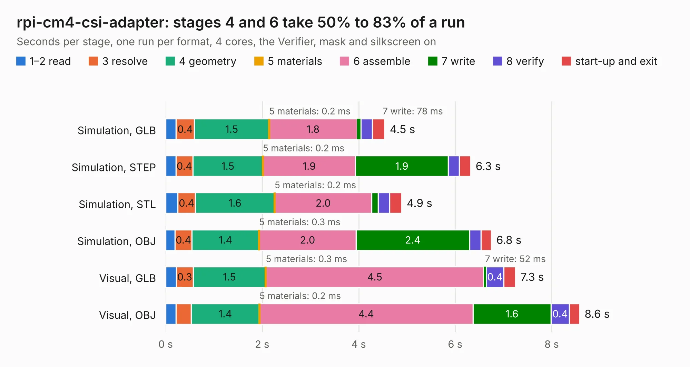

# 401. rpi-cm4-csi-adapter

Board 401 of the 3,124 of [Corpus Testing](../Corpus-Testing.md), on [Corpus Page 4](../CorpusTestingPages/Corpus-Testing-04.md#401-rpi-cm4-csi-adapter).

| Mode and format | 1–2 read | 3 resolve | 4 geometry | 5 materials | 6 assemble | 7 write | 8 verify | start-up and exit | Total |
|---|---:|---:|---:|---:|---:|---:|---:|---:|---:|
| Simulation, GLB | 0.2 | 0.4 | 1.5 | 0.2&nbsp;ms | 1.8 | 78&nbsp;ms | 0.2 | 0.3 | 4.5 |
| Simulation, STEP | 0.2 | 0.4 | 1.5 | 0.2&nbsp;ms | 1.9 | 1.9 | 0.2 | 0.2 | 6.3 |
| Simulation, STL | 0.3 | 0.4 | 1.6 | 0.2&nbsp;ms | 2.0 | 0.1 | 0.2 | 0.3 | 4.9 |
| Simulation, OBJ | 0.2 | 0.4 | 1.4 | 0.3&nbsp;ms | 2.0 | 2.4 | 0.2 | 0.2 | 6.8 |
| Visual, GLB | 0.2 | 0.3 | 1.5 | 0.3&nbsp;ms | 4.5 | 52&nbsp;ms | 0.4 | 0.2 | 7.3 |
| Visual, OBJ | 0.2 | 0.3 | 1.4 | 0.2&nbsp;ms | 4.4 | 1.6 | 0.4 | 0.2 | 8.6 |

<table align="center"><tr><td valign="top">

| Board | Repo: [antmicro/raspberry-pi-cm4-csi-adapter](https://github.com/antmicro/raspberry-pi-cm4-csi-adapter) Board: `rpi-cm4-csi-adapter.kicad_pcb` |
|---|---|
| Complexity | 227&nbsp;/&nbsp;1000 (size&nbsp;172, features&nbsp;55) |
| KESE&nbsp;features | through vias, rounded, trapezoid or chamfered pads, filled zones, copper text |
| Tested | 9th November 2026 |
| Copper&nbsp;layers | 4 |
| File&nbsp;format | KiCad 5 (20171130) |
| Parts,&nbsp;tracks,&nbsp;vias | 6, 1,229, 38 |
| Triangles,&nbsp;simulation | 471,986 in 33 parts |
| Verifier | PASS in all six runs |

</td><td valign="top">

<table>
<tr><th>File type</th><th>File size</th><th>Peak memory used</th></tr>
<tr><th colspan="3" align="left">Simulation</th></tr>
<tr><td>GLB</td><td align="right">16&nbsp;MB</td><td align="right">297&nbsp;MB</td></tr>
<tr><td>STEP</td><td align="right">93&nbsp;MB</td><td align="right">349&nbsp;MB</td></tr>
<tr><td>STL</td><td align="right">24&nbsp;MB</td><td align="right">292&nbsp;MB</td></tr>
<tr><td>OBJ</td><td align="right">48&nbsp;MB</td><td align="right">373&nbsp;MB</td></tr>
<tr><th colspan="3" align="left">Visual</th></tr>
<tr><td>GLB</td><td align="right">11&nbsp;MB</td><td align="right">332&nbsp;MB</td></tr>
<tr><td>OBJ</td><td align="right">32&nbsp;MB</td><td align="right">334&nbsp;MB</td></tr>
</table>

</td></tr></table>

| Previous | Next |
|:---|---:|
| [400. quickfeather-board](b0400b_quickfeather-dev-board_quickfeather-board.md) | [402. rpi-led-flex-board](b0402b_rpi-led-flex-board_rpi-led-flex-board.md) |
