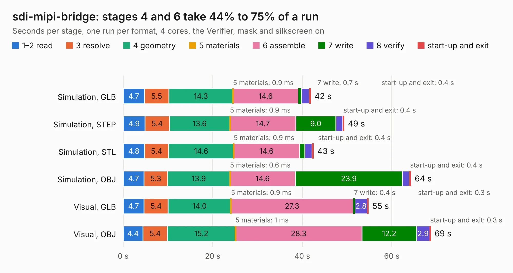

# 402. sdi-mipi-bridge

Board 402 of the 3,110 of [Corpus Testing](../Corpus-Testing.md), on [Corpus Page 4](../CorpusTestingPages/Corpus-Testing-04.md#402-sdi-mipi-bridge).

| Mode and format | 1–2 read | 3 resolve | 4 geometry | 5 materials | 6 assemble | 7 write | 8 verify | start-up and exit | Total |
|---|---:|---:|---:|---:|---:|---:|---:|---:|---:|
| Simulation, GLB | 4.7 | 5.5 | 14.3 | 0.9&nbsp;ms | 14.6 | 0.7 | 1.7 | 0.4 | 41.9 |
| Simulation, STEP | 4.9 | 5.4 | 13.6 | 0.9&nbsp;ms | 14.7 | 9.0 | 1.5 | 0.4 | 49.4 |
| Simulation, STL | 4.8 | 5.4 | 14.6 | 0.9&nbsp;ms | 14.6 | 1.2 | 1.6 | 0.4 | 42.5 |
| Simulation, OBJ | 4.7 | 5.3 | 13.9 | 0.6&nbsp;ms | 14.6 | 23.9 | 1.5 | 0.4 | 64.3 |
| Visual, GLB | 4.7 | 5.4 | 14.0 | 0.9&nbsp;ms | 27.3 | 0.4 | 2.8 | 0.3 | 54.8 |
| Visual, OBJ | 4.4 | 5.4 | 15.2 | 1&nbsp;ms | 28.3 | 12.2 | 2.9 | 0.3 | 68.7 |

<table align="center"><tr><td valign="top">

| Board | Repo: [antmicro/sdi-mipi-bridge-hw](https://github.com/antmicro/sdi-mipi-bridge-hw) Board: `sdi-mipi-bridge.kicad_pcb` |
|---|---|
| Complexity | 390&nbsp;/&nbsp;1000 (size&nbsp;300, features&nbsp;90) |
| KESE&nbsp;features | through vias, rounded, trapezoid or chamfered pads, filled zones, copper text, stack-up, dielectric εr and tanδ, mask and silkscreen colours |
| Tested | 9th November 2026 |
| Copper&nbsp;layers | 6 |
| File&nbsp;format | KiCad 7 (20221018) |
| Parts,&nbsp;tracks,&nbsp;vias | 166, 4,789, 374 |
| Triangles,&nbsp;simulation | 3,614,688 in 191 parts |
| Verifier | PASS in all six runs |

</td><td valign="top">

<table>
<tr><th>File type</th><th>File size</th><th>Peak memory used</th></tr>
<tr><th colspan="3" align="left">Simulation</th></tr>
<tr><td>GLB</td><td align="right">125&nbsp;MB</td><td align="right">1.1&nbsp;GB</td></tr>
<tr><td>STEP</td><td align="right">535&nbsp;MB</td><td align="right">1.4&nbsp;GB</td></tr>
<tr><td>STL</td><td align="right">181&nbsp;MB</td><td align="right">1.1&nbsp;GB</td></tr>
<tr><td>OBJ</td><td align="right">388&nbsp;MB</td><td align="right">2.5&nbsp;GB</td></tr>
<tr><th colspan="3" align="left">Visual</th></tr>
<tr><td>GLB</td><td align="right">69&nbsp;MB</td><td align="right">1.5&nbsp;GB</td></tr>
<tr><td>OBJ</td><td align="right">218&nbsp;MB</td><td align="right">1.6&nbsp;GB</td></tr>
</table>

</td></tr></table>

| Previous | Next |
|:---|---:|
| [401. sdi-fiber-adapter](b0401b_sdi-fiber-adapter_sdi-fiber-adapter.md) | [403. sdi-mipi-video-converter](b0403b_sdi-mipi-video-converter-hw_sdi-mipi-video-converter.md) |
