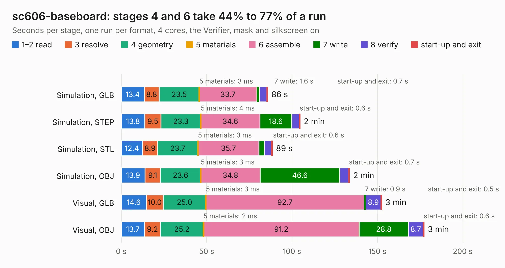

# 405. sc606-baseboard

Board 405 of the 3,108 of [Corpus Testing](../Corpus-Testing.md), on [Corpus Page 4](../CorpusTestingPages/Corpus-Testing-04.md#405-sc606-baseboard).

| Mode and format | 1–2 read | 3 resolve | 4 geometry | 5 materials | 6 assemble | 7 write | 8 verify | start-up and exit | Total |
|---|---:|---:|---:|---:|---:|---:|---:|---:|---:|
| Simulation, GLB | 13.4 | 8.8 | 23.5 | 3&nbsp;ms | 33.7 | 1.6 | 4.3 | 0.7 | 85.8 |
| Simulation, STEP | 13.8 | 9.5 | 23.3 | 4&nbsp;ms | 34.6 | 18.6 | 4.4 | 0.6 | 104.8 |
| Simulation, STL | 12.4 | 8.9 | 23.7 | 3&nbsp;ms | 35.7 | 3.2 | 4.1 | 0.6 | 88.5 |
| Simulation, OBJ | 13.9 | 9.1 | 23.6 | 3&nbsp;ms | 34.8 | 46.6 | 5.1 | 0.7 | 133.7 |
| Visual, GLB | 14.6 | 10.0 | 25.0 | 3&nbsp;ms | 92.7 | 0.9 | 8.9 | 0.5 | 152.6 |
| Visual, OBJ | 13.7 | 9.2 | 25.2 | 2&nbsp;ms | 91.2 | 28.8 | 8.7 | 0.6 | 177.4 |

<table align="center"><tr><td valign="top">

| Board | Repo: [antmicro/snapdragon-625-baseboard](https://github.com/antmicro/snapdragon-625-baseboard) Board: `sc606-baseboard.kicad_pcb` |
|---|---|
| Complexity | 470&nbsp;/&nbsp;1000 (size&nbsp;315, features&nbsp;155) |
| KESE&nbsp;features | through vias, slotted holes, custom pads, rounded, trapezoid or chamfered pads, arc tracks, filled zones, copper drawings, copper text, knockout text, stack-up, dielectric εr and tanδ, mask and silkscreen colours |
| Tested | 9th November 2026 |
| Copper&nbsp;layers | 6 |
| File&nbsp;format | KiCad 7 (20221018) |
| Parts,&nbsp;tracks,&nbsp;vias | 530, 8,510, 930 |
| Triangles,&nbsp;simulation | 7,974,702 in 672 parts |
| Verifier | PASS in all six runs |

</td><td valign="top">

<table>
<tr><th>File type</th><th>File size</th><th>Peak memory used</th></tr>
<tr><th colspan="3" align="left">Simulation</th></tr>
<tr><td>GLB</td><td align="right">269&nbsp;MB</td><td align="right">2.6&nbsp;GB</td></tr>
<tr><td>STEP</td><td align="right">1.1&nbsp;GB</td><td align="right">3.0&nbsp;GB</td></tr>
<tr><td>STL</td><td align="right">399&nbsp;MB</td><td align="right">2.6&nbsp;GB</td></tr>
<tr><td>OBJ</td><td align="right">850&nbsp;MB</td><td align="right">5.3&nbsp;GB</td></tr>
<tr><th colspan="3" align="left">Visual</th></tr>
<tr><td>GLB</td><td align="right">170&nbsp;MB</td><td align="right">3.0&nbsp;GB</td></tr>
<tr><td>OBJ</td><td align="right">550&nbsp;MB</td><td align="right">3.7&nbsp;GB</td></tr>
</table>

</td></tr></table>

| Previous | Next |
|:---|---:|
| [404. si-simulation-test-board](b0404b_signal-integrity-test-board_si-simulation-test-board.md) | [406. sa800u-baseboard-hw](b0406b_snapdragon-845-baseboard_sa800u-baseboard-hw.md) |
