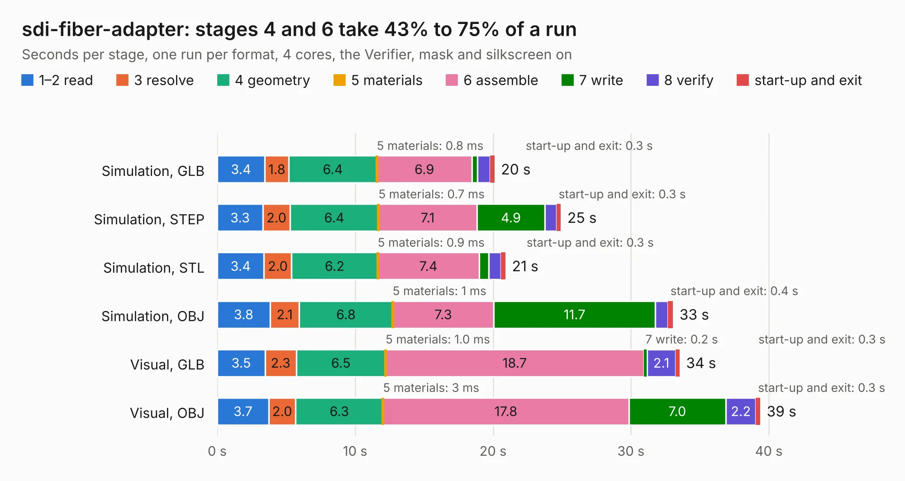

# 406. sdi-fiber-adapter

Board 406 of the 3,131 of [Corpus Testing](../Corpus-Testing.md), on [Corpus Page 4](../CorpusTestingPages/Corpus-Testing-04.md#406-sdi-fiber-adapter).

| Mode and format | 1–2 read | 3 resolve | 4 geometry | 5 materials | 6 assemble | 7 write | 8 verify | start-up and exit | Total |
|---|---:|---:|---:|---:|---:|---:|---:|---:|---:|
| Simulation, GLB | 3.4 | 1.8 | 6.4 | 0.8&nbsp;ms | 6.9 | 0.4 | 0.9 | 0.3 | 20.1 |
| Simulation, STEP | 3.3 | 2.0 | 6.4 | 0.7&nbsp;ms | 7.1 | 4.9 | 0.8 | 0.3 | 24.9 |
| Simulation, STL | 3.4 | 2.0 | 6.2 | 0.9&nbsp;ms | 7.4 | 0.7 | 0.9 | 0.3 | 20.9 |
| Simulation, OBJ | 3.8 | 2.1 | 6.8 | 1&nbsp;ms | 7.3 | 11.7 | 0.9 | 0.4 | 33.0 |
| Visual, GLB | 3.5 | 2.3 | 6.5 | 1.0&nbsp;ms | 18.7 | 0.2 | 2.1 | 0.3 | 33.5 |
| Visual, OBJ | 3.7 | 2.0 | 6.3 | 3&nbsp;ms | 17.8 | 7.0 | 2.2 | 0.3 | 39.4 |

<table align="center"><tr><td valign="top">

| Board | Repo: [antmicro/sdi-fiber-adapter](https://github.com/antmicro/sdi-fiber-adapter) Board: `sdi-fiber-adapter.kicad_pcb` |
|---|---|
| Complexity | 408&nbsp;/&nbsp;1000 (size&nbsp;263, features&nbsp;145) |
| KESE&nbsp;features | through vias, slotted holes, rounded, trapezoid or chamfered pads, arc tracks, filled zones, copper text, knockout text, stack-up, dielectric εr and tanδ, copper finish, mask and silkscreen colours |
| Tested | 9th November 2026 |
| Copper&nbsp;layers | 4 |
| File&nbsp;format | KiCad 9 (20241229) |
| Parts,&nbsp;tracks,&nbsp;vias | 183, 1,386, 268 |
| Triangles,&nbsp;simulation | 2,048,802 in 137 parts |
| Verifier | PASS in all six runs |

</td><td valign="top">

<table>
<tr><th>File type</th><th>File size</th><th>Peak memory used</th></tr>
<tr><th colspan="3" align="left">Simulation</th></tr>
<tr><td>GLB</td><td align="right">71&nbsp;MB</td><td align="right">889&nbsp;MB</td></tr>
<tr><td>STEP</td><td align="right">308&nbsp;MB</td><td align="right">988&nbsp;MB</td></tr>
<tr><td>STL</td><td align="right">102&nbsp;MB</td><td align="right">923&nbsp;MB</td></tr>
<tr><td>OBJ</td><td align="right">215&nbsp;MB</td><td align="right">1.4&nbsp;GB</td></tr>
<tr><th colspan="3" align="left">Visual</th></tr>
<tr><td>GLB</td><td align="right">47&nbsp;MB</td><td align="right">1.0&nbsp;GB</td></tr>
<tr><td>OBJ</td><td align="right">145&nbsp;MB</td><td align="right">1.1&nbsp;GB</td></tr>
</table>

</td></tr></table>

| Previous | Next |
|:---|---:|
| [405. scalenode-cm4-baseboard](b0405b_scalenode-cm4-baseboard_scalenode-cm4-baseboard.md) | [407. sdi-mipi-bridge](b0407b_sdi-mipi-bridge-hw_sdi-mipi-bridge.md) |
