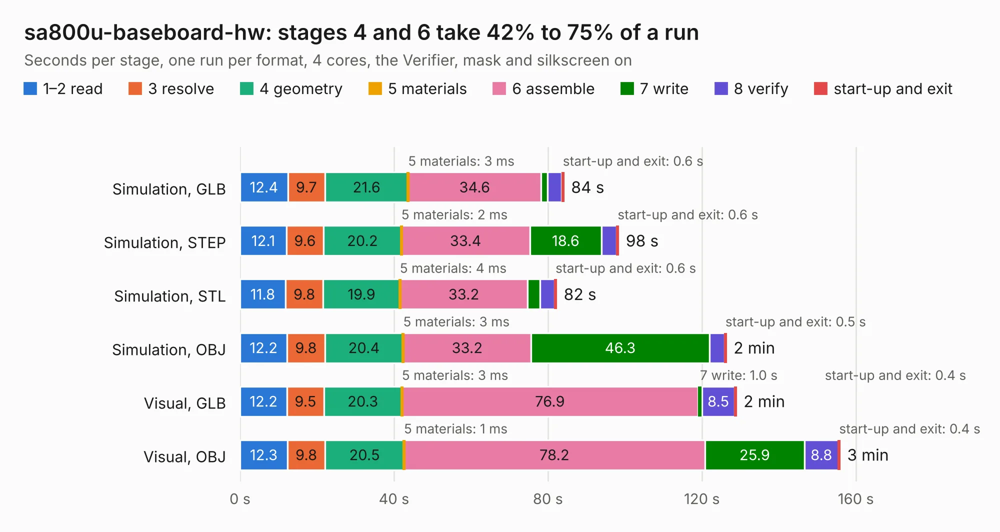

# 406. sa800u-baseboard-hw

Board 406 of the 3,109 of [Corpus Testing](../Corpus-Testing.md), on [Corpus Page 4](../CorpusTestingPages/Corpus-Testing-04.md#406-sa800u-baseboard-hw).

| Mode and format | 1–2 read | 3 resolve | 4 geometry | 5 materials | 6 assemble | 7 write | 8 verify | start-up and exit | Total |
|---|---:|---:|---:|---:|---:|---:|---:|---:|---:|
| Simulation, GLB | 12.4 | 9.7 | 21.6 | 3&nbsp;ms | 34.6 | 1.7 | 3.7 | 0.6 | 84.2 |
| Simulation, STEP | 12.1 | 9.6 | 20.2 | 2&nbsp;ms | 33.4 | 18.6 | 3.9 | 0.6 | 98.4 |
| Simulation, STL | 11.8 | 9.8 | 19.9 | 4&nbsp;ms | 33.2 | 3.3 | 3.7 | 0.6 | 82.3 |
| Simulation, OBJ | 12.2 | 9.8 | 20.4 | 3&nbsp;ms | 33.2 | 46.3 | 3.9 | 0.5 | 126.4 |
| Visual, GLB | 12.2 | 9.5 | 20.3 | 3&nbsp;ms | 76.9 | 1.0 | 8.5 | 0.4 | 129.0 |
| Visual, OBJ | 12.3 | 9.8 | 20.5 | 1&nbsp;ms | 78.2 | 25.9 | 8.8 | 0.4 | 155.9 |

<table align="center"><tr><td valign="top">

| Board | Repo: [antmicro/snapdragon-845-baseboard](https://github.com/antmicro/snapdragon-845-baseboard) Board: `sa800u-baseboard-hw.kicad_pcb` |
|---|---|
| Complexity | 459&nbsp;/&nbsp;1000 (size&nbsp;319, features&nbsp;140) |
| KESE&nbsp;features | through vias, slotted holes, custom pads, rounded, trapezoid or chamfered pads, drill offsets, filled zones, copper drawings, copper text, curved board outline, stack-up, dielectric εr and tanδ |
| Tested | 9th November 2026 |
| Copper&nbsp;layers | 6 |
| File&nbsp;format | KiCad 6 (20211014) |
| Parts,&nbsp;tracks,&nbsp;vias | 474, 13,038, 992 |
| Triangles,&nbsp;simulation | 8,203,048 in 683 parts |
| Verifier | PASS in all six runs |

</td><td valign="top">

<table>
<tr><th>File type</th><th>File size</th><th>Peak memory used</th></tr>
<tr><th colspan="3" align="left">Simulation</th></tr>
<tr><td>GLB</td><td align="right">275&nbsp;MB</td><td align="right">2.5&nbsp;GB</td></tr>
<tr><td>STEP</td><td align="right">1.1&nbsp;GB</td><td align="right">2.9&nbsp;GB</td></tr>
<tr><td>STL</td><td align="right">410&nbsp;MB</td><td align="right">2.4&nbsp;GB</td></tr>
<tr><td>OBJ</td><td align="right">881&nbsp;MB</td><td align="right">5.4&nbsp;GB</td></tr>
<tr><th colspan="3" align="left">Visual</th></tr>
<tr><td>GLB</td><td align="right">166&nbsp;MB</td><td align="right">2.9&nbsp;GB</td></tr>
<tr><td>OBJ</td><td align="right">538&nbsp;MB</td><td align="right">3.8&nbsp;GB</td></tr>
</table>

</td></tr></table>

| Previous | Next |
|:---|---:|
| [405. sc606-baseboard](b0405b_snapdragon-625-baseboard_sc606-baseboard.md) | [407. snickerdoodle-hdmi-breakout](b0407b_snickerdoodle-hdmi-breakout_snickerdoodle-hdmi-breakout.md) |
