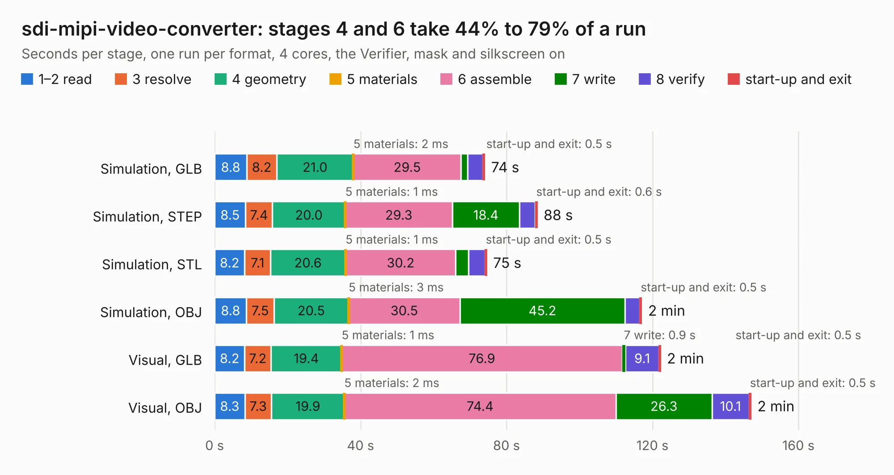

# 407. sdi-mipi-video-converter

Board 407 of the 3,120 of [Corpus Testing](../Corpus-Testing.md), on [Corpus Page 4](../CorpusTestingPages/Corpus-Testing-04.md#407-sdi-mipi-video-converter).

| Mode and format | 1–2 read | 3 resolve | 4 geometry | 5 materials | 6 assemble | 7 write | 8 verify | start-up and exit | Total |
|---|---:|---:|---:|---:|---:|---:|---:|---:|---:|
| Simulation, GLB | 8.8 | 8.2 | 21.0 | 2&nbsp;ms | 29.5 | 1.8 | 4.2 | 0.5 | 74.0 |
| Simulation, STEP | 8.5 | 7.4 | 20.0 | 1&nbsp;ms | 29.3 | 18.4 | 4.3 | 0.6 | 88.4 |
| Simulation, STL | 8.2 | 7.1 | 20.6 | 1&nbsp;ms | 30.2 | 3.5 | 4.5 | 0.5 | 74.6 |
| Simulation, OBJ | 8.8 | 7.5 | 20.5 | 3&nbsp;ms | 30.5 | 45.2 | 4.0 | 0.5 | 117.1 |
| Visual, GLB | 8.2 | 7.2 | 19.4 | 1&nbsp;ms | 76.9 | 0.9 | 9.1 | 0.5 | 122.2 |
| Visual, OBJ | 8.3 | 7.3 | 19.9 | 2&nbsp;ms | 74.4 | 26.3 | 10.1 | 0.5 | 147.0 |

<table align="center"><tr><td valign="top">

| Board | Repo: [antmicro/sdi-mipi-video-converter-hw](https://github.com/antmicro/sdi-mipi-video-converter-hw) Board: `sdi-mipi-video-converter.kicad_pcb` |
|---|---|
| Complexity | 469&nbsp;/&nbsp;1000 (size&nbsp;329, features&nbsp;140) |
| KESE&nbsp;features | through vias, slotted holes, custom pads, rounded, trapezoid or chamfered pads, arc tracks, filled zones, copper text, curved board outline, stack-up, dielectric εr and tanδ, mask and silkscreen colours |
| Tested | 9th November 2026 |
| Copper&nbsp;layers | 8 |
| File&nbsp;format | KiCad 9 (20241229) |
| Parts,&nbsp;tracks,&nbsp;vias | 327, 8,337, 1,093 |
| Triangles,&nbsp;simulation | 8,040,594 in 419 parts |
| Verifier | PASS in all six runs |

</td><td valign="top">

<table>
<tr><th>File type</th><th>File size</th><th>Peak memory used</th></tr>
<tr><th colspan="3" align="left">Simulation</th></tr>
<tr><td>GLB</td><td align="right">259&nbsp;MB</td><td align="right">2.1&nbsp;GB</td></tr>
<tr><td>STEP</td><td align="right">908&nbsp;MB</td><td align="right">3.0&nbsp;GB</td></tr>
<tr><td>STL</td><td align="right">402&nbsp;MB</td><td align="right">2.1&nbsp;GB</td></tr>
<tr><td>OBJ</td><td align="right">840&nbsp;MB</td><td align="right">5.1&nbsp;GB</td></tr>
<tr><th colspan="3" align="left">Visual</th></tr>
<tr><td>GLB</td><td align="right">157&nbsp;MB</td><td align="right">2.8&nbsp;GB</td></tr>
<tr><td>OBJ</td><td align="right">515&nbsp;MB</td><td align="right">3.6&nbsp;GB</td></tr>
</table>

</td></tr></table>

| Previous | Next |
|:---|---:|
| [406. sdi-mipi-bridge](b0406b_sdi-mipi-bridge-hw_sdi-mipi-bridge.md) | [408. si-simulation-test-board](b0408b_signal-integrity-test-board_si-simulation-test-board.md) |
