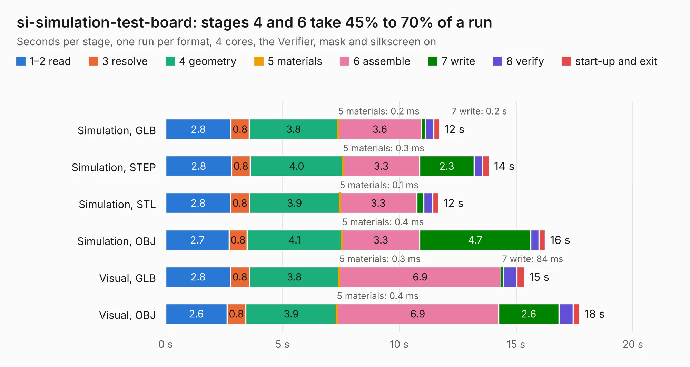

# 408. si-simulation-test-board

Board 408 of the 3,123 of [Corpus Testing](../Corpus-Testing.md), on [Corpus Page 4](../CorpusTestingPages/Corpus-Testing-04.md#408-si-simulation-test-board).

| Mode and format | 1–2 read | 3 resolve | 4 geometry | 5 materials | 6 assemble | 7 write | 8 verify | start-up and exit | Total |
|---|---:|---:|---:|---:|---:|---:|---:|---:|---:|
| Simulation, GLB | 2.8 | 0.8 | 3.8 | 0.2&nbsp;ms | 3.6 | 0.2 | 0.4 | 0.2 | 11.7 |
| Simulation, STEP | 2.8 | 0.8 | 4.0 | 0.3&nbsp;ms | 3.3 | 2.3 | 0.4 | 0.3 | 13.8 |
| Simulation, STL | 2.8 | 0.8 | 3.9 | 0.1&nbsp;ms | 3.3 | 0.3 | 0.4 | 0.3 | 11.7 |
| Simulation, OBJ | 2.7 | 0.8 | 4.1 | 0.4&nbsp;ms | 3.3 | 4.7 | 0.4 | 0.3 | 16.2 |
| Visual, GLB | 2.8 | 0.8 | 3.8 | 0.3&nbsp;ms | 6.9 | 84&nbsp;ms | 0.6 | 0.3 | 15.4 |
| Visual, OBJ | 2.6 | 0.8 | 3.9 | 0.4&nbsp;ms | 6.9 | 2.6 | 0.6 | 0.3 | 17.7 |

<table align="center"><tr><td valign="top">

| Board | Repo: [antmicro/signal-integrity-test-board](https://github.com/antmicro/signal-integrity-test-board) Board: `si-simulation-test-board.kicad_pcb` |
|---|---|
| Complexity | 277&nbsp;/&nbsp;1000 (size&nbsp;182, features&nbsp;95) |
| KESE&nbsp;features | through vias, rounded, trapezoid or chamfered pads, arc tracks, filled zones, stack-up, dielectric εr and tanδ, mask and silkscreen colours |
| Tested | 9th November 2026 |
| Copper&nbsp;layers | 4 |
| File&nbsp;format | KiCad 6 (20211014) |
| Parts,&nbsp;tracks,&nbsp;vias | 27, 189, 252 |
| Triangles,&nbsp;simulation | 1,024,056 in 26 parts |
| Verifier | PASS in all six runs |

</td><td valign="top">

<table>
<tr><th>File type</th><th>File size</th><th>Peak memory used</th></tr>
<tr><th colspan="3" align="left">Simulation</th></tr>
<tr><td>GLB</td><td align="right">33&nbsp;MB</td><td align="right">533&nbsp;MB</td></tr>
<tr><td>STEP</td><td align="right">110&nbsp;MB</td><td align="right">584&nbsp;MB</td></tr>
<tr><td>STL</td><td align="right">51&nbsp;MB</td><td align="right">561&nbsp;MB</td></tr>
<tr><td>OBJ</td><td align="right">102&nbsp;MB</td><td align="right">749&nbsp;MB</td></tr>
<tr><th colspan="3" align="left">Visual</th></tr>
<tr><td>GLB</td><td align="right">17&nbsp;MB</td><td align="right">545&nbsp;MB</td></tr>
<tr><td>OBJ</td><td align="right">52&nbsp;MB</td><td align="right">545&nbsp;MB</td></tr>
</table>

</td></tr></table>

| Previous | Next |
|:---|---:|
| [407. sdi-mipi-video-converter](b0407b_sdi-mipi-video-converter-hw_sdi-mipi-video-converter.md) | [409. sc606-baseboard](b0409b_snapdragon-625-baseboard_sc606-baseboard.md) |
