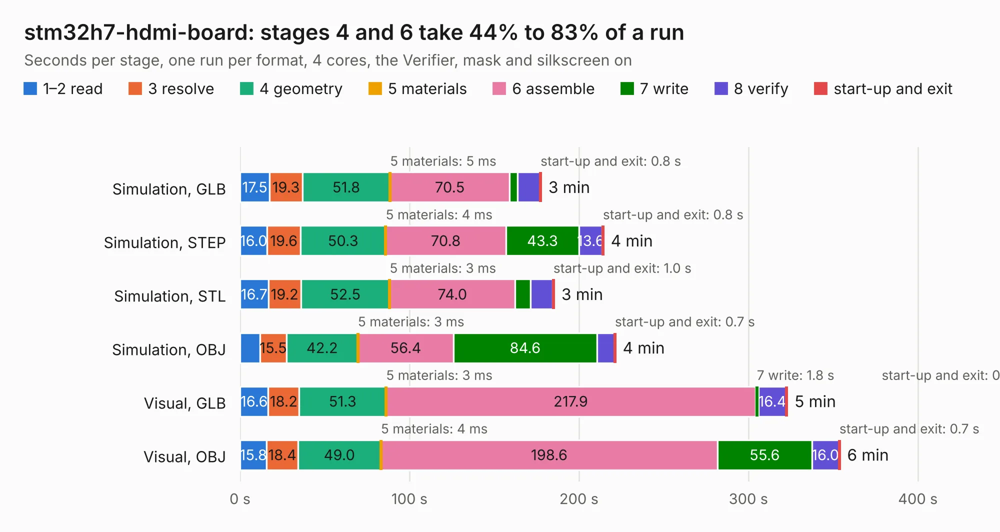

# 408. stm32h7-hdmi-board

Board 408 of the 3,107 of [Corpus Testing](../Corpus-Testing.md), on [Corpus Page 4](../CorpusTestingPages/Corpus-Testing-04.md#408-stm32h7-hdmi-board).

| Mode and format | 1–2 read | 3 resolve | 4 geometry | 5 materials | 6 assemble | 7 write | 8 verify | start-up and exit | Total |
|---|---:|---:|---:|---:|---:|---:|---:|---:|---:|
| Simulation, GLB | 17.5 | 19.3 | 51.8 | 5&nbsp;ms | 70.5 | 4.8 | 13.1 | 0.8 | 177.7 |
| Simulation, STEP | 16.0 | 19.6 | 50.3 | 4&nbsp;ms | 70.8 | 43.3 | 13.6 | 0.8 | 214.6 |
| Simulation, STL | 16.7 | 19.2 | 52.5 | 3&nbsp;ms | 74.0 | 9.2 | 12.9 | 1.0 | 185.4 |
| Simulation, OBJ | 11.8 | 15.5 | 42.2 | 3&nbsp;ms | 56.4 | 84.6 | 10.3 | 0.7 | 221.6 |
| Visual, GLB | 16.6 | 18.2 | 51.3 | 3&nbsp;ms | 217.9 | 1.8 | 16.4 | 0.7 | 323.0 |
| Visual, OBJ | 15.8 | 18.4 | 49.0 | 4&nbsp;ms | 198.6 | 55.6 | 16.0 | 0.7 | 354.1 |

<table align="center"><tr><td valign="top">

| Board | Repo: [antmicro/stm32h7-hdmi-board](https://github.com/antmicro/stm32h7-hdmi-board) Board: `stm32h7-hdmi-board.kicad_pcb` |
|---|---|
| Complexity | 521&nbsp;/&nbsp;1000 (size&nbsp;351, features&nbsp;170) |
| KESE&nbsp;features | through vias, slotted holes, custom pads, rounded, trapezoid or chamfered pads, arc tracks, filled zones, copper drawings, copper text, knockout text, TrueType text, stack-up, dielectric εr and tanδ, mask and silkscreen colours |
| Tested | 9th November 2026 to 10th November 2026 |
| Copper&nbsp;layers | 8 |
| File&nbsp;format | KiCad 9 (20241229) |
| Parts,&nbsp;tracks,&nbsp;vias | 749, 15,474, 1,703 |
| Triangles,&nbsp;simulation | 17,829,614 in 925 parts |
| Verifier | PASS in all six runs |
| Run&nbsp;again | Simulation, OBJ: failed in the corpus run, run again with the memory cap raised from 11 GB to 14.5 GB, and passed |

</td><td valign="top">

<table>
<tr><th>File type</th><th>File size</th><th>Peak memory used</th></tr>
<tr><th colspan="3" align="left">Simulation</th></tr>
<tr><td>GLB</td><td align="right">595&nbsp;MB</td><td align="right">4.0&nbsp;GB</td></tr>
<tr><td>STEP</td><td align="right">2.0&nbsp;GB</td><td align="right">5.2&nbsp;GB</td></tr>
<tr><td>STL</td><td align="right">892&nbsp;MB</td><td align="right">4.1&nbsp;GB</td></tr>
<tr><td>OBJ</td><td align="right">1.9&nbsp;GB</td><td align="right">11&nbsp;GB</td></tr>
<tr><th colspan="3" align="left">Visual</th></tr>
<tr><td>GLB</td><td align="right">290&nbsp;MB</td><td align="right">5.1&nbsp;GB</td></tr>
<tr><td>OBJ</td><td align="right">944&nbsp;MB</td><td align="right">6.1&nbsp;GB</td></tr>
</table>

</td></tr></table>

| Previous | Next |
|:---|---:|
| [407. snickerdoodle-hdmi-breakout](b0407b_snickerdoodle-hdmi-breakout_snickerdoodle-hdmi-breakout.md) | [409. stm32h7-hdmi-board-sodimm-module](b0409b_stm32h7-hdmi-board-sodimm_stm32h7-hdmi-board-sodimm-module.md) |
