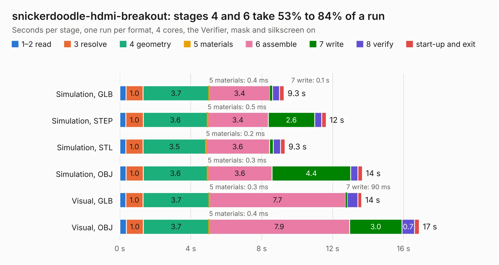

# 411. snickerdoodle-hdmi-breakout

Board 411 of the 3,119 of [Corpus Testing](../Corpus-Testing.md), on [Corpus Page 4](../CorpusTestingPages/Corpus-Testing-04.md#411-snickerdoodle-hdmi-breakout).

| Mode and format | 1–2 read | 3 resolve | 4 geometry | 5 materials | 6 assemble | 7 write | 8 verify | start-up and exit | Total |
|---|---:|---:|---:|---:|---:|---:|---:|---:|---:|
| Simulation, GLB | 0.3 | 1.0 | 3.7 | 0.4&nbsp;ms | 3.4 | 0.1 | 0.4 | 0.2 | 9.3 |
| Simulation, STEP | 0.3 | 1.0 | 3.6 | 0.5&nbsp;ms | 3.4 | 2.6 | 0.4 | 0.2 | 11.6 |
| Simulation, STL | 0.3 | 1.0 | 3.5 | 0.2&nbsp;ms | 3.6 | 0.2 | 0.4 | 0.2 | 9.3 |
| Simulation, OBJ | 0.3 | 1.0 | 3.6 | 0.3&nbsp;ms | 3.6 | 4.4 | 0.4 | 0.2 | 13.7 |
| Visual, GLB | 0.3 | 1.0 | 3.7 | 0.3&nbsp;ms | 7.7 | 90&nbsp;ms | 0.6 | 0.2 | 13.6 |
| Visual, OBJ | 0.4 | 1.0 | 3.7 | 0.4&nbsp;ms | 7.9 | 3.0 | 0.7 | 0.3 | 16.9 |

<table align="center"><tr><td valign="top">

| Board | Repo: [antmicro/snickerdoodle-hdmi-breakout](https://github.com/antmicro/snickerdoodle-hdmi-breakout) Board: `snickerdoodle-hdmi-breakout.kicad_pcb` |
|---|---|
| Complexity | 289&nbsp;/&nbsp;1000 (size&nbsp;199, features&nbsp;90) |
| KESE&nbsp;features | through vias, slotted holes, custom pads, rounded, trapezoid or chamfered pads, filled zones, copper drawings, copper text |
| Tested | 9th November 2026 |
| Copper&nbsp;layers | 4 |
| File&nbsp;format | KiCad 5 (20171130) |
| Parts,&nbsp;tracks,&nbsp;vias | 37, 1,980, 66 |
| Triangles,&nbsp;simulation | 737,764 in 70 parts |
| Verifier | PASS in all six runs |

</td><td valign="top">

<table>
<tr><th>File type</th><th>File size</th><th>Peak memory used</th></tr>
<tr><th colspan="3" align="left">Simulation</th></tr>
<tr><td>GLB</td><td align="right">26&nbsp;MB</td><td align="right">412&nbsp;MB</td></tr>
<tr><td>STEP</td><td align="right">149&nbsp;MB</td><td align="right">478&nbsp;MB</td></tr>
<tr><td>STL</td><td align="right">37&nbsp;MB</td><td align="right">422&nbsp;MB</td></tr>
<tr><td>OBJ</td><td align="right">77&nbsp;MB</td><td align="right">573&nbsp;MB</td></tr>
<tr><th colspan="3" align="left">Visual</th></tr>
<tr><td>GLB</td><td align="right">17&nbsp;MB</td><td align="right">506&nbsp;MB</td></tr>
<tr><td>OBJ</td><td align="right">52&nbsp;MB</td><td align="right">512&nbsp;MB</td></tr>
</table>

</td></tr></table>

| Previous | Next |
|:---|---:|
| [410. sa800u-baseboard-hw](b0410b_snapdragon-845-baseboard_sa800u-baseboard-hw.md) | [412. stm32h7-hdmi-board](b0412b_stm32h7-hdmi-board_stm32h7-hdmi-board.md) |
