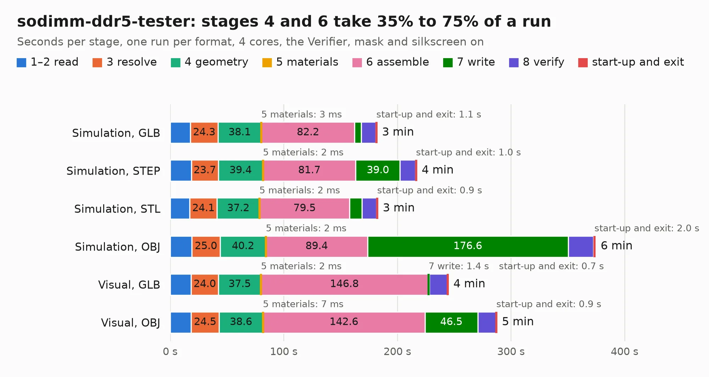

# 412. sodimm-ddr5-tester

Board 412 of the 3,127 of [Corpus Testing](../Corpus-Testing.md), on [Corpus Page 4](../CorpusTestingPages/Corpus-Testing-04.md#412-sodimm-ddr5-tester).

| Mode and format | 1–2 read | 3 resolve | 4 geometry | 5 materials | 6 assemble | 7 write | 8 verify | start-up and exit | Total |
|---|---:|---:|---:|---:|---:|---:|---:|---:|---:|
| Simulation, GLB | 17.8 | 24.3 | 38.1 | 3&nbsp;ms | 82.2 | 5.9 | 12.7 | 1.1 | 182.0 |
| Simulation, STEP | 18.6 | 23.7 | 39.4 | 2&nbsp;ms | 81.7 | 39.0 | 13.5 | 1.0 | 216.9 |
| Simulation, STL | 17.2 | 24.1 | 37.2 | 2&nbsp;ms | 79.5 | 10.8 | 13.0 | 0.9 | 182.7 |
| Simulation, OBJ | 19.0 | 25.0 | 40.2 | 2&nbsp;ms | 89.4 | 176.6 | 22.2 | 2.0 | 374.5 |
| Visual, GLB | 18.4 | 24.0 | 37.5 | 2&nbsp;ms | 146.8 | 1.4 | 15.9 | 0.7 | 244.8 |
| Visual, OBJ | 18.5 | 24.5 | 38.6 | 7&nbsp;ms | 142.6 | 46.5 | 16.0 | 0.9 | 287.6 |

<table align="center"><tr><td valign="top">

| Board | Repo: [antmicro/sodimm-ddr5-tester](https://github.com/antmicro/sodimm-ddr5-tester) Board: `sodimm-ddr5-tester.kicad_pcb` |
|---|---|
| Complexity | 538&nbsp;/&nbsp;1000 (size&nbsp;358, features&nbsp;180) |
| KESE&nbsp;features | through vias, slotted holes, custom pads, rounded, trapezoid or chamfered pads, arc tracks, filled zones, copper drawings, copper text, curved board outline, TrueType text, stack-up, dielectric εr and tanδ, copper finish, mask and silkscreen colours |
| Tested | 9th November 2026 to 11th November 2026 |
| Copper&nbsp;layers | 12 |
| File&nbsp;format | KiCad 9 (20241229) |
| Parts,&nbsp;tracks,&nbsp;vias | 546, 16,830, 2,115 |
| Triangles,&nbsp;simulation | 23,485,012 in 784 parts |
| Verifier | PASS in all six runs |
| Run&nbsp;again | Simulation, OBJ: failed in the corpus run, run again with no memory cap and no time limit (swap added to a 16 GB machine), and passed |

</td><td valign="top">

<table>
<tr><th>File type</th><th>File size</th><th>Peak memory used</th></tr>
<tr><th colspan="3" align="left">Simulation</th></tr>
<tr><td>GLB</td><td align="right">768&nbsp;MB</td><td align="right">5.0&nbsp;GB</td></tr>
<tr><td>STEP</td><td align="right">2.0&nbsp;GB</td><td align="right">6.8&nbsp;GB</td></tr>
<tr><td>STL</td><td align="right">1.2&nbsp;GB</td><td align="right">5.1&nbsp;GB</td></tr>
<tr><td>OBJ</td><td align="right">2.6&nbsp;GB</td><td align="right">15&nbsp;GB</td></tr>
<tr><th colspan="3" align="left">Visual</th></tr>
<tr><td>GLB</td><td align="right">269&nbsp;MB</td><td align="right">5.4&nbsp;GB</td></tr>
<tr><td>OBJ</td><td align="right">940&nbsp;MB</td><td align="right">6.7&nbsp;GB</td></tr>
</table>

</td></tr></table>

| Previous | Next |
|:---|---:|
| [411. snickerdoodle-hdmi-breakout](b0411b_snickerdoodle-hdmi-breakout_snickerdoodle-hdmi-breakout.md) | [413. stm32h7-hdmi-board](b0413b_stm32h7-hdmi-board_stm32h7-hdmi-board.md) |
