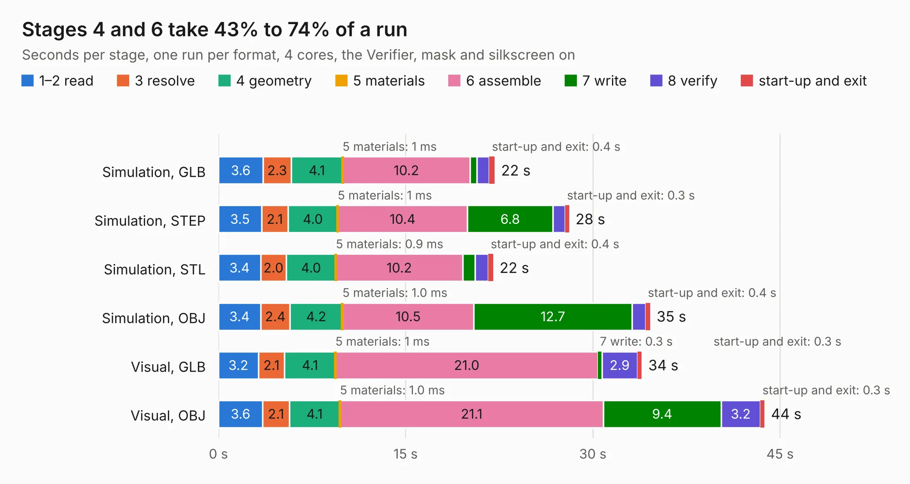

# 415. stm32h7-hdmi-board-sodimm-module

Board 415 of the 3,139 of [Corpus Testing](../Corpus-Testing.md), on [Corpus Page 4](../CorpusTestingPages/Corpus-Testing-04.md#415-stm32h7-hdmi-board-sodimm-module).

| Mode and format | 1–2 read | 3 resolve | 4 geometry | 5 materials | 6 assemble | 7 write | 8 verify | start-up and exit | Total |
|---|---:|---:|---:|---:|---:|---:|---:|---:|---:|
| Simulation, GLB | 3.6 | 2.3 | 4.1 | 1&nbsp;ms | 10.2 | 0.5 | 1.0 | 0.4 | 22.1 |
| Simulation, STEP | 3.5 | 2.1 | 4.0 | 1&nbsp;ms | 10.4 | 6.8 | 1.0 | 0.3 | 28.1 |
| Simulation, STL | 3.4 | 2.0 | 4.0 | 0.9&nbsp;ms | 10.2 | 1.0 | 1.1 | 0.4 | 22.0 |
| Simulation, OBJ | 3.4 | 2.4 | 4.2 | 1.0&nbsp;ms | 10.5 | 12.7 | 1.1 | 0.4 | 34.6 |
| Visual, GLB | 3.2 | 2.1 | 4.1 | 1&nbsp;ms | 21.0 | 0.3 | 2.9 | 0.3 | 33.9 |
| Visual, OBJ | 3.6 | 2.1 | 4.1 | 1.0&nbsp;ms | 21.1 | 9.4 | 3.2 | 0.3 | 43.7 |

<table align="center"><tr><td valign="top">

| Board | Repo: [antmicro/stm32h7-hdmi-board-sodimm](https://github.com/antmicro/stm32h7-hdmi-board-sodimm) Board: `stm32h7-hdmi-board-sodimm-module.kicad_pcb` |
|---|---|
| Complexity | 389&nbsp;/&nbsp;1000 (size&nbsp;274, features&nbsp;115) |
| KESE&nbsp;features | through vias, rounded, trapezoid or chamfered pads, arc tracks, filled zones, curved board outline, knockout text, stack-up, dielectric εr and tanδ |
| Tested | 9th November 2026 |
| Copper&nbsp;layers | 6 |
| File&nbsp;format | KiCad 10 (20260206) |
| Parts,&nbsp;tracks,&nbsp;vias | 86, 5,173, 247 |
| Triangles,&nbsp;simulation | 2,444,492 in 235 parts |
| Verifier | PASS in all six runs |

</td><td valign="top">

<table>
<tr><th>File type</th><th>File size</th><th>Peak memory used</th></tr>
<tr><th colspan="3" align="left">Simulation</th></tr>
<tr><td>GLB</td><td align="right">83&nbsp;MB</td><td align="right">894&nbsp;MB</td></tr>
<tr><td>STEP</td><td align="right">354&nbsp;MB</td><td align="right">1.1&nbsp;GB</td></tr>
<tr><td>STL</td><td align="right">122&nbsp;MB</td><td align="right">870&nbsp;MB</td></tr>
<tr><td>OBJ</td><td align="right">258&nbsp;MB</td><td align="right">1.7&nbsp;GB</td></tr>
<tr><th colspan="3" align="left">Visual</th></tr>
<tr><td>GLB</td><td align="right">59&nbsp;MB</td><td align="right">1.2&nbsp;GB</td></tr>
<tr><td>OBJ</td><td align="right">183&nbsp;MB</td><td align="right">1.4&nbsp;GB</td></tr>
</table>

</td></tr></table>

| Previous | Next |
|:---|---:|
| [414. stm32h7-hdmi-board](b0414b_stm32h7-hdmi-board_stm32h7-hdmi-board.md) | [416. thunderbolt-to-10gbe-adapter](b0416b_thunderbolt-10gbe-adapter_thunderbolt-to-10gbe-adapter.md) |
