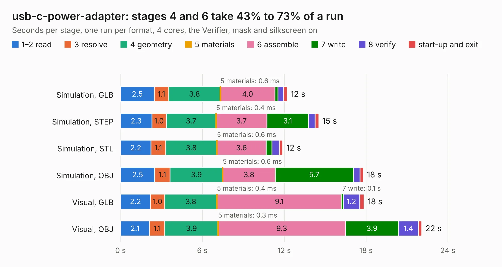

# 415. usb-c-power-adapter

Board 415 of the 3,116 of [Corpus Testing](../Corpus-Testing.md), on [Corpus Page 4](../CorpusTestingPages/Corpus-Testing-04.md#415-usb-c-power-adapter).

| Mode and format | 1–2 read | 3 resolve | 4 geometry | 5 materials | 6 assemble | 7 write | 8 verify | start-up and exit | Total |
|---|---:|---:|---:|---:|---:|---:|---:|---:|---:|
| Simulation, GLB | 2.5 | 1.1 | 3.8 | 0.6&nbsp;ms | 4.0 | 0.2 | 0.4 | 0.2 | 12.2 |
| Simulation, STEP | 2.3 | 1.0 | 3.7 | 0.4&nbsp;ms | 3.7 | 3.1 | 0.5 | 0.3 | 14.5 |
| Simulation, STL | 2.2 | 1.1 | 3.8 | 0.6&nbsp;ms | 3.6 | 0.4 | 0.5 | 0.3 | 11.9 |
| Simulation, OBJ | 2.5 | 1.1 | 3.9 | 0.6&nbsp;ms | 3.8 | 5.7 | 0.5 | 0.2 | 17.8 |
| Visual, GLB | 2.2 | 1.0 | 3.8 | 0.4&nbsp;ms | 9.1 | 0.1 | 1.2 | 0.3 | 17.9 |
| Visual, OBJ | 2.1 | 1.1 | 3.9 | 0.3&nbsp;ms | 9.3 | 3.9 | 1.4 | 0.3 | 22.1 |

<table align="center"><tr><td valign="top">

| Board | Repo: [antmicro/usb-c-power-adapter](https://github.com/antmicro/usb-c-power-adapter) Board: `usb-c-power-adapter.kicad_pcb` |
|---|---|
| Complexity | 332&nbsp;/&nbsp;1000 (size&nbsp;202, features&nbsp;130) |
| KESE&nbsp;features | through vias, slotted holes, custom pads, rounded, trapezoid or chamfered pads, filled zones, copper drawings, knockout text, stack-up, dielectric εr and tanδ, mask and silkscreen colours |
| Tested | 9th November 2026 |
| Copper&nbsp;layers | 4 |
| File&nbsp;format | KiCad 9 (20241229) |
| Parts,&nbsp;tracks,&nbsp;vias | 108, 600, 229 |
| Triangles,&nbsp;simulation | 1,245,326 in 84 parts |
| Verifier | PASS in all six runs |

</td><td valign="top">

<table>
<tr><th>File type</th><th>File size</th><th>Peak memory used</th></tr>
<tr><th colspan="3" align="left">Simulation</th></tr>
<tr><td>GLB</td><td align="right">43&nbsp;MB</td><td align="right">567&nbsp;MB</td></tr>
<tr><td>STEP</td><td align="right">174&nbsp;MB</td><td align="right">626&nbsp;MB</td></tr>
<tr><td>STL</td><td align="right">62&nbsp;MB</td><td align="right">549&nbsp;MB</td></tr>
<tr><td>OBJ</td><td align="right">128&nbsp;MB</td><td align="right">929&nbsp;MB</td></tr>
<tr><th colspan="3" align="left">Visual</th></tr>
<tr><td>GLB</td><td align="right">28&nbsp;MB</td><td align="right">736&nbsp;MB</td></tr>
<tr><td>OBJ</td><td align="right">85&nbsp;MB</td><td align="right">711&nbsp;MB</td></tr>
</table>

</td></tr></table>

| Previous | Next |
|:---|---:|
| [414. thunderbolt-pcie-adapter](b0414b_thunderbolt-pcie-adapter_thunderbolt-pcie-adapter.md) | [416. video-latency-testing-probe](b0416b_video-latency-testing-probe_video-latency-testing-probe.md) |
