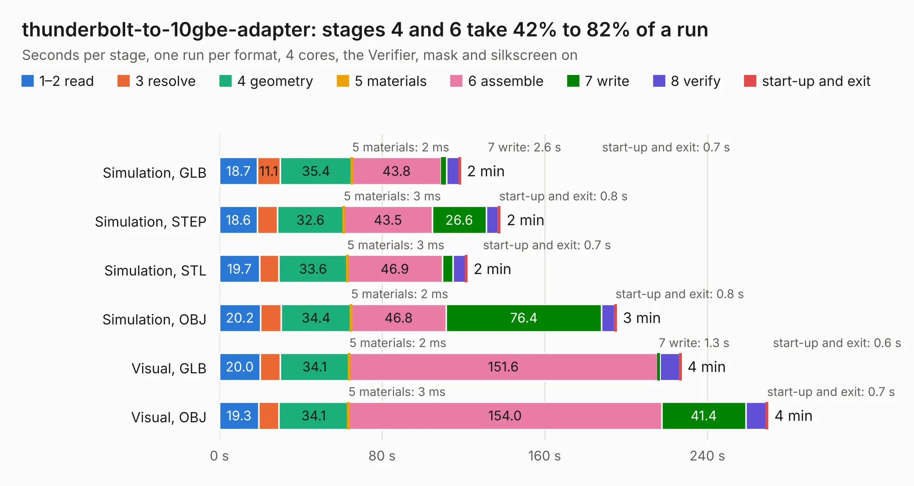

# 416. thunderbolt-to-10gbe-adapter

Board 416 of the 3,138 of [Corpus Testing](../Corpus-Testing.md), on [Corpus Page 4](../CorpusTestingPages/Corpus-Testing-04.md#416-thunderbolt-to-10gbe-adapter).

| Mode and format | 1–2 read | 3 resolve | 4 geometry | 5 materials | 6 assemble | 7 write | 8 verify | start-up and exit | Total |
|---|---:|---:|---:|---:|---:|---:|---:|---:|---:|
| Simulation, GLB | 18.7 | 11.1 | 35.4 | 2&nbsp;ms | 43.8 | 2.6 | 6.3 | 0.7 | 118.6 |
| Simulation, STEP | 18.6 | 9.8 | 32.6 | 3&nbsp;ms | 43.5 | 26.6 | 6.0 | 0.8 | 138.0 |
| Simulation, STL | 19.7 | 9.6 | 33.6 | 3&nbsp;ms | 46.9 | 5.1 | 6.3 | 0.7 | 121.8 |
| Simulation, OBJ | 20.2 | 10.2 | 34.4 | 2&nbsp;ms | 46.8 | 76.4 | 6.5 | 0.8 | 195.2 |
| Visual, GLB | 20.0 | 9.8 | 34.1 | 2&nbsp;ms | 151.6 | 1.3 | 9.7 | 0.6 | 227.0 |
| Visual, OBJ | 19.3 | 10.1 | 34.1 | 3&nbsp;ms | 154.0 | 41.4 | 10.1 | 0.7 | 269.7 |

<table align="center"><tr><td valign="top">

| Board | Repo: [antmicro/thunderbolt-10gbe-adapter](https://github.com/antmicro/thunderbolt-10gbe-adapter) Board: `thunderbolt-to-10gbe-adapter.kicad_pcb` |
|---|---|
| Complexity | 463&nbsp;/&nbsp;1000 (size&nbsp;323, features&nbsp;140) |
| KESE&nbsp;features | through vias, slotted holes, custom pads, rounded, trapezoid or chamfered pads, arc tracks, filled zones, copper drawings, copper text, stack-up, dielectric εr and tanδ, mask and silkscreen colours |
| Tested | 9th November 2026 |
| Copper&nbsp;layers | 8 |
| File&nbsp;format | KiCad 9 (20241229) |
| Parts,&nbsp;tracks,&nbsp;vias | 652, 5,595, 1,411 |
| Triangles,&nbsp;simulation | 11,099,384 in 620 parts |
| Verifier | PASS in all six runs |

</td><td valign="top">

<table>
<tr><th>File type</th><th>File size</th><th>Peak memory used</th></tr>
<tr><th colspan="3" align="left">Simulation</th></tr>
<tr><td>GLB</td><td align="right">358&nbsp;MB</td><td align="right">3.3&nbsp;GB</td></tr>
<tr><td>STEP</td><td align="right">1.3&nbsp;GB</td><td align="right">4.1&nbsp;GB</td></tr>
<tr><td>STL</td><td align="right">555&nbsp;MB</td><td align="right">3.3&nbsp;GB</td></tr>
<tr><td>OBJ</td><td align="right">1.2&nbsp;GB</td><td align="right">7.1&nbsp;GB</td></tr>
<tr><th colspan="3" align="left">Visual</th></tr>
<tr><td>GLB</td><td align="right">216&nbsp;MB</td><td align="right">3.9&nbsp;GB</td></tr>
<tr><td>OBJ</td><td align="right">708&nbsp;MB</td><td align="right">5.0&nbsp;GB</td></tr>
</table>

</td></tr></table>

| Previous | Next |
|:---|---:|
| [415. stm32h7-hdmi-board-sodimm-module](b0415b_stm32h7-hdmi-board-sodimm_stm32h7-hdmi-board-sodimm-module.md) | [417. thunderbolt-gpu-adapter](b0417b_thunderbolt-gpu-adapter_thunderbolt-gpu-adapter.md) |
