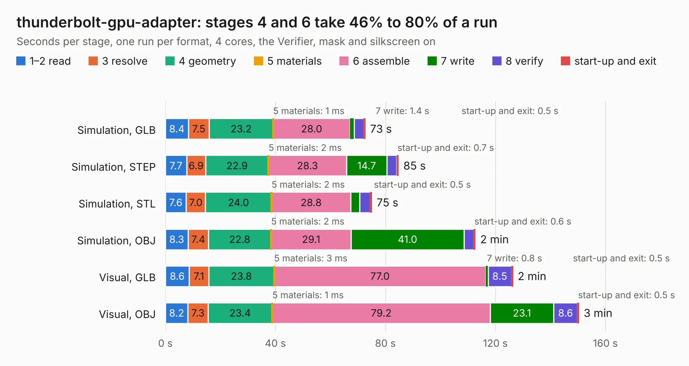

# 416. thunderbolt-gpu-adapter

Board 416 of the 3,130 of [Corpus Testing](../Corpus-Testing.md), on [Corpus Page 4](../CorpusTestingPages/Corpus-Testing-04.md#416-thunderbolt-gpu-adapter).

| Mode and format | 1–2 read | 3 resolve | 4 geometry | 5 materials | 6 assemble | 7 write | 8 verify | start-up and exit | Total |
|---|---:|---:|---:|---:|---:|---:|---:|---:|---:|
| Simulation, GLB | 8.4 | 7.5 | 23.2 | 1&nbsp;ms | 28.0 | 1.4 | 3.5 | 0.5 | 72.6 |
| Simulation, STEP | 7.7 | 6.9 | 22.9 | 2&nbsp;ms | 28.3 | 14.7 | 3.5 | 0.7 | 84.7 |
| Simulation, STL | 7.6 | 7.0 | 24.0 | 2&nbsp;ms | 28.8 | 3.2 | 3.9 | 0.5 | 75.0 |
| Simulation, OBJ | 8.3 | 7.4 | 22.8 | 2&nbsp;ms | 29.1 | 41.0 | 3.5 | 0.6 | 112.7 |
| Visual, GLB | 8.6 | 7.1 | 23.8 | 3&nbsp;ms | 77.0 | 0.8 | 8.5 | 0.5 | 126.3 |
| Visual, OBJ | 8.2 | 7.3 | 23.4 | 1&nbsp;ms | 79.2 | 23.1 | 8.6 | 0.5 | 150.3 |

<table align="center"><tr><td valign="top">

| Board | Repo: [antmicro/thunderbolt-gpu-adapter](https://github.com/antmicro/thunderbolt-gpu-adapter) Board: `thunderbolt-gpu-adapter.kicad_pcb` |
|---|---|
| Complexity | 433&nbsp;/&nbsp;1000 (size&nbsp;293, features&nbsp;140) |
| KESE&nbsp;features | through vias, slotted holes, custom pads, rounded, trapezoid or chamfered pads, arc tracks, filled zones, copper drawings, copper text, stack-up, dielectric εr and tanδ, mask and silkscreen colours |
| Tested | 9th November 2026 |
| Copper&nbsp;layers | 6 |
| File&nbsp;format | KiCad 8 (20240108) |
| Parts,&nbsp;tracks,&nbsp;vias | 344, 4,545, 1,092 |
| Triangles,&nbsp;simulation | 7,315,338 in 378 parts |
| Verifier | PASS in all six runs |

</td><td valign="top">

<table>
<tr><th>File type</th><th>File size</th><th>Peak memory used</th></tr>
<tr><th colspan="3" align="left">Simulation</th></tr>
<tr><td>GLB</td><td align="right">245&nbsp;MB</td><td align="right">1.9&nbsp;GB</td></tr>
<tr><td>STEP</td><td align="right">811&nbsp;MB</td><td align="right">2.6&nbsp;GB</td></tr>
<tr><td>STL</td><td align="right">366&nbsp;MB</td><td align="right">1.9&nbsp;GB</td></tr>
<tr><td>OBJ</td><td align="right">779&nbsp;MB</td><td align="right">4.7&nbsp;GB</td></tr>
<tr><th colspan="3" align="left">Visual</th></tr>
<tr><td>GLB</td><td align="right">139&nbsp;MB</td><td align="right">2.5&nbsp;GB</td></tr>
<tr><td>OBJ</td><td align="right">448&nbsp;MB</td><td align="right">3.0&nbsp;GB</td></tr>
</table>

</td></tr></table>

| Previous | Next |
|:---|---:|
| [415. thunderbolt-to-10gbe-adapter](b0415b_thunderbolt-10gbe-adapter_thunderbolt-to-10gbe-adapter.md) | [417. thunderbolt-pcie-adapter](b0417b_thunderbolt-pcie-adapter_thunderbolt-pcie-adapter.md) |
