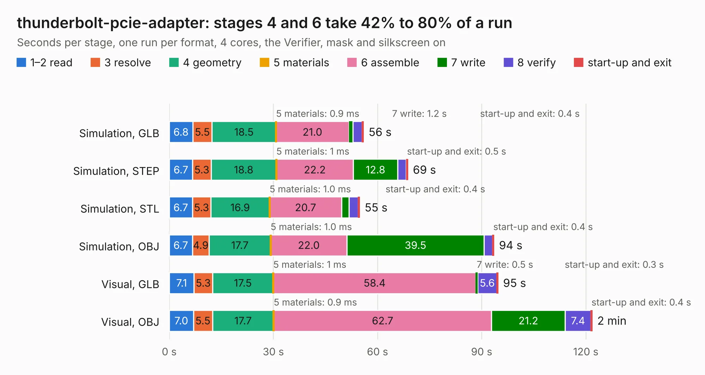

# 416. thunderbolt-pcie-adapter

Board 416 of the 3,122 of [Corpus Testing](../Corpus-Testing.md), on [Corpus Page 4](../CorpusTestingPages/Corpus-Testing-04.md#416-thunderbolt-pcie-adapter).

| Mode and format | 1–2 read | 3 resolve | 4 geometry | 5 materials | 6 assemble | 7 write | 8 verify | start-up and exit | Total |
|---|---:|---:|---:|---:|---:|---:|---:|---:|---:|
| Simulation, GLB | 6.8 | 5.5 | 18.5 | 0.9&nbsp;ms | 21.0 | 1.2 | 2.6 | 0.4 | 56.0 |
| Simulation, STEP | 6.7 | 5.3 | 18.8 | 1&nbsp;ms | 22.2 | 12.8 | 2.5 | 0.5 | 68.7 |
| Simulation, STL | 6.7 | 5.3 | 16.9 | 1.0&nbsp;ms | 20.7 | 2.2 | 2.6 | 0.4 | 54.8 |
| Simulation, OBJ | 6.7 | 4.9 | 17.7 | 1.0&nbsp;ms | 22.0 | 39.5 | 2.5 | 0.4 | 93.5 |
| Visual, GLB | 7.1 | 5.3 | 17.5 | 1&nbsp;ms | 58.4 | 0.5 | 5.6 | 0.3 | 94.7 |
| Visual, OBJ | 7.0 | 5.5 | 17.7 | 0.9&nbsp;ms | 62.7 | 21.2 | 7.4 | 0.4 | 121.8 |

<table align="center"><tr><td valign="top">

| Board | Repo: [antmicro/thunderbolt-pcie-adapter](https://github.com/antmicro/thunderbolt-pcie-adapter) Board: `thunderbolt-pcie-adapter.kicad_pcb` |
|---|---|
| Complexity | 438&nbsp;/&nbsp;1000 (size&nbsp;283, features&nbsp;155) |
| KESE&nbsp;features | through vias, slotted holes, custom pads, rounded, trapezoid or chamfered pads, arc tracks, filled zones, copper drawings, curved board outline, knockout text, stack-up, dielectric εr and tanδ, mask and silkscreen colours |
| Tested | 9th November 2026 |
| Copper&nbsp;layers | 6 |
| File&nbsp;format | KiCad 7 (20221018) |
| Parts,&nbsp;tracks,&nbsp;vias | 250, 2,631, 833 |
| Triangles,&nbsp;simulation | 5,556,214 in 286 parts |
| Verifier | PASS in all six runs |

</td><td valign="top">

<table>
<tr><th>File type</th><th>File size</th><th>Peak memory used</th></tr>
<tr><th colspan="3" align="left">Simulation</th></tr>
<tr><td>GLB</td><td align="right">186&nbsp;MB</td><td align="right">1.9&nbsp;GB</td></tr>
<tr><td>STEP</td><td align="right">592&nbsp;MB</td><td align="right">2.1&nbsp;GB</td></tr>
<tr><td>STL</td><td align="right">278&nbsp;MB</td><td align="right">1.9&nbsp;GB</td></tr>
<tr><td>OBJ</td><td align="right">588&nbsp;MB</td><td align="right">3.6&nbsp;GB</td></tr>
<tr><th colspan="3" align="left">Visual</th></tr>
<tr><td>GLB</td><td align="right">103&nbsp;MB</td><td align="right">2.1&nbsp;GB</td></tr>
<tr><td>OBJ</td><td align="right">332&nbsp;MB</td><td align="right">2.3&nbsp;GB</td></tr>
</table>

</td></tr></table>

| Previous | Next |
|:---|---:|
| [415. thunderbolt-gpu-adapter](b0415b_thunderbolt-gpu-adapter_thunderbolt-gpu-adapter.md) | [417. usb-c-power-adapter](b0417b_usb-c-power-adapter_usb-c-power-adapter.md) |
