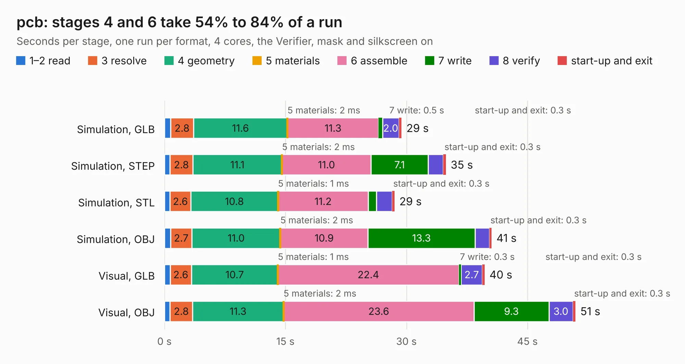

# 417. pcb

Board 417 of the 3,103 of [Corpus Testing](../Corpus-Testing.md), on [Corpus Page 4](../CorpusTestingPages/Corpus-Testing-04.md#417-pcb).

| Mode and format | 1–2 read | 3 resolve | 4 geometry | 5 materials | 6 assemble | 7 write | 8 verify | start-up and exit | Total |
|---|---:|---:|---:|---:|---:|---:|---:|---:|---:|
| Simulation, GLB | 0.8 | 2.8 | 11.6 | 2&nbsp;ms | 11.3 | 0.5 | 2.0 | 0.3 | 29.4 |
| Simulation, STEP | 0.7 | 2.8 | 11.1 | 2&nbsp;ms | 11.0 | 7.1 | 1.8 | 0.3 | 34.9 |
| Simulation, STL | 0.7 | 2.6 | 10.8 | 1&nbsp;ms | 11.2 | 1.0 | 1.9 | 0.3 | 28.5 |
| Simulation, OBJ | 0.7 | 2.7 | 11.0 | 2&nbsp;ms | 10.9 | 13.3 | 1.8 | 0.3 | 40.5 |
| Visual, GLB | 0.7 | 2.6 | 10.7 | 1&nbsp;ms | 22.4 | 0.3 | 2.7 | 0.3 | 39.7 |
| Visual, OBJ | 0.7 | 2.8 | 11.3 | 2&nbsp;ms | 23.6 | 9.3 | 3.0 | 0.3 | 51.0 |

<table align="center"><tr><td valign="top">

| Board | Repo: [apertus-open-source-cinema/axiom-micro-mainboard](https://github.com/apertus-open-source-cinema/axiom-micro-mainboard) Board: `pcb.kicad_pcb` |
|---|---|
| Folder | pcb |
| Complexity | 270&nbsp;/&nbsp;1000 (size&nbsp;215, features&nbsp;55) |
| KESE&nbsp;features | through vias, slotted holes, filled zones, curved board outline |
| Tested | 9th November 2026 |
| Copper&nbsp;layers | 4 |
| File&nbsp;format | KiCad 5 (20171130) |
| Parts,&nbsp;tracks,&nbsp;vias | 83, 2,555, 310 |
| Triangles,&nbsp;simulation | 2,695,538 in 165 parts |
| Verifier | PASS in all six runs |

</td><td valign="top">

<table>
<tr><th>File type</th><th>File size</th><th>Peak memory used</th></tr>
<tr><th colspan="3" align="left">Simulation</th></tr>
<tr><td>GLB</td><td align="right">92&nbsp;MB</td><td align="right">853&nbsp;MB</td></tr>
<tr><td>STEP</td><td align="right">376&nbsp;MB</td><td align="right">1.1&nbsp;GB</td></tr>
<tr><td>STL</td><td align="right">135&nbsp;MB</td><td align="right">864&nbsp;MB</td></tr>
<tr><td>OBJ</td><td align="right">282&nbsp;MB</td><td align="right">1.8&nbsp;GB</td></tr>
<tr><th colspan="3" align="left">Visual</th></tr>
<tr><td>GLB</td><td align="right">61&nbsp;MB</td><td align="right">1.1&nbsp;GB</td></tr>
<tr><td>OBJ</td><td align="right">189&nbsp;MB</td><td align="right">1.3&nbsp;GB</td></tr>
</table>

</td></tr></table>

| Previous | Next |
|:---|---:|
| [416. ATMEGA328_Motor_Board](b0416b_ATMEGA328-Motor-Board_ATMEGA328-Motor-Board.md) | [418. NxtPX4](b0418b_hardware_NxtPX4.md) |
