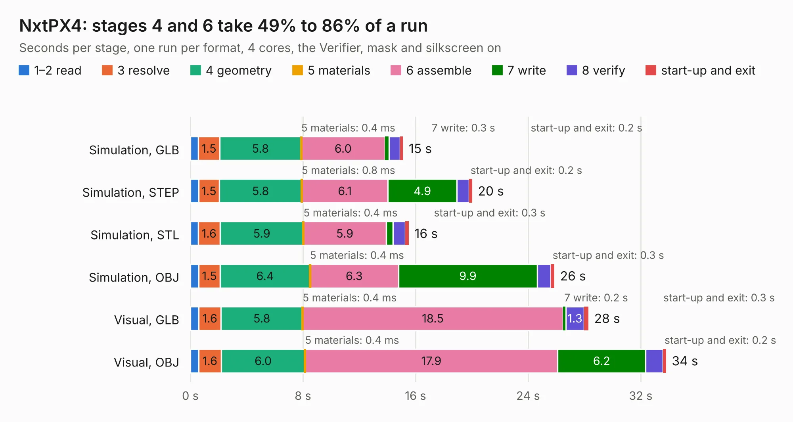

# 419. NxtPX4

Board 419 of the 3,107 of [Corpus Testing](../Corpus-Testing.md), on [Corpus Page 4](../CorpusTestingPages/Corpus-Testing-04.md#419-nxtpx4).

| Mode and format | 1–2 read | 3 resolve | 4 geometry | 5 materials | 6 assemble | 7 write | 8 verify | start-up and exit | Total |
|---|---:|---:|---:|---:|---:|---:|---:|---:|---:|
| Simulation, GLB | 0.6 | 1.5 | 5.8 | 0.4&nbsp;ms | 6.0 | 0.3 | 0.8 | 0.2 | 15.1 |
| Simulation, STEP | 0.6 | 1.5 | 5.8 | 0.8&nbsp;ms | 6.1 | 4.9 | 0.9 | 0.2 | 20.0 |
| Simulation, STL | 0.6 | 1.6 | 5.9 | 0.4&nbsp;ms | 5.9 | 0.5 | 0.9 | 0.3 | 15.5 |
| Simulation, OBJ | 0.6 | 1.5 | 6.4 | 0.4&nbsp;ms | 6.3 | 9.9 | 1.0 | 0.3 | 25.9 |
| Visual, GLB | 0.6 | 1.6 | 5.8 | 0.4&nbsp;ms | 18.5 | 0.2 | 1.3 | 0.3 | 28.3 |
| Visual, OBJ | 0.6 | 1.6 | 6.0 | 0.4&nbsp;ms | 17.9 | 6.2 | 1.2 | 0.2 | 33.8 |

<table align="center"><tr><td valign="top">

| Board | Repo: [ardupilot/hardware](https://github.com/ardupilot/hardware) Board: `NxtPX4.kicad_pcb` |
|---|---|
| Folder | HKUST-UAV-Group / NxtPX4v2 |
| Complexity | 393&nbsp;/&nbsp;1000 (size&nbsp;263, features&nbsp;130) |
| KESE&nbsp;features | through vias, slotted holes, rounded, trapezoid or chamfered pads, arc tracks, filled zones, curved board outline, TrueType text, stack-up, dielectric εr and tanδ, mask and silkscreen colours |
| Tested | 9th November 2026 |
| Copper&nbsp;layers | 4 |
| File&nbsp;format | KiCad 7 (20221018) |
| Parts,&nbsp;tracks,&nbsp;vias | 122, 1,193, 296 |
| Triangles,&nbsp;simulation | 1,917,514 in 147 parts |
| Verifier | PASS in all six runs |

</td><td valign="top">

<table>
<tr><th>File type</th><th>File size</th><th>Peak memory used</th></tr>
<tr><th colspan="3" align="left">Simulation</th></tr>
<tr><td>GLB</td><td align="right">65&nbsp;MB</td><td align="right">648&nbsp;MB</td></tr>
<tr><td>STEP</td><td align="right">281&nbsp;MB</td><td align="right">793&nbsp;MB</td></tr>
<tr><td>STL</td><td align="right">96&nbsp;MB</td><td align="right">642&nbsp;MB</td></tr>
<tr><td>OBJ</td><td align="right">200&nbsp;MB</td><td align="right">1.3&nbsp;GB</td></tr>
<tr><th colspan="3" align="left">Visual</th></tr>
<tr><td>GLB</td><td align="right">42&nbsp;MB</td><td align="right">809&nbsp;MB</td></tr>
<tr><td>OBJ</td><td align="right">130&nbsp;MB</td><td align="right">993&nbsp;MB</td></tr>
</table>

</td></tr></table>

| Previous | Next |
|:---|---:|
| [418. pcb](b0418b_axiom-micro-mainboard_pcb.md) | [420. Sparky2](b0420b_hardware_Sparky2.md) |
