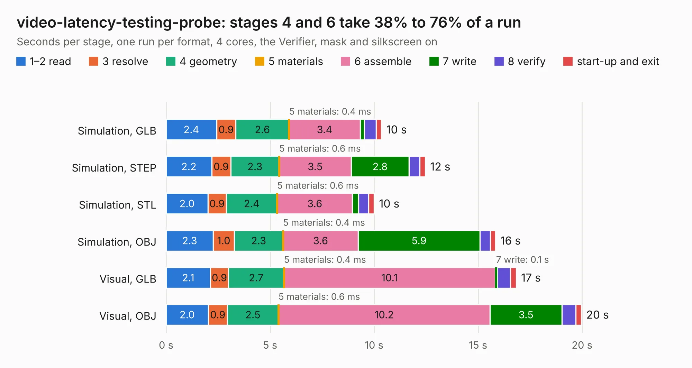

# 420. video-latency-testing-probe

Board 420 of the 3,132 of [Corpus Testing](../Corpus-Testing.md), on [Corpus Page 4](../CorpusTestingPages/Corpus-Testing-04.md#420-video-latency-testing-probe).

| Mode and format | 1–2 read | 3 resolve | 4 geometry | 5 materials | 6 assemble | 7 write | 8 verify | start-up and exit | Total |
|---|---:|---:|---:|---:|---:|---:|---:|---:|---:|
| Simulation, GLB | 2.4 | 0.9 | 2.6 | 0.4&nbsp;ms | 3.4 | 0.2 | 0.6 | 0.3 | 10.4 |
| Simulation, STEP | 2.2 | 0.9 | 2.3 | 0.6&nbsp;ms | 3.5 | 2.8 | 0.5 | 0.3 | 12.5 |
| Simulation, STL | 2.0 | 0.9 | 2.4 | 0.6&nbsp;ms | 3.6 | 0.3 | 0.5 | 0.3 | 10.0 |
| Simulation, OBJ | 2.3 | 1.0 | 2.3 | 0.4&nbsp;ms | 3.6 | 5.9 | 0.5 | 0.2 | 15.8 |
| Visual, GLB | 2.1 | 0.9 | 2.7 | 0.4&nbsp;ms | 10.1 | 0.1 | 0.6 | 0.3 | 16.8 |
| Visual, OBJ | 2.0 | 0.9 | 2.5 | 0.6&nbsp;ms | 10.2 | 3.5 | 0.7 | 0.3 | 20.0 |

<table align="center"><tr><td valign="top">

| Board | Repo: [antmicro/video-latency-testing-probe](https://github.com/antmicro/video-latency-testing-probe) Board: `video-latency-testing-probe.kicad_pcb` |
|---|---|
| Complexity | 365&nbsp;/&nbsp;1000 (size&nbsp;250, features&nbsp;115) |
| KESE&nbsp;features | through vias, slotted holes, rounded, trapezoid or chamfered pads, arc tracks, filled zones, curved board outline, stack-up, dielectric εr and tanδ, mask and silkscreen colours |
| Tested | 9th November 2026 |
| Copper&nbsp;layers | 6 |
| File&nbsp;format | KiCad 9 (20241229) |
| Parts,&nbsp;tracks,&nbsp;vias | 86, 1,028, 128 |
| Triangles,&nbsp;simulation | 1,121,652 in 114 parts |
| Verifier | PASS in all six runs |

</td><td valign="top">

<table>
<tr><th>File type</th><th>File size</th><th>Peak memory used</th></tr>
<tr><th colspan="3" align="left">Simulation</th></tr>
<tr><td>GLB</td><td align="right">38&nbsp;MB</td><td align="right">556&nbsp;MB</td></tr>
<tr><td>STEP</td><td align="right">159&nbsp;MB</td><td align="right">599&nbsp;MB</td></tr>
<tr><td>STL</td><td align="right">56&nbsp;MB</td><td align="right">558&nbsp;MB</td></tr>
<tr><td>OBJ</td><td align="right">114&nbsp;MB</td><td align="right">840&nbsp;MB</td></tr>
<tr><th colspan="3" align="left">Visual</th></tr>
<tr><td>GLB</td><td align="right">22&nbsp;MB</td><td align="right">630&nbsp;MB</td></tr>
<tr><td>OBJ</td><td align="right">68&nbsp;MB</td><td align="right">637&nbsp;MB</td></tr>
</table>

</td></tr></table>

| Previous | Next |
|:---|---:|
| [419. usb-c-power-adapter](b0419b_usb-c-power-adapter_usb-c-power-adapter.md) | [421. video-booster-board](b0421b_video-signal-booster-board_video-booster-board.md) |
