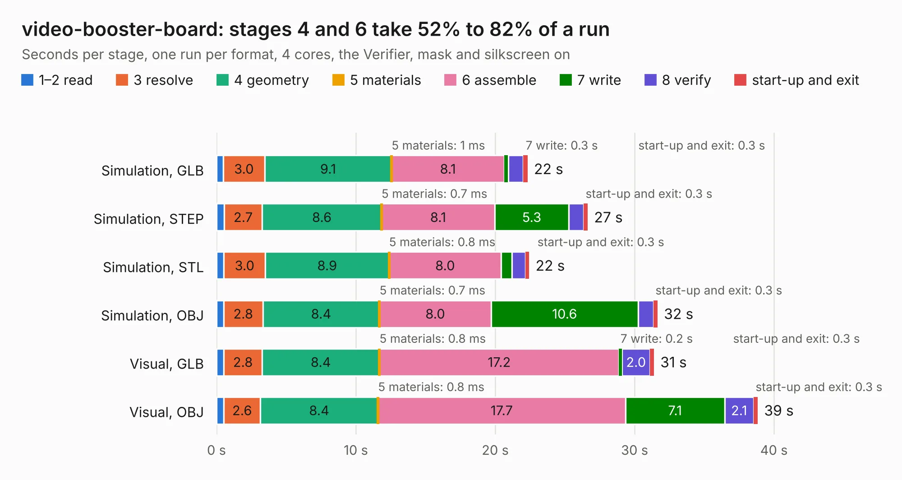

# 420. video-booster-board

Board 420 of the 3,125 of [Corpus Testing](../Corpus-Testing.md), on [Corpus Page 4](../CorpusTestingPages/Corpus-Testing-04.md#420-video-booster-board).

| Mode and format | 1–2 read | 3 resolve | 4 geometry | 5 materials | 6 assemble | 7 write | 8 verify | start-up and exit | Total |
|---|---:|---:|---:|---:|---:|---:|---:|---:|---:|
| Simulation, GLB | 0.5 | 3.0 | 9.1 | 1&nbsp;ms | 8.1 | 0.3 | 1.1 | 0.3 | 22.3 |
| Simulation, STEP | 0.5 | 2.7 | 8.6 | 0.7&nbsp;ms | 8.1 | 5.3 | 1.1 | 0.3 | 26.6 |
| Simulation, STL | 0.5 | 3.0 | 8.9 | 0.8&nbsp;ms | 8.0 | 0.8 | 1.0 | 0.3 | 22.4 |
| Simulation, OBJ | 0.5 | 2.8 | 8.4 | 0.7&nbsp;ms | 8.0 | 10.6 | 1.1 | 0.3 | 31.6 |
| Visual, GLB | 0.5 | 2.8 | 8.4 | 0.8&nbsp;ms | 17.2 | 0.2 | 2.0 | 0.3 | 31.4 |
| Visual, OBJ | 0.5 | 2.6 | 8.4 | 0.8&nbsp;ms | 17.7 | 7.1 | 2.1 | 0.3 | 38.8 |

<table align="center"><tr><td valign="top">

| Board | Repo: [antmicro/video-signal-booster-board](https://github.com/antmicro/video-signal-booster-board) Board: `video-booster-board.kicad_pcb` |
|---|---|
| Complexity | 361&nbsp;/&nbsp;1000 (size&nbsp;271, features&nbsp;90) |
| KESE&nbsp;features | through vias, slotted holes, custom pads, rounded, trapezoid or chamfered pads, filled zones, copper drawings, copper text |
| Tested | 9th November 2026 |
| Copper&nbsp;layers | 4 |
| File&nbsp;format | KiCad 5 (20171130) |
| Parts,&nbsp;tracks,&nbsp;vias | 141, 2,792, 242 |
| Triangles,&nbsp;simulation | 2,129,152 in 151 parts |
| Verifier | PASS in all six runs |

</td><td valign="top">

<table>
<tr><th>File type</th><th>File size</th><th>Peak memory used</th></tr>
<tr><th colspan="3" align="left">Simulation</th></tr>
<tr><td>GLB</td><td align="right">74&nbsp;MB</td><td align="right">788&nbsp;MB</td></tr>
<tr><td>STEP</td><td align="right">340&nbsp;MB</td><td align="right">876&nbsp;MB</td></tr>
<tr><td>STL</td><td align="right">106&nbsp;MB</td><td align="right">748&nbsp;MB</td></tr>
<tr><td>OBJ</td><td align="right">229&nbsp;MB</td><td align="right">1.5&nbsp;GB</td></tr>
<tr><th colspan="3" align="left">Visual</th></tr>
<tr><td>GLB</td><td align="right">45&nbsp;MB</td><td align="right">907&nbsp;MB</td></tr>
<tr><td>OBJ</td><td align="right">138&nbsp;MB</td><td align="right">1.0&nbsp;GB</td></tr>
</table>

</td></tr></table>

| Previous | Next |
|:---|---:|
| [419. video-latency-testing-probe](b0419b_video-latency-testing-probe_video-latency-testing-probe.md) | [421. vna-se-probe](b0421b_vna-se-probe_vna-se-probe.md) |
