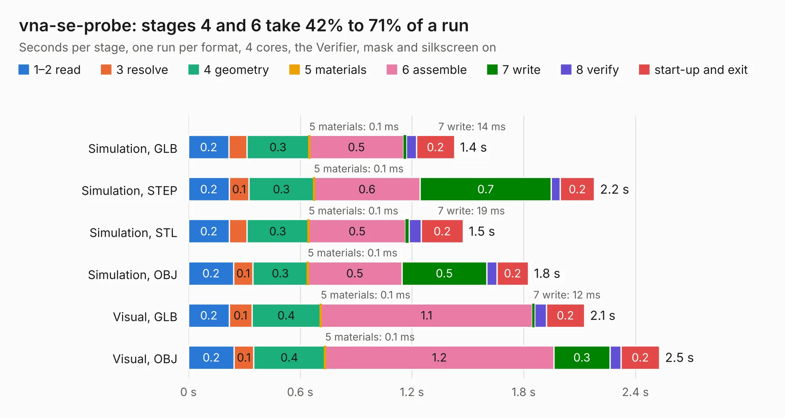

# 421. vna-se-probe

Board 421 of the 3,128 of [Corpus Testing](../Corpus-Testing.md), on [Corpus Page 4](../CorpusTestingPages/Corpus-Testing-04.md#421-vna-se-probe).

| Mode and format | 1–2 read | 3 resolve | 4 geometry | 5 materials | 6 assemble | 7 write | 8 verify | start-up and exit | Total |
|---|---:|---:|---:|---:|---:|---:|---:|---:|---:|
| Simulation, GLB | 0.2 | 96&nbsp;ms | 0.3 | 0.1&nbsp;ms | 0.5 | 14&nbsp;ms | 55&nbsp;ms | 0.2 | 1.4 |
| Simulation, STEP | 0.2 | 0.1 | 0.3 | 0.1&nbsp;ms | 0.6 | 0.7 | 49&nbsp;ms | 0.2 | 2.2 |
| Simulation, STL | 0.2 | 95&nbsp;ms | 0.3 | 0.1&nbsp;ms | 0.5 | 19&nbsp;ms | 65&nbsp;ms | 0.2 | 1.5 |
| Simulation, OBJ | 0.2 | 0.1 | 0.3 | 0.1&nbsp;ms | 0.5 | 0.5 | 55&nbsp;ms | 0.2 | 1.8 |
| Visual, GLB | 0.2 | 0.1 | 0.4 | 0.1&nbsp;ms | 1.1 | 12&nbsp;ms | 64&nbsp;ms | 0.2 | 2.1 |
| Visual, OBJ | 0.2 | 0.1 | 0.4 | 0.1&nbsp;ms | 1.2 | 0.3 | 60&nbsp;ms | 0.2 | 2.5 |

<table align="center"><tr><td valign="top">

| Board | Repo: [antmicro/vna-se-probe](https://github.com/antmicro/vna-se-probe) Board: `vna-se-probe.kicad_pcb` |
|---|---|
| Complexity | 241&nbsp;/&nbsp;1000 (size&nbsp;116, features&nbsp;125) |
| KESE&nbsp;features | through vias, rounded, trapezoid or chamfered pads, arc tracks, filled zones, curved board outline, stack-up, dielectric εr and tanδ, castellated pads |
| Tested | 9th November 2026 |
| Copper&nbsp;layers | 4 |
| File&nbsp;format | KiCad 9 (20241229) |
| Parts,&nbsp;tracks,&nbsp;vias | 2, 5, 23 |
| Triangles,&nbsp;simulation | 90,012 in 17 parts |
| Verifier | PASS in all six runs |

</td><td valign="top">

<table>
<tr><th>File type</th><th>File size</th><th>Peak memory used</th></tr>
<tr><th colspan="3" align="left">Simulation</th></tr>
<tr><td>GLB</td><td align="right">3.1&nbsp;MB</td><td align="right">181&nbsp;MB</td></tr>
<tr><td>STEP</td><td align="right">9.3&nbsp;MB</td><td align="right">184&nbsp;MB</td></tr>
<tr><td>STL</td><td align="right">4.5&nbsp;MB</td><td align="right">184&nbsp;MB</td></tr>
<tr><td>OBJ</td><td align="right">8.6&nbsp;MB</td><td align="right">183&nbsp;MB</td></tr>
<tr><th colspan="3" align="left">Visual</th></tr>
<tr><td>GLB</td><td align="right">1.8&nbsp;MB</td><td align="right">162&nbsp;MB</td></tr>
<tr><td>OBJ</td><td align="right">5.1&nbsp;MB</td><td align="right">163&nbsp;MB</td></tr>
</table>

</td></tr></table>

| Previous | Next |
|:---|---:|
| [420. video-booster-board](b0420b_video-signal-booster-board_video-booster-board.md) | [422. ATMEGA328_Motor_Board](b0422b_ATMEGA328-Motor-Board_ATMEGA328-Motor-Board.md) |
