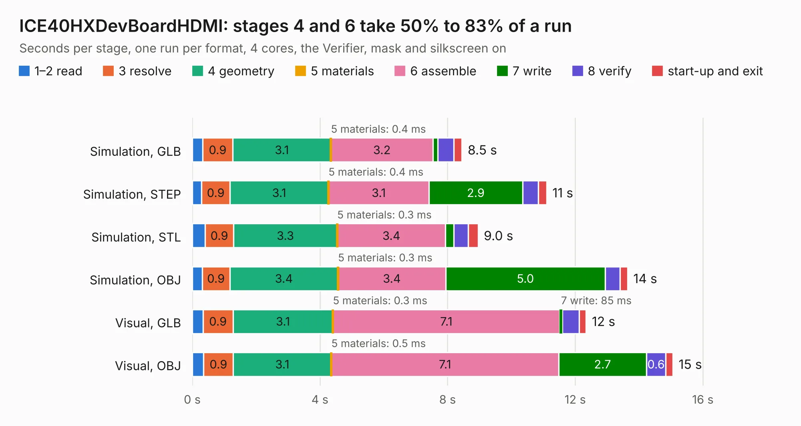

# 422. ICE40HXDevBoardHDMI

Board 422 of the 3,109 of [Corpus Testing](../Corpus-Testing.md), on [Corpus Page 4](../CorpusTestingPages/Corpus-Testing-04.md#422-ice40hxdevboardhdmi).

| Mode and format | 1–2 read | 3 resolve | 4 geometry | 5 materials | 6 assemble | 7 write | 8 verify | start-up and exit | Total |
|---|---:|---:|---:|---:|---:|---:|---:|---:|---:|
| Simulation, GLB | 0.3 | 0.9 | 3.1 | 0.4&nbsp;ms | 3.2 | 0.2 | 0.5 | 0.3 | 8.5 |
| Simulation, STEP | 0.3 | 0.9 | 3.1 | 0.4&nbsp;ms | 3.1 | 2.9 | 0.5 | 0.3 | 11.1 |
| Simulation, STL | 0.4 | 0.9 | 3.3 | 0.3&nbsp;ms | 3.4 | 0.3 | 0.5 | 0.3 | 9.0 |
| Simulation, OBJ | 0.3 | 0.9 | 3.4 | 0.3&nbsp;ms | 3.4 | 5.0 | 0.5 | 0.2 | 13.6 |
| Visual, GLB | 0.3 | 0.9 | 3.1 | 0.3&nbsp;ms | 7.1 | 85&nbsp;ms | 0.5 | 0.2 | 12.3 |
| Visual, OBJ | 0.4 | 0.9 | 3.1 | 0.5&nbsp;ms | 7.1 | 2.7 | 0.6 | 0.2 | 15.1 |

<table align="center"><tr><td valign="top">

| Board | Repo: [aslak3/ICE40HXDevBoard](https://github.com/aslak3/ICE40HXDevBoard) Board: `ICE40HXDevBoardHDMI.kicad_pcb` |
|---|---|
| Folder | ExpansionCards / ICE40HXDevBoardHDMI |
| Complexity | 344&nbsp;/&nbsp;1000 (size&nbsp;224, features&nbsp;120) |
| KESE&nbsp;features | through vias, slotted holes, custom pads, rounded, trapezoid or chamfered pads, filled zones, copper drawings, curved board outline, stack-up, dielectric εr and tanδ |
| Tested | 9th November 2026 |
| Copper&nbsp;layers | 4 |
| File&nbsp;format | KiCad 9 (20241229) |
| Parts,&nbsp;tracks,&nbsp;vias | 48, 542, 64 |
| Triangles,&nbsp;simulation | 899,090 in 84 parts |
| Verifier | PASS in all six runs |

</td><td valign="top">

<table>
<tr><th>File type</th><th>File size</th><th>Peak memory used</th></tr>
<tr><th colspan="3" align="left">Simulation</th></tr>
<tr><td>GLB</td><td align="right">31&nbsp;MB</td><td align="right">414&nbsp;MB</td></tr>
<tr><td>STEP</td><td align="right">122&nbsp;MB</td><td align="right">457&nbsp;MB</td></tr>
<tr><td>STL</td><td align="right">45&nbsp;MB</td><td align="right">397&nbsp;MB</td></tr>
<tr><td>OBJ</td><td align="right">92&nbsp;MB</td><td align="right">633&nbsp;MB</td></tr>
<tr><th colspan="3" align="left">Visual</th></tr>
<tr><td>GLB</td><td align="right">17&nbsp;MB</td><td align="right">416&nbsp;MB</td></tr>
<tr><td>OBJ</td><td align="right">53&nbsp;MB</td><td align="right">500&nbsp;MB</td></tr>
</table>

</td></tr></table>

| Previous | Next |
|:---|---:|
| [421. motherboard-hk10](b0421b_motherboard-hk10_motherboard-hk10.md) | [423. ICE40HXDevBoardVGA](b0423b_ICE40HXDevBoard_ICE40HXDevBoardVGA.md) |
