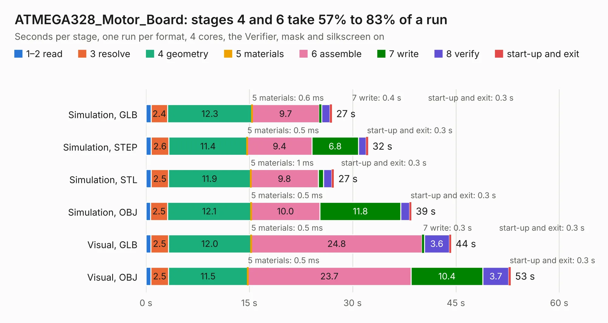

# 423. ATMEGA328_Motor_Board

Board 423 of the 3,138 of [Corpus Testing](../Corpus-Testing.md), on [Corpus Page 4](../CorpusTestingPages/Corpus-Testing-04.md#423-atmega328_motor_board).

| Mode and format | 1–2 read | 3 resolve | 4 geometry | 5 materials | 6 assemble | 7 write | 8 verify | start-up and exit | Total |
|---|---:|---:|---:|---:|---:|---:|---:|---:|---:|
| Simulation, GLB | 0.7 | 2.4 | 12.3 | 0.6&nbsp;ms | 9.7 | 0.4 | 1.2 | 0.3 | 27.0 |
| Simulation, STEP | 0.8 | 2.6 | 11.4 | 0.5&nbsp;ms | 9.4 | 6.8 | 1.1 | 0.3 | 32.3 |
| Simulation, STL | 0.8 | 2.5 | 11.9 | 1&nbsp;ms | 9.8 | 0.8 | 1.2 | 0.3 | 27.3 |
| Simulation, OBJ | 0.7 | 2.5 | 12.1 | 0.5&nbsp;ms | 10.0 | 11.8 | 1.3 | 0.3 | 38.6 |
| Visual, GLB | 0.7 | 2.5 | 12.0 | 0.5&nbsp;ms | 24.8 | 0.3 | 3.6 | 0.3 | 44.3 |
| Visual, OBJ | 0.7 | 2.5 | 11.5 | 0.5&nbsp;ms | 23.7 | 10.4 | 3.7 | 0.3 | 53.0 |

<table align="center"><tr><td valign="top">

| Board | Repo: [AntonioMR/ATMEGA328-Motor-Board](https://github.com/AntonioMR/ATMEGA328-Motor-Board) Board: `ATMEGA328_Motor_Board.kicad_pcb` |
|---|---|
| Folder | pcb |
| Complexity | 285&nbsp;/&nbsp;1000 (size&nbsp;250, features&nbsp;35) |
| KESE&nbsp;features | through vias, filled zones |
| Tested | 9th November 2026 |
| Copper&nbsp;layers | 2 |
| File&nbsp;format | KiCad 4 (4) |
| Parts,&nbsp;tracks,&nbsp;vias | 171, 4,134, 136 |
| Triangles,&nbsp;simulation | 2,315,194 in 137 parts |
| Verifier | PASS in all six runs |

</td><td valign="top">

<table>
<tr><th>File type</th><th>File size</th><th>Peak memory used</th></tr>
<tr><th colspan="3" align="left">Simulation</th></tr>
<tr><td>GLB</td><td align="right">82&nbsp;MB</td><td align="right">823&nbsp;MB</td></tr>
<tr><td>STEP</td><td align="right">478&nbsp;MB</td><td align="right">1.1&nbsp;GB</td></tr>
<tr><td>STL</td><td align="right">116&nbsp;MB</td><td align="right">804&nbsp;MB</td></tr>
<tr><td>OBJ</td><td align="right">248&nbsp;MB</td><td align="right">1.6&nbsp;GB</td></tr>
<tr><th colspan="3" align="left">Visual</th></tr>
<tr><td>GLB</td><td align="right">71&nbsp;MB</td><td align="right">1.2&nbsp;GB</td></tr>
<tr><td>OBJ</td><td align="right">220&nbsp;MB</td><td align="right">1.5&nbsp;GB</td></tr>
</table>

</td></tr></table>

| Previous | Next |
|:---|---:|
| [422. vna-se-probe](b0422b_vna-se-probe_vna-se-probe.md) | [424. pcb](b0424b_axiom-micro-mainboard_pcb.md) |
