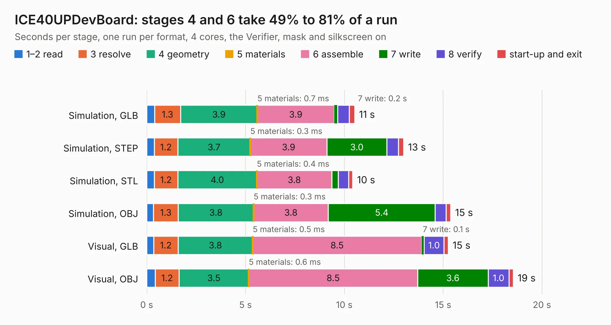

# 423. ICE40UPDevBoard

Board 423 of the 3,102 of [Corpus Testing](../Corpus-Testing.md), on [Corpus Page 4](../CorpusTestingPages/Corpus-Testing-04.md#423-ice40updevboard).

| Mode and format | 1–2 read | 3 resolve | 4 geometry | 5 materials | 6 assemble | 7 write | 8 verify | start-up and exit | Total |
|---|---:|---:|---:|---:|---:|---:|---:|---:|---:|
| Simulation, GLB | 0.4 | 1.3 | 3.9 | 0.7&nbsp;ms | 3.9 | 0.2 | 0.6 | 0.3 | 10.5 |
| Simulation, STEP | 0.4 | 1.2 | 3.7 | 0.3&nbsp;ms | 3.9 | 3.0 | 0.6 | 0.3 | 13.0 |
| Simulation, STL | 0.4 | 1.2 | 4.0 | 0.4&nbsp;ms | 3.8 | 0.3 | 0.5 | 0.2 | 10.4 |
| Simulation, OBJ | 0.3 | 1.3 | 3.8 | 0.3&nbsp;ms | 3.8 | 5.4 | 0.5 | 0.2 | 15.4 |
| Visual, GLB | 0.4 | 1.2 | 3.8 | 0.5&nbsp;ms | 8.5 | 0.1 | 1.0 | 0.2 | 15.3 |
| Visual, OBJ | 0.4 | 1.2 | 3.5 | 0.6&nbsp;ms | 8.5 | 3.6 | 1.0 | 0.2 | 18.6 |

<table align="center"><tr><td valign="top">

| Board | Repo: [aslak3/ICE40UPDevBoard](https://github.com/aslak3/ICE40UPDevBoard) Board: `ICE40UPDevBoard.kicad_pcb` |
|---|---|
| Complexity | 339&nbsp;/&nbsp;1000 (size&nbsp;244, features&nbsp;95) |
| KESE&nbsp;features | through vias, slotted holes, rounded, trapezoid or chamfered pads, filled zones, curved board outline, stack-up, dielectric εr and tanδ |
| Tested | 9th November 2026 |
| Copper&nbsp;layers | 4 |
| File&nbsp;format | KiCad 7 (20221018) |
| Parts,&nbsp;tracks,&nbsp;vias | 92, 734, 133 |
| Triangles,&nbsp;simulation | 1,231,682 in 97 parts |
| Verifier | PASS in all six runs |

</td><td valign="top">

<table>
<tr><th>File type</th><th>File size</th><th>Peak memory used</th></tr>
<tr><th colspan="3" align="left">Simulation</th></tr>
<tr><td>GLB</td><td align="right">42&nbsp;MB</td><td align="right">496&nbsp;MB</td></tr>
<tr><td>STEP</td><td align="right">157&nbsp;MB</td><td align="right">561&nbsp;MB</td></tr>
<tr><td>STL</td><td align="right">62&nbsp;MB</td><td align="right">486&nbsp;MB</td></tr>
<tr><td>OBJ</td><td align="right">126&nbsp;MB</td><td align="right">843&nbsp;MB</td></tr>
<tr><th colspan="3" align="left">Visual</th></tr>
<tr><td>GLB</td><td align="right">27&nbsp;MB</td><td align="right">657&nbsp;MB</td></tr>
<tr><td>OBJ</td><td align="right">81&nbsp;MB</td><td align="right">646&nbsp;MB</td></tr>
</table>

</td></tr></table>

| Previous | Next |
|:---|---:|
| [422. ICE40HXDevBoard](b0422b_ICE40HXDevBoard_ICE40HXDevBoard.md) | [424. Printer+Sticks](b0424b_maxi030_Printer-Sticks.md) |
