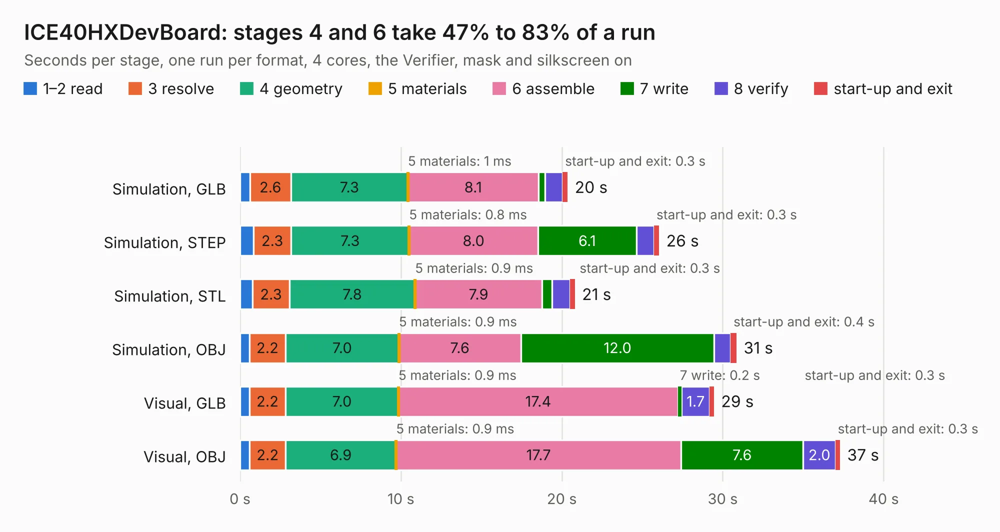

# 424. ICE40HXDevBoard

Board 424 of the 3,111 of [Corpus Testing](../Corpus-Testing.md), on [Corpus Page 4](../CorpusTestingPages/Corpus-Testing-04.md#424-ice40hxdevboard).

| Mode and format | 1–2 read | 3 resolve | 4 geometry | 5 materials | 6 assemble | 7 write | 8 verify | start-up and exit | Total |
|---|---:|---:|---:|---:|---:|---:|---:|---:|---:|
| Simulation, GLB | 0.6 | 2.6 | 7.3 | 1&nbsp;ms | 8.1 | 0.4 | 1.1 | 0.3 | 20.4 |
| Simulation, STEP | 0.8 | 2.3 | 7.3 | 0.8&nbsp;ms | 8.0 | 6.1 | 1.1 | 0.3 | 26.0 |
| Simulation, STL | 0.8 | 2.3 | 7.8 | 0.9&nbsp;ms | 7.9 | 0.6 | 1.1 | 0.3 | 20.8 |
| Simulation, OBJ | 0.6 | 2.2 | 7.0 | 0.9&nbsp;ms | 7.6 | 12.0 | 1.0 | 0.4 | 30.9 |
| Visual, GLB | 0.6 | 2.2 | 7.0 | 0.9&nbsp;ms | 17.4 | 0.2 | 1.7 | 0.3 | 29.5 |
| Visual, OBJ | 0.6 | 2.2 | 6.9 | 0.9&nbsp;ms | 17.7 | 7.6 | 2.0 | 0.3 | 37.3 |

<table align="center"><tr><td valign="top">

| Board | Repo: [aslak3/ICE40HXDevBoard](https://github.com/aslak3/ICE40HXDevBoard) Board: `ICE40HXDevBoard.kicad_pcb` |
|---|---|
| Complexity | 345&nbsp;/&nbsp;1000 (size&nbsp;250, features&nbsp;95) |
| KESE&nbsp;features | through vias, slotted holes, rounded, trapezoid or chamfered pads, filled zones, curved board outline, stack-up, dielectric εr and tanδ |
| Tested | 9th November 2026 |
| Copper&nbsp;layers | 4 |
| File&nbsp;format | KiCad 9 (20241229) |
| Parts,&nbsp;tracks,&nbsp;vias | 111, 1,526, 194 |
| Triangles,&nbsp;simulation | 1,898,466 in 175 parts |
| Verifier | PASS in all six runs |

</td><td valign="top">

<table>
<tr><th>File type</th><th>File size</th><th>Peak memory used</th></tr>
<tr><th colspan="3" align="left">Simulation</th></tr>
<tr><td>GLB</td><td align="right">65&nbsp;MB</td><td align="right">636&nbsp;MB</td></tr>
<tr><td>STEP</td><td align="right">250&nbsp;MB</td><td align="right">818&nbsp;MB</td></tr>
<tr><td>STL</td><td align="right">95&nbsp;MB</td><td align="right">630&nbsp;MB</td></tr>
<tr><td>OBJ</td><td align="right">198&nbsp;MB</td><td align="right">1.2&nbsp;GB</td></tr>
<tr><th colspan="3" align="left">Visual</th></tr>
<tr><td>GLB</td><td align="right">43&nbsp;MB</td><td align="right">862&nbsp;MB</td></tr>
<tr><td>OBJ</td><td align="right">131&nbsp;MB</td><td align="right">953&nbsp;MB</td></tr>
</table>

</td></tr></table>

| Previous | Next |
|:---|---:|
| [423. ICE40HXDevBoardVGA](b0423b_ICE40HXDevBoard_ICE40HXDevBoardVGA.md) | [425. ICE40UPDevBoard](b0425b_ICE40UPDevBoard_ICE40UPDevBoard.md) |
