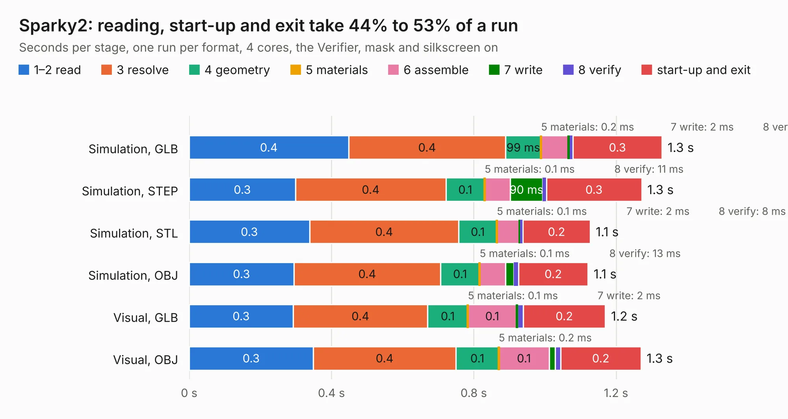

# 424. Sparky2

Board 424 of the 3,119 of [Corpus Testing](../Corpus-Testing.md), on [Corpus Page 4](../CorpusTestingPages/Corpus-Testing-04.md#424-sparky2).

| Mode and format | 1–2 read | 3 resolve | 4 geometry | 5 materials | 6 assemble | 7 write | 8 verify | start-up and exit | Total |
|---|---:|---:|---:|---:|---:|---:|---:|---:|---:|
| Simulation, GLB | 0.4 | 0.4 | 99&nbsp;ms | 0.2&nbsp;ms | 76&nbsp;ms | 2&nbsp;ms | 11&nbsp;ms | 0.3 | 1.3 |
| Simulation, STEP | 0.3 | 0.4 | 0.1 | 0.1&nbsp;ms | 72&nbsp;ms | 90&nbsp;ms | 11&nbsp;ms | 0.3 | 1.3 |
| Simulation, STL | 0.3 | 0.4 | 0.1 | 0.1&nbsp;ms | 63&nbsp;ms | 2&nbsp;ms | 8&nbsp;ms | 0.2 | 1.1 |
| Simulation, OBJ | 0.3 | 0.4 | 0.1 | 0.1&nbsp;ms | 73&nbsp;ms | 23&nbsp;ms | 13&nbsp;ms | 0.2 | 1.1 |
| Visual, GLB | 0.3 | 0.4 | 0.1 | 0.1&nbsp;ms | 0.1 | 2&nbsp;ms | 17&nbsp;ms | 0.2 | 1.2 |
| Visual, OBJ | 0.3 | 0.4 | 0.1 | 0.2&nbsp;ms | 0.1 | 17&nbsp;ms | 15&nbsp;ms | 0.2 | 1.3 |

<table align="center"><tr><td valign="top">

| Board | Repo: [ardupilot/hardware](https://github.com/ardupilot/hardware) Board: `Sparky2.kicad_pcb` |
|---|---|
| Folder | TauLabs-Sparky / sparky2 / hw / kicad |
| Complexity | 241&nbsp;/&nbsp;1000 (size&nbsp;196, features&nbsp;45) |
| KESE&nbsp;features | through vias, copper drawings, copper text, curved board outline |
| Tested | 9th November 2026 |
| Copper&nbsp;layers | 4 |
| File&nbsp;format | KiCad 4 (4) |
| Parts,&nbsp;tracks,&nbsp;vias | 78, 864, 79 |
| Triangles,&nbsp;simulation | 3,856 in 9 parts |
| Verifier | PASS in all six runs |

</td><td valign="top">

<table>
<tr><th>File type</th><th>File size</th><th>Peak memory used</th></tr>
<tr><th colspan="3" align="left">Simulation</th></tr>
<tr><td>GLB</td><td align="right">143&nbsp;kB</td><td align="right">82&nbsp;MB</td></tr>
<tr><td>STEP</td><td align="right">895&nbsp;kB</td><td align="right">82&nbsp;MB</td></tr>
<tr><td>STL</td><td align="right">194&nbsp;kB</td><td align="right">82&nbsp;MB</td></tr>
<tr><td>OBJ</td><td align="right">374&nbsp;kB</td><td align="right">82&nbsp;MB</td></tr>
<tr><th colspan="3" align="left">Visual</th></tr>
<tr><td>GLB</td><td align="right">117&nbsp;kB</td><td align="right">82&nbsp;MB</td></tr>
<tr><td>OBJ</td><td align="right">281&nbsp;kB</td><td align="right">82&nbsp;MB</td></tr>
</table>

</td></tr></table>

| Previous | Next |
|:---|---:|
| [423. NxtPX4](b0423b_hardware_NxtPX4.md) | [425. motherboard-hk10](b0425b_motherboard-hk10_motherboard-hk10.md) |
