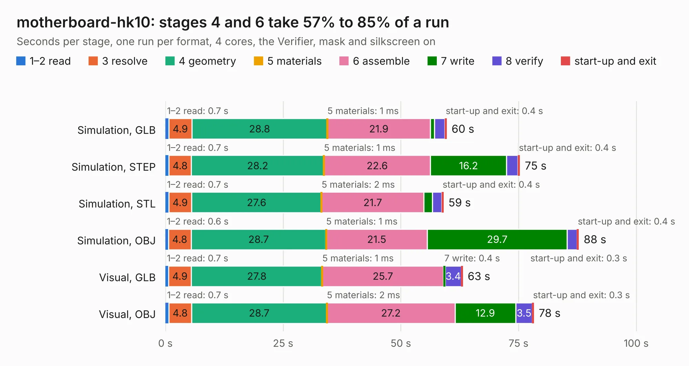

# 424. motherboard-hk10

Board 424 of the 3,117 of [Corpus Testing](../Corpus-Testing.md), on [Corpus Page 4](../CorpusTestingPages/Corpus-Testing-04.md#424-motherboard-hk10).

| Mode and format | 1–2 read | 3 resolve | 4 geometry | 5 materials | 6 assemble | 7 write | 8 verify | start-up and exit | Total |
|---|---:|---:|---:|---:|---:|---:|---:|---:|---:|
| Simulation, GLB | 0.7 | 4.9 | 28.8 | 1&nbsp;ms | 21.9 | 0.9 | 2.2 | 0.4 | 59.7 |
| Simulation, STEP | 0.7 | 4.8 | 28.2 | 1&nbsp;ms | 22.6 | 16.2 | 2.4 | 0.4 | 75.3 |
| Simulation, STL | 0.7 | 4.9 | 27.6 | 2&nbsp;ms | 21.7 | 1.8 | 2.0 | 0.4 | 59.1 |
| Simulation, OBJ | 0.6 | 4.8 | 28.7 | 1&nbsp;ms | 21.5 | 29.7 | 2.1 | 0.4 | 87.8 |
| Visual, GLB | 0.7 | 4.9 | 27.8 | 1&nbsp;ms | 25.7 | 0.4 | 3.4 | 0.3 | 63.2 |
| Visual, OBJ | 0.7 | 4.8 | 28.7 | 2&nbsp;ms | 27.2 | 12.9 | 3.5 | 0.3 | 78.3 |

<table align="center"><tr><td valign="top">

| Board | Repo: [artemisamsx/motherboard-hk10](https://github.com/artemisamsx/motherboard-hk10) Board: `motherboard-hk10.kicad_pcb` |
|---|---|
| Complexity | 88&nbsp;/&nbsp;1000 (size&nbsp;68, features&nbsp;20) |
| KESE&nbsp;features | rounded, trapezoid or chamfered pads, drill offsets |
| Tested | 9th November 2026 |
| Copper&nbsp;layers | 2 |
| File&nbsp;format | KiCad 10 (20260206) |
| Parts,&nbsp;tracks,&nbsp;vias | 111, 0, 0 |
| Triangles,&nbsp;simulation | 4,952,416 in 256 parts |
| Note | mostly unrouted |
| Verifier | PASS in all six runs |

</td><td valign="top">

<table>
<tr><th>File type</th><th>File size</th><th>Peak memory used</th></tr>
<tr><th colspan="3" align="left">Simulation</th></tr>
<tr><td>GLB</td><td align="right">156&nbsp;MB</td><td align="right">1.4&nbsp;GB</td></tr>
<tr><td>STEP</td><td align="right">784&nbsp;MB</td><td align="right">1.9&nbsp;GB</td></tr>
<tr><td>STL</td><td align="right">248&nbsp;MB</td><td align="right">1.4&nbsp;GB</td></tr>
<tr><td>OBJ</td><td align="right">525&nbsp;MB</td><td align="right">3.2&nbsp;GB</td></tr>
<tr><th colspan="3" align="left">Visual</th></tr>
<tr><td>GLB</td><td align="right">73&nbsp;MB</td><td align="right">1.5&nbsp;GB</td></tr>
<tr><td>OBJ</td><td align="right">230&nbsp;MB</td><td align="right">1.7&nbsp;GB</td></tr>
</table>

</td></tr></table>

| Previous | Next |
|:---|---:|
| [423. Sparky2](b0423b_hardware_Sparky2.md) | [425. ICE40HXDevBoardHDMI](b0425b_ICE40HXDevBoard_ICE40HXDevBoardHDMI.md) |
