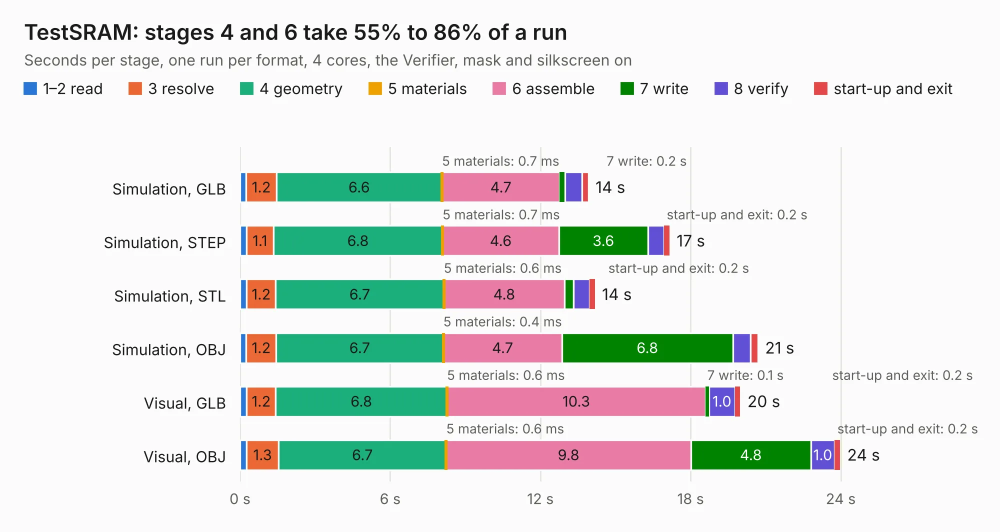

# 427. TestSRAM

Board 427 of the 3,105 of [Corpus Testing](../Corpus-Testing.md), on [Corpus Page 4](../CorpusTestingPages/Corpus-Testing-04.md#427-testsram).

| Mode and format | 1–2 read | 3 resolve | 4 geometry | 5 materials | 6 assemble | 7 write | 8 verify | start-up and exit | Total |
|---|---:|---:|---:|---:|---:|---:|---:|---:|---:|
| Simulation, GLB | 0.2 | 1.2 | 6.6 | 0.7&nbsp;ms | 4.7 | 0.2 | 0.7 | 0.3 | 13.9 |
| Simulation, STEP | 0.3 | 1.1 | 6.8 | 0.7&nbsp;ms | 4.6 | 3.6 | 0.6 | 0.2 | 17.2 |
| Simulation, STL | 0.3 | 1.2 | 6.7 | 0.6&nbsp;ms | 4.8 | 0.3 | 0.6 | 0.2 | 14.2 |
| Simulation, OBJ | 0.2 | 1.2 | 6.7 | 0.4&nbsp;ms | 4.7 | 6.8 | 0.7 | 0.3 | 20.7 |
| Visual, GLB | 0.3 | 1.2 | 6.8 | 0.6&nbsp;ms | 10.3 | 0.1 | 1.0 | 0.2 | 20.0 |
| Visual, OBJ | 0.3 | 1.3 | 6.7 | 0.6&nbsp;ms | 9.8 | 4.8 | 1.0 | 0.2 | 24.0 |

<table align="center"><tr><td valign="top">

| Board | Repo: [aslak3/maxi030](https://github.com/aslak3/maxi030) Board: `TestSRAM.kicad_pcb` |
|---|---|
| Folder | ExpansionCards / TestSRAM |
| Complexity | 202&nbsp;/&nbsp;1000 (size&nbsp;157, features&nbsp;45) |
| KESE&nbsp;features | through vias, rounded, trapezoid or chamfered pads, filled zones |
| Tested | 9th November 2026 |
| Copper&nbsp;layers | 2 |
| File&nbsp;format | KiCad 6 (20211014) |
| Parts,&nbsp;tracks,&nbsp;vias | 15, 683, 52 |
| Triangles,&nbsp;simulation | 1,299,500 in 71 parts |
| Verifier | PASS in all six runs |

</td><td valign="top">

<table>
<tr><th>File type</th><th>File size</th><th>Peak memory used</th></tr>
<tr><th colspan="3" align="left">Simulation</th></tr>
<tr><td>GLB</td><td align="right">45&nbsp;MB</td><td align="right">531&nbsp;MB</td></tr>
<tr><td>STEP</td><td align="right">216&nbsp;MB</td><td align="right">627&nbsp;MB</td></tr>
<tr><td>STL</td><td align="right">65&nbsp;MB</td><td align="right">523&nbsp;MB</td></tr>
<tr><td>OBJ</td><td align="right">134&nbsp;MB</td><td align="right">877&nbsp;MB</td></tr>
<tr><th colspan="3" align="left">Visual</th></tr>
<tr><td>GLB</td><td align="right">30&nbsp;MB</td><td align="right">713&nbsp;MB</td></tr>
<tr><td>OBJ</td><td align="right">90&nbsp;MB</td><td align="right">745&nbsp;MB</td></tr>
</table>

</td></tr></table>

| Previous | Next |
|:---|---:|
| [426. Printer+Sticks](b0426b_maxi030_Printer-Sticks.md) | [428. Video+Sound](b0428b_maxi030_Video-Sound.md) |
