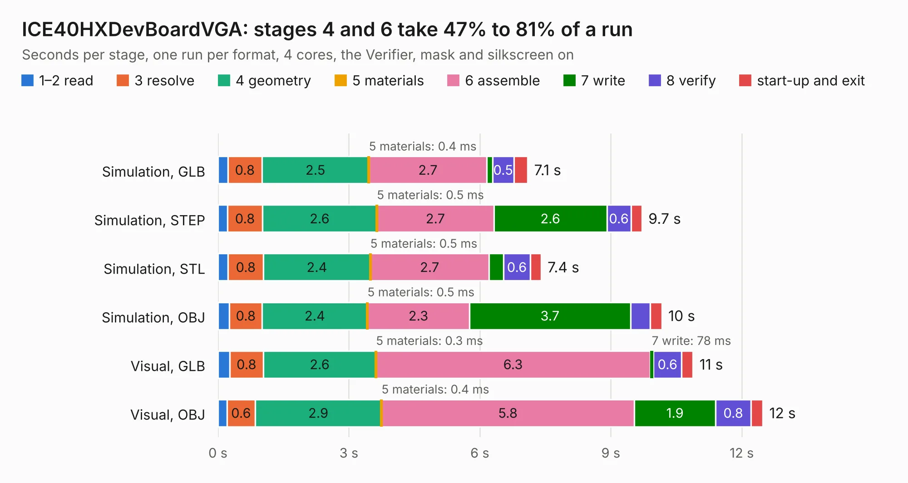

# 428. ICE40HXDevBoardVGA

Board 428 of the 3,125 of [Corpus Testing](../Corpus-Testing.md), on [Corpus Page 4](../CorpusTestingPages/Corpus-Testing-04.md#428-ice40hxdevboardvga).

| Mode and format | 1–2 read | 3 resolve | 4 geometry | 5 materials | 6 assemble | 7 write | 8 verify | start-up and exit | Total |
|---|---:|---:|---:|---:|---:|---:|---:|---:|---:|
| Simulation, GLB | 0.2 | 0.8 | 2.5 | 0.4&nbsp;ms | 2.7 | 0.1 | 0.5 | 0.3 | 7.1 |
| Simulation, STEP | 0.2 | 0.8 | 2.6 | 0.5&nbsp;ms | 2.7 | 2.6 | 0.6 | 0.3 | 9.7 |
| Simulation, STL | 0.2 | 0.8 | 2.4 | 0.5&nbsp;ms | 2.7 | 0.3 | 0.6 | 0.2 | 7.4 |
| Simulation, OBJ | 0.3 | 0.8 | 2.4 | 0.5&nbsp;ms | 2.3 | 3.7 | 0.4 | 0.3 | 10.2 |
| Visual, GLB | 0.3 | 0.8 | 2.6 | 0.3&nbsp;ms | 6.3 | 78&nbsp;ms | 0.6 | 0.3 | 10.9 |
| Visual, OBJ | 0.2 | 0.6 | 2.9 | 0.4&nbsp;ms | 5.8 | 1.9 | 0.8 | 0.3 | 12.5 |

<table align="center"><tr><td valign="top">

| Board | Repo: [aslak3/ICE40HXDevBoard](https://github.com/aslak3/ICE40HXDevBoard) Board: `ICE40HXDevBoardVGA.kicad_pcb` |
|---|---|
| Folder | ExpansionCards / ICE40HXDevBoardVGA |
| Complexity | 299&nbsp;/&nbsp;1000 (size&nbsp;214, features&nbsp;85) |
| KESE&nbsp;features | through vias, rounded, trapezoid or chamfered pads, filled zones, curved board outline, stack-up, dielectric εr and tanδ |
| Tested | 9th November 2026 |
| Copper&nbsp;layers | 4 |
| File&nbsp;format | KiCad 9 (20241229) |
| Parts,&nbsp;tracks,&nbsp;vias | 36, 379, 39 |
| Triangles,&nbsp;simulation | 765,242 in 78 parts |
| Verifier | PASS in all six runs |

</td><td valign="top">

<table>
<tr><th>File type</th><th>File size</th><th>Peak memory used</th></tr>
<tr><th colspan="3" align="left">Simulation</th></tr>
<tr><td>GLB</td><td align="right">26&nbsp;MB</td><td align="right">346&nbsp;MB</td></tr>
<tr><td>STEP</td><td align="right">89&nbsp;MB</td><td align="right">392&nbsp;MB</td></tr>
<tr><td>STL</td><td align="right">38&nbsp;MB</td><td align="right">357&nbsp;MB</td></tr>
<tr><td>OBJ</td><td align="right">77&nbsp;MB</td><td align="right">553&nbsp;MB</td></tr>
<tr><th colspan="3" align="left">Visual</th></tr>
<tr><td>GLB</td><td align="right">15&nbsp;MB</td><td align="right">431&nbsp;MB</td></tr>
<tr><td>OBJ</td><td align="right">43&nbsp;MB</td><td align="right">411&nbsp;MB</td></tr>
</table>

</td></tr></table>

| Previous | Next |
|:---|---:|
| [427. ICE40HXDevBoardHDMI](b0427b_ICE40HXDevBoard_ICE40HXDevBoardHDMI.md) | [429. ICE40HXDevBoard](b0429b_ICE40HXDevBoard_ICE40HXDevBoard.md) |
