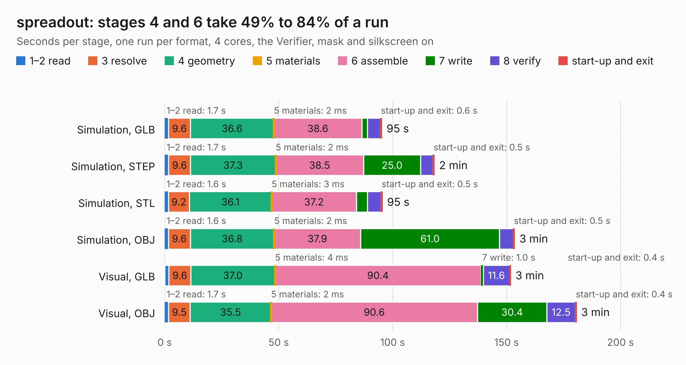

# 428. spreadout

Board 428 of the 3,100 of [Corpus Testing](../Corpus-Testing.md), on [Corpus Page 4](../CorpusTestingPages/Corpus-Testing-04.md#428-spreadout).

| Mode and format | 1–2 read | 3 resolve | 4 geometry | 5 materials | 6 assemble | 7 write | 8 verify | start-up and exit | Total |
|---|---:|---:|---:|---:|---:|---:|---:|---:|---:|
| Simulation, GLB | 1.7 | 9.6 | 36.6 | 2&nbsp;ms | 38.6 | 2.4 | 5.7 | 0.6 | 95.2 |
| Simulation, STEP | 1.7 | 9.6 | 37.3 | 2&nbsp;ms | 38.5 | 25.0 | 5.4 | 0.5 | 118.3 |
| Simulation, STL | 1.6 | 9.2 | 36.1 | 3&nbsp;ms | 37.2 | 4.9 | 5.9 | 0.5 | 95.4 |
| Simulation, OBJ | 1.6 | 9.6 | 36.8 | 2&nbsp;ms | 37.9 | 61.0 | 6.0 | 0.5 | 153.5 |
| Visual, GLB | 1.9 | 9.6 | 37.0 | 4&nbsp;ms | 90.4 | 1.0 | 11.6 | 0.4 | 151.8 |
| Visual, OBJ | 1.7 | 9.5 | 35.5 | 2&nbsp;ms | 90.6 | 30.4 | 12.5 | 0.4 | 180.6 |

<table align="center"><tr><td valign="top">

| Board | Repo: [aslak3/maxi030](https://github.com/aslak3/maxi030) Board: `spreadout.kicad_pcb` |
|---|---|
| Complexity | 352&nbsp;/&nbsp;1000 (size&nbsp;297, features&nbsp;55) |
| KESE&nbsp;features | through vias, slotted holes, rounded, trapezoid or chamfered pads, filled zones |
| Tested | 9th November 2026 |
| Copper&nbsp;layers | 4 |
| File&nbsp;format | KiCad 5 (20171130) |
| Parts,&nbsp;tracks,&nbsp;vias | 187, 7,565, 880 |
| Triangles,&nbsp;simulation | 10,283,014 in 455 parts |
| Verifier | PASS in all six runs |

</td><td valign="top">

<table>
<tr><th>File type</th><th>File size</th><th>Peak memory used</th></tr>
<tr><th colspan="3" align="left">Simulation</th></tr>
<tr><td>GLB</td><td align="right">347&nbsp;MB</td><td align="right">2.7&nbsp;GB</td></tr>
<tr><td>STEP</td><td align="right">1.2&nbsp;GB</td><td align="right">3.2&nbsp;GB</td></tr>
<tr><td>STL</td><td align="right">514&nbsp;MB</td><td align="right">2.5&nbsp;GB</td></tr>
<tr><td>OBJ</td><td align="right">1.1&nbsp;GB</td><td align="right">6.3&nbsp;GB</td></tr>
<tr><th colspan="3" align="left">Visual</th></tr>
<tr><td>GLB</td><td align="right">185&nbsp;MB</td><td align="right">3.1&nbsp;GB</td></tr>
<tr><td>OBJ</td><td align="right">607&nbsp;MB</td><td align="right">3.8&nbsp;GB</td></tr>
</table>

</td></tr></table>

| Previous | Next |
|:---|---:|
| [427. MAXI030](b0427b_maxi030_MAXI030.md) | [429. CTRL_L](b0429b_4ds_CTRL-L.md) |
