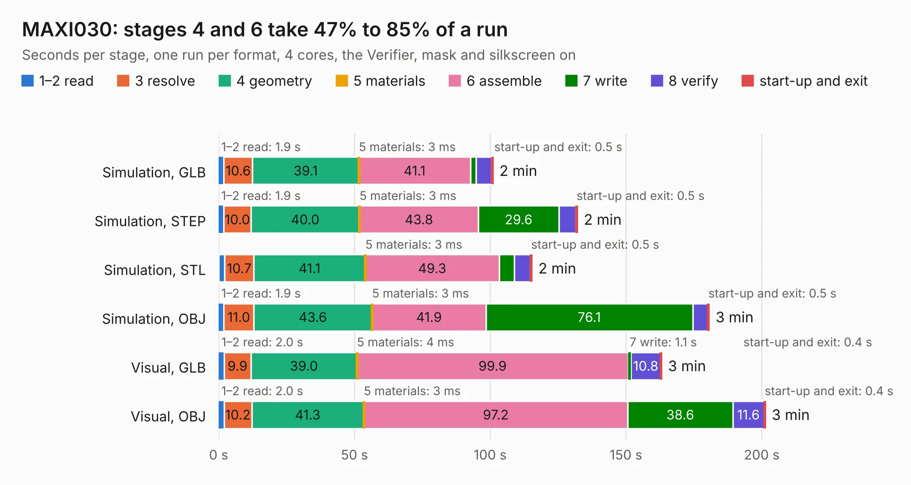

# 430. MAXI030

Board 430 of the 3,112 of [Corpus Testing](../Corpus-Testing.md), on [Corpus Page 4](../CorpusTestingPages/Corpus-Testing-04.md#430-maxi030).

| Mode and format | 1–2 read | 3 resolve | 4 geometry | 5 materials | 6 assemble | 7 write | 8 verify | start-up and exit | Total |
|---|---:|---:|---:|---:|---:|---:|---:|---:|---:|
| Simulation, GLB | 1.9 | 10.6 | 39.1 | 3&nbsp;ms | 41.1 | 2.0 | 5.8 | 0.5 | 101.0 |
| Simulation, STEP | 1.9 | 10.0 | 40.0 | 3&nbsp;ms | 43.8 | 29.6 | 6.2 | 0.5 | 132.1 |
| Simulation, STL | 2.2 | 10.7 | 41.1 | 3&nbsp;ms | 49.3 | 5.6 | 5.9 | 0.5 | 115.3 |
| Simulation, OBJ | 1.9 | 11.0 | 43.6 | 3&nbsp;ms | 41.9 | 76.1 | 5.6 | 0.5 | 180.6 |
| Visual, GLB | 2.0 | 9.9 | 39.0 | 4&nbsp;ms | 99.9 | 1.1 | 10.8 | 0.4 | 163.1 |
| Visual, OBJ | 2.0 | 10.2 | 41.3 | 3&nbsp;ms | 97.2 | 38.6 | 11.6 | 0.4 | 201.3 |

<table align="center"><tr><td valign="top">

| Board | Repo: [aslak3/maxi030](https://github.com/aslak3/maxi030) Board: `MAXI030.kicad_pcb` |
|---|---|
| Complexity | 353&nbsp;/&nbsp;1000 (size&nbsp;298, features&nbsp;55) |
| KESE&nbsp;features | through vias, slotted holes, rounded, trapezoid or chamfered pads, filled zones |
| Tested | 9th November 2026 |
| Copper&nbsp;layers | 4 |
| File&nbsp;format | KiCad 6 (20211014) |
| Parts,&nbsp;tracks,&nbsp;vias | 194, 7,695, 923 |
| Triangles,&nbsp;simulation | 10,527,020 in 457 parts |
| Verifier | PASS in all six runs |

</td><td valign="top">

<table>
<tr><th>File type</th><th>File size</th><th>Peak memory used</th></tr>
<tr><th colspan="3" align="left">Simulation</th></tr>
<tr><td>GLB</td><td align="right">356&nbsp;MB</td><td align="right">2.3&nbsp;GB</td></tr>
<tr><td>STEP</td><td align="right">1.2&nbsp;GB</td><td align="right">3.3&nbsp;GB</td></tr>
<tr><td>STL</td><td align="right">526&nbsp;MB</td><td align="right">2.7&nbsp;GB</td></tr>
<tr><td>OBJ</td><td align="right">1.1&nbsp;GB</td><td align="right">6.5&nbsp;GB</td></tr>
<tr><th colspan="3" align="left">Visual</th></tr>
<tr><td>GLB</td><td align="right">191&nbsp;MB</td><td align="right">3.1&nbsp;GB</td></tr>
<tr><td>OBJ</td><td align="right">626&nbsp;MB</td><td align="right">4.0&nbsp;GB</td></tr>
</table>

</td></tr></table>

| Previous | Next |
|:---|---:|
| [429. Video+Sound](b0429b_maxi030_Video-Sound.md) | [431. spreadout](b0431b_maxi030_spreadout.md) |
