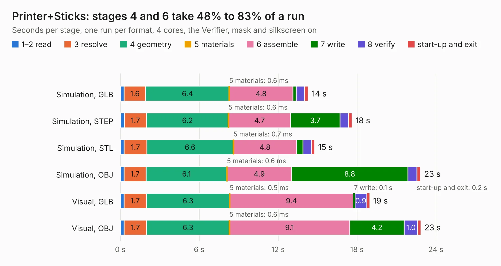

# 430. Printer+Sticks

Board 430 of the 3,118 of [Corpus Testing](../Corpus-Testing.md), on [Corpus Page 4](../CorpusTestingPages/Corpus-Testing-04.md#430-printersticks).

| Mode and format | 1–2 read | 3 resolve | 4 geometry | 5 materials | 6 assemble | 7 write | 8 verify | start-up and exit | Total |
|---|---:|---:|---:|---:|---:|---:|---:|---:|---:|
| Simulation, GLB | 0.3 | 1.6 | 6.4 | 0.6&nbsp;ms | 4.8 | 0.2 | 0.6 | 0.3 | 14.3 |
| Simulation, STEP | 0.3 | 1.7 | 6.2 | 0.6&nbsp;ms | 4.7 | 3.7 | 0.7 | 0.3 | 17.6 |
| Simulation, STL | 0.3 | 1.7 | 6.6 | 0.7&nbsp;ms | 4.8 | 0.5 | 0.7 | 0.2 | 14.8 |
| Simulation, OBJ | 0.3 | 1.7 | 6.1 | 0.6&nbsp;ms | 4.9 | 8.8 | 0.7 | 0.3 | 22.8 |
| Visual, GLB | 0.3 | 1.7 | 6.3 | 0.5&nbsp;ms | 9.4 | 0.1 | 0.9 | 0.2 | 19.0 |
| Visual, OBJ | 0.3 | 1.7 | 6.3 | 0.6&nbsp;ms | 9.1 | 4.2 | 1.0 | 0.2 | 22.9 |

<table align="center"><tr><td valign="top">

| Board | Repo: [aslak3/maxi030](https://github.com/aslak3/maxi030) Board: `Printer+Sticks.kicad_pcb` |
|---|---|
| Folder | ExpansionCards / Printer+Sticks |
| Complexity | 269&nbsp;/&nbsp;1000 (size&nbsp;224, features&nbsp;45) |
| KESE&nbsp;features | through vias, rounded, trapezoid or chamfered pads, filled zones |
| Tested | 9th November 2026 |
| Copper&nbsp;layers | 4 |
| File&nbsp;format | KiCad 6 (20211014) |
| Parts,&nbsp;tracks,&nbsp;vias | 26, 810, 98 |
| Triangles,&nbsp;simulation | 1,489,044 in 88 parts |
| Verifier | PASS in all six runs |

</td><td valign="top">

<table>
<tr><th>File type</th><th>File size</th><th>Peak memory used</th></tr>
<tr><th colspan="3" align="left">Simulation</th></tr>
<tr><td>GLB</td><td align="right">52&nbsp;MB</td><td align="right">526&nbsp;MB</td></tr>
<tr><td>STEP</td><td align="right">196&nbsp;MB</td><td align="right">596&nbsp;MB</td></tr>
<tr><td>STL</td><td align="right">74&nbsp;MB</td><td align="right">502&nbsp;MB</td></tr>
<tr><td>OBJ</td><td align="right">155&nbsp;MB</td><td align="right">1.0&nbsp;GB</td></tr>
<tr><th colspan="3" align="left">Visual</th></tr>
<tr><td>GLB</td><td align="right">25&nbsp;MB</td><td align="right">606&nbsp;MB</td></tr>
<tr><td>OBJ</td><td align="right">75&nbsp;MB</td><td align="right">604&nbsp;MB</td></tr>
</table>

</td></tr></table>

| Previous | Next |
|:---|---:|
| [429. ICE40UPDevBoard](b0429b_ICE40UPDevBoard_ICE40UPDevBoard.md) | [431. TestSRAM](b0431b_maxi030_TestSRAM.md) |
