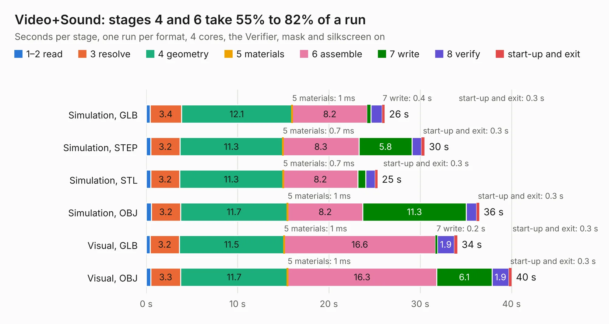

# 430. Video+Sound

Board 430 of the 3,116 of [Corpus Testing](../Corpus-Testing.md), on [Corpus Page 4](../CorpusTestingPages/Corpus-Testing-04.md#430-videosound).

| Mode and format | 1–2 read | 3 resolve | 4 geometry | 5 materials | 6 assemble | 7 write | 8 verify | start-up and exit | Total |
|---|---:|---:|---:|---:|---:|---:|---:|---:|---:|
| Simulation, GLB | 0.4 | 3.4 | 12.1 | 1&nbsp;ms | 8.2 | 0.4 | 1.2 | 0.3 | 26.1 |
| Simulation, STEP | 0.5 | 3.2 | 11.3 | 0.7&nbsp;ms | 8.3 | 5.8 | 1.0 | 0.3 | 30.5 |
| Simulation, STL | 0.5 | 3.2 | 11.3 | 0.7&nbsp;ms | 8.2 | 0.9 | 1.0 | 0.3 | 25.3 |
| Simulation, OBJ | 0.6 | 3.2 | 11.7 | 1&nbsp;ms | 8.2 | 11.3 | 1.1 | 0.3 | 36.5 |
| Visual, GLB | 0.4 | 3.2 | 11.5 | 1&nbsp;ms | 16.6 | 0.2 | 1.9 | 0.3 | 34.1 |
| Visual, OBJ | 0.5 | 3.3 | 11.7 | 1&nbsp;ms | 16.3 | 6.1 | 1.9 | 0.3 | 40.0 |

<table align="center"><tr><td valign="top">

| Board | Repo: [aslak3/maxi030](https://github.com/aslak3/maxi030) Board: `Video+Sound.kicad_pcb` |
|---|---|
| Folder | ExpansionCards / Video+Sound |
| Complexity | 303&nbsp;/&nbsp;1000 (size&nbsp;258, features&nbsp;45) |
| KESE&nbsp;features | through vias, rounded, trapezoid or chamfered pads, filled zones |
| Tested | 9th November 2026 |
| Copper&nbsp;layers | 4 |
| File&nbsp;format | KiCad 6 (20211014) |
| Parts,&nbsp;tracks,&nbsp;vias | 100, 2,044, 147 |
| Triangles,&nbsp;simulation | 2,109,506 in 231 parts |
| Verifier | PASS in all six runs |

</td><td valign="top">

<table>
<tr><th>File type</th><th>File size</th><th>Peak memory used</th></tr>
<tr><th colspan="3" align="left">Simulation</th></tr>
<tr><td>GLB</td><td align="right">74&nbsp;MB</td><td align="right">724&nbsp;MB</td></tr>
<tr><td>STEP</td><td align="right">350&nbsp;MB</td><td align="right">866&nbsp;MB</td></tr>
<tr><td>STL</td><td align="right">105&nbsp;MB</td><td align="right">716&nbsp;MB</td></tr>
<tr><td>OBJ</td><td align="right">226&nbsp;MB</td><td align="right">1.5&nbsp;GB</td></tr>
<tr><th colspan="3" align="left">Visual</th></tr>
<tr><td>GLB</td><td align="right">41&nbsp;MB</td><td align="right">830&nbsp;MB</td></tr>
<tr><td>OBJ</td><td align="right">125&nbsp;MB</td><td align="right">922&nbsp;MB</td></tr>
</table>

</td></tr></table>

| Previous | Next |
|:---|---:|
| [429. TestSRAM](b0429b_maxi030_TestSRAM.md) | [431. MAXI030](b0431b_maxi030_MAXI030.md) |
