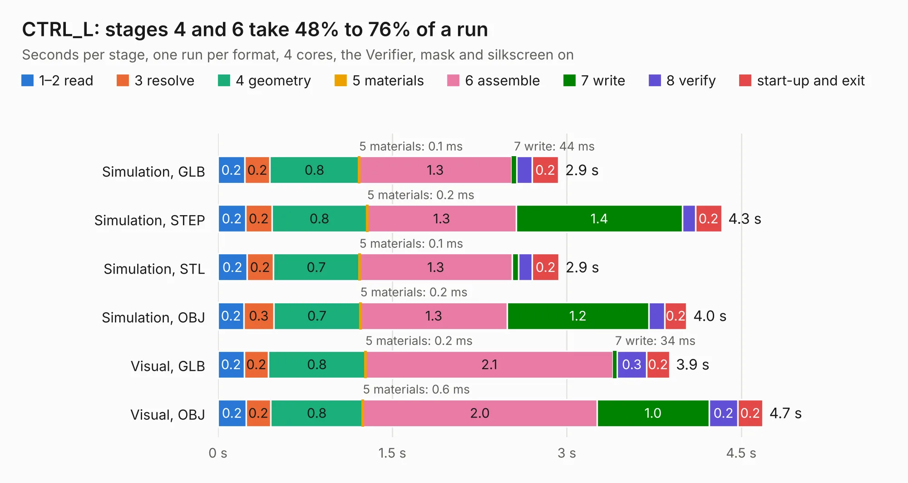

# 431. CTRL_L

Board 431 of the 3,109 of [Corpus Testing](../Corpus-Testing.md), on [Corpus Page 4](../CorpusTestingPages/Corpus-Testing-04.md#431-ctrl_l).

| Mode and format | 1–2 read | 3 resolve | 4 geometry | 5 materials | 6 assemble | 7 write | 8 verify | start-up and exit | Total |
|---|---:|---:|---:|---:|---:|---:|---:|---:|---:|
| Simulation, GLB | 0.2 | 0.2 | 0.8 | 0.1&nbsp;ms | 1.3 | 44&nbsp;ms | 0.1 | 0.2 | 2.9 |
| Simulation, STEP | 0.2 | 0.2 | 0.8 | 0.2&nbsp;ms | 1.3 | 1.4 | 0.1 | 0.2 | 4.3 |
| Simulation, STL | 0.2 | 0.2 | 0.7 | 0.1&nbsp;ms | 1.3 | 56&nbsp;ms | 0.1 | 0.2 | 2.9 |
| Simulation, OBJ | 0.2 | 0.3 | 0.7 | 0.2&nbsp;ms | 1.3 | 1.2 | 0.1 | 0.2 | 4.0 |
| Visual, GLB | 0.2 | 0.2 | 0.8 | 0.2&nbsp;ms | 2.1 | 34&nbsp;ms | 0.3 | 0.2 | 3.9 |
| Visual, OBJ | 0.2 | 0.2 | 0.8 | 0.6&nbsp;ms | 2.0 | 1.0 | 0.2 | 0.2 | 4.7 |

<table align="center"><tr><td valign="top">

| Board | Repo: [astronuat21/4ds](https://github.com/astronuat21/4ds) Board: `CTRL_L.kicad_pcb` |
|---|---|
| Folder | CTRL_L |
| Complexity | 189&nbsp;/&nbsp;1000 (size&nbsp;144, features&nbsp;45) |
| KESE&nbsp;features | through vias, rounded, trapezoid or chamfered pads, filled zones |
| Tested | 9th November 2026 |
| Copper&nbsp;layers | 2 |
| File&nbsp;format | KiCad 10 (20260206) |
| Parts,&nbsp;tracks,&nbsp;vias | 25, 192, 26 |
| Triangles,&nbsp;simulation | 197,174 in 30 parts |
| Verifier | PASS in all six runs |

</td><td valign="top">

<table>
<tr><th>File type</th><th>File size</th><th>Peak memory used</th></tr>
<tr><th colspan="3" align="left">Simulation</th></tr>
<tr><td>GLB</td><td align="right">6.9&nbsp;MB</td><td align="right">229&nbsp;MB</td></tr>
<tr><td>STEP</td><td align="right">39&nbsp;MB</td><td align="right">247&nbsp;MB</td></tr>
<tr><td>STL</td><td align="right">9.9&nbsp;MB</td><td align="right">227&nbsp;MB</td></tr>
<tr><td>OBJ</td><td align="right">20&nbsp;MB</td><td align="right">226&nbsp;MB</td></tr>
<tr><th colspan="3" align="left">Visual</th></tr>
<tr><td>GLB</td><td align="right">6.0&nbsp;MB</td><td align="right">234&nbsp;MB</td></tr>
<tr><td>OBJ</td><td align="right">17&nbsp;MB</td><td align="right">237&nbsp;MB</td></tr>
</table>

</td></tr></table>

| Previous | Next |
|:---|---:|
| [430. spreadout](b0430b_maxi030_spreadout.md) | [432. CTRL_panelized](b0432b_4ds_CTRL-panelized.md) |
