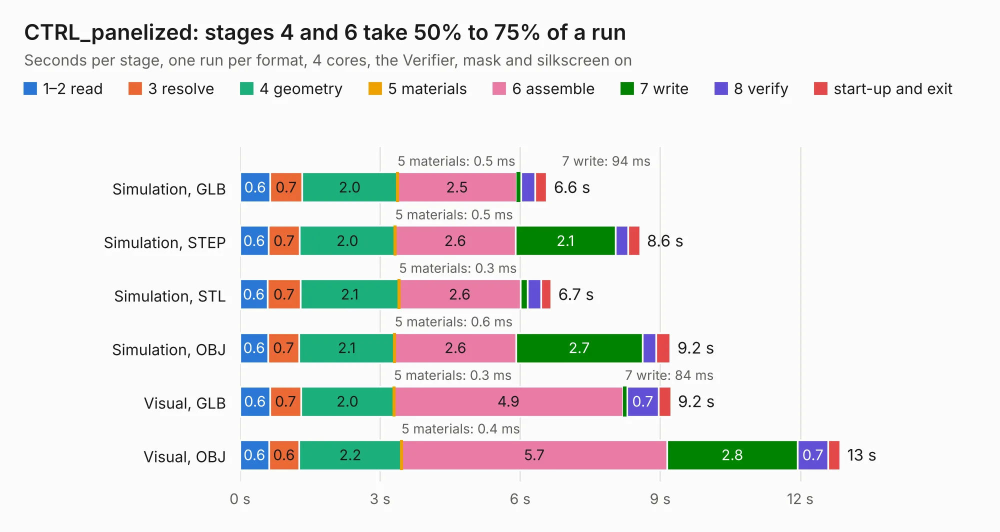

# 432. CTRL_panelized

Board 432 of the 3,109 of [Corpus Testing](../Corpus-Testing.md), on [Corpus Page 4](../CorpusTestingPages/Corpus-Testing-04.md#432-ctrl_panelized).

| Mode and format | 1–2 read | 3 resolve | 4 geometry | 5 materials | 6 assemble | 7 write | 8 verify | start-up and exit | Total |
|---|---:|---:|---:|---:|---:|---:|---:|---:|---:|
| Simulation, GLB | 0.6 | 0.7 | 2.0 | 0.5&nbsp;ms | 2.5 | 94&nbsp;ms | 0.3 | 0.2 | 6.6 |
| Simulation, STEP | 0.6 | 0.7 | 2.0 | 0.5&nbsp;ms | 2.6 | 2.1 | 0.3 | 0.2 | 8.6 |
| Simulation, STL | 0.6 | 0.7 | 2.1 | 0.3&nbsp;ms | 2.6 | 0.2 | 0.3 | 0.2 | 6.7 |
| Simulation, OBJ | 0.6 | 0.7 | 2.1 | 0.6&nbsp;ms | 2.6 | 2.7 | 0.3 | 0.3 | 9.2 |
| Visual, GLB | 0.6 | 0.7 | 2.0 | 0.3&nbsp;ms | 4.9 | 84&nbsp;ms | 0.7 | 0.3 | 9.2 |
| Visual, OBJ | 0.6 | 0.6 | 2.2 | 0.4&nbsp;ms | 5.7 | 2.8 | 0.7 | 0.3 | 12.9 |

<table align="center"><tr><td valign="top">

| Board | Repo: [astronuat21/4ds](https://github.com/astronuat21/4ds) Board: `CTRL_panelized.kicad_pcb` |
|---|---|
| Folder | CTRL_Panelized |
| Complexity | 197&nbsp;/&nbsp;1000 (size&nbsp;172, features&nbsp;25) |
| KESE&nbsp;features | through vias, rounded, trapezoid or chamfered pads |
| Tested | 9th November 2026 |
| Copper&nbsp;layers | 2 |
| File&nbsp;format | KiCad 10 (20260206) |
| Parts,&nbsp;tracks,&nbsp;vias | 80, 494, 78 |
| Triangles,&nbsp;simulation | 545,574 in 47 parts |
| Note | panel |
| Verifier | PASS in all six runs |

</td><td valign="top">

<table>
<tr><th>File type</th><th>File size</th><th>Peak memory used</th></tr>
<tr><th colspan="3" align="left">Simulation</th></tr>
<tr><td>GLB</td><td align="right">19&nbsp;MB</td><td align="right">332&nbsp;MB</td></tr>
<tr><td>STEP</td><td align="right">90&nbsp;MB</td><td align="right">403&nbsp;MB</td></tr>
<tr><td>STL</td><td align="right">27&nbsp;MB</td><td align="right">328&nbsp;MB</td></tr>
<tr><td>OBJ</td><td align="right">56&nbsp;MB</td><td align="right">424&nbsp;MB</td></tr>
<tr><th colspan="3" align="left">Visual</th></tr>
<tr><td>GLB</td><td align="right">17&nbsp;MB</td><td align="right">433&nbsp;MB</td></tr>
<tr><td>OBJ</td><td align="right">51&nbsp;MB</td><td align="right">492&nbsp;MB</td></tr>
</table>

</td></tr></table>

| Previous | Next |
|:---|---:|
| [431. CTRL_L](b0431b_4ds_CTRL-L.md) | [433. CTRL_PWR](b0433b_4ds_CTRL-PWR.md) |
