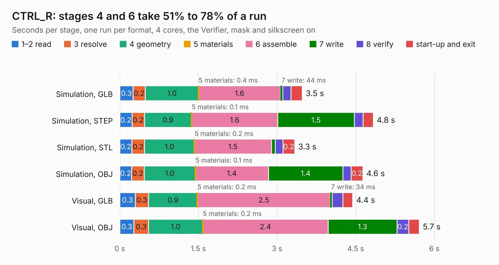

# 434. CTRL_R

Board 434 of the 3,111 of [Corpus Testing](../Corpus-Testing.md), on [Corpus Page 5](../CorpusTestingPages/Corpus-Testing-05.md#434-ctrl_r).

| Mode and format | 1–2 read | 3 resolve | 4 geometry | 5 materials | 6 assemble | 7 write | 8 verify | start-up and exit | Total |
|---|---:|---:|---:|---:|---:|---:|---:|---:|---:|
| Simulation, GLB | 0.3 | 0.2 | 1.0 | 0.4&nbsp;ms | 1.6 | 44&nbsp;ms | 0.2 | 0.2 | 3.5 |
| Simulation, STEP | 0.2 | 0.2 | 0.9 | 0.1&nbsp;ms | 1.6 | 1.5 | 0.2 | 0.2 | 4.8 |
| Simulation, STL | 0.2 | 0.2 | 1.0 | 0.2&nbsp;ms | 1.5 | 72&nbsp;ms | 0.1 | 0.2 | 3.3 |
| Simulation, OBJ | 0.2 | 0.2 | 1.0 | 0.1&nbsp;ms | 1.4 | 1.4 | 0.2 | 0.2 | 4.6 |
| Visual, GLB | 0.3 | 0.3 | 0.9 | 0.2&nbsp;ms | 2.5 | 34&nbsp;ms | 0.2 | 0.2 | 4.4 |
| Visual, OBJ | 0.3 | 0.3 | 1.0 | 0.2&nbsp;ms | 2.4 | 1.3 | 0.2 | 0.2 | 5.7 |

<table align="center"><tr><td valign="top">

| Board | Repo: [astronuat21/4ds](https://github.com/astronuat21/4ds) Board: `CTRL_R.kicad_pcb` |
|---|---|
| Folder | CTRL_R |
| Complexity | 193&nbsp;/&nbsp;1000 (size&nbsp;148, features&nbsp;45) |
| KESE&nbsp;features | through vias, rounded, trapezoid or chamfered pads, filled zones |
| Tested | 9th November 2026 |
| Copper&nbsp;layers | 2 |
| File&nbsp;format | KiCad 10 (20260206) |
| Parts,&nbsp;tracks,&nbsp;vias | 28, 217, 34 |
| Triangles,&nbsp;simulation | 257,380 in 33 parts |
| Verifier | PASS in all six runs |

</td><td valign="top">

<table>
<tr><th>File type</th><th>File size</th><th>Peak memory used</th></tr>
<tr><th colspan="3" align="left">Simulation</th></tr>
<tr><td>GLB</td><td align="right">9.0&nbsp;MB</td><td align="right">247&nbsp;MB</td></tr>
<tr><td>STEP</td><td align="right">50&nbsp;MB</td><td align="right">279&nbsp;MB</td></tr>
<tr><td>STL</td><td align="right">13&nbsp;MB</td><td align="right">248&nbsp;MB</td></tr>
<tr><td>OBJ</td><td align="right">26&nbsp;MB</td><td align="right">248&nbsp;MB</td></tr>
<tr><th colspan="3" align="left">Visual</th></tr>
<tr><td>GLB</td><td align="right">7.8&nbsp;MB</td><td align="right">272&nbsp;MB</td></tr>
<tr><td>OBJ</td><td align="right">23&nbsp;MB</td><td align="right">275&nbsp;MB</td></tr>
</table>

</td></tr></table>

| Previous | Next |
|:---|---:|
| [433. CTRL_PWR](b0433b_4ds_CTRL-PWR.md) | [435. CTRL_Z](b0435b_4ds_CTRL-Z.md) |
