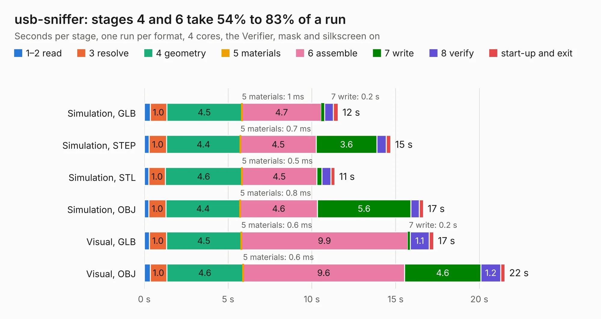

# 437. usb-sniffer

Board 437 of the 3,105 of [Corpus Testing](../Corpus-Testing.md), on [Corpus Page 5](../CorpusTestingPages/Corpus-Testing-05.md#437-usb-sniffer).

| Mode and format | 1–2 read | 3 resolve | 4 geometry | 5 materials | 6 assemble | 7 write | 8 verify | start-up and exit | Total |
|---|---:|---:|---:|---:|---:|---:|---:|---:|---:|
| Simulation, GLB | 0.4 | 1.0 | 4.5 | 1&nbsp;ms | 4.7 | 0.2 | 0.5 | 0.3 | 11.6 |
| Simulation, STEP | 0.3 | 1.0 | 4.4 | 0.7&nbsp;ms | 4.5 | 3.6 | 0.6 | 0.3 | 14.7 |
| Simulation, STL | 0.3 | 1.0 | 4.6 | 0.5&nbsp;ms | 4.5 | 0.3 | 0.5 | 0.2 | 11.4 |
| Simulation, OBJ | 0.3 | 1.0 | 4.4 | 0.8&nbsp;ms | 4.6 | 5.6 | 0.5 | 0.2 | 16.7 |
| Visual, GLB | 0.3 | 1.0 | 4.5 | 0.6&nbsp;ms | 9.9 | 0.2 | 1.1 | 0.3 | 17.3 |
| Visual, OBJ | 0.4 | 1.0 | 4.6 | 0.6&nbsp;ms | 9.6 | 4.6 | 1.2 | 0.3 | 21.5 |

<table align="center"><tr><td valign="top">

| Board | Repo: [ataradov/usb-sniffer](https://github.com/ataradov/usb-sniffer) Board: `usb-sniffer.kicad_pcb` |
|---|---|
| Folder | hardware |
| Complexity | 332&nbsp;/&nbsp;1000 (size&nbsp;227, features&nbsp;105) |
| KESE&nbsp;features | through vias, slotted holes, rounded, trapezoid or chamfered pads, filled zones, copper text, curved board outline, stack-up, dielectric εr and tanδ |
| Tested | 9th November 2026 |
| Copper&nbsp;layers | 2 |
| File&nbsp;format | KiCad 7 (20221018) |
| Parts,&nbsp;tracks,&nbsp;vias | 72, 601, 220 |
| Triangles,&nbsp;simulation | 1,085,510 in 136 parts |
| Verifier | PASS in all six runs |

</td><td valign="top">

<table>
<tr><th>File type</th><th>File size</th><th>Peak memory used</th></tr>
<tr><th colspan="3" align="left">Simulation</th></tr>
<tr><td>GLB</td><td align="right">37&nbsp;MB</td><td align="right">489&nbsp;MB</td></tr>
<tr><td>STEP</td><td align="right">194&nbsp;MB</td><td align="right">628&nbsp;MB</td></tr>
<tr><td>STL</td><td align="right">54&nbsp;MB</td><td align="right">491&nbsp;MB</td></tr>
<tr><td>OBJ</td><td align="right">110&nbsp;MB</td><td align="right">797&nbsp;MB</td></tr>
<tr><th colspan="3" align="left">Visual</th></tr>
<tr><td>GLB</td><td align="right">32&nbsp;MB</td><td align="right">706&nbsp;MB</td></tr>
<tr><td>OBJ</td><td align="right">96&nbsp;MB</td><td align="right">728&nbsp;MB</td></tr>
</table>

</td></tr></table>

| Previous | Next |
|:---|---:|
| [436. Motherboard](b0436b_4ds_Motherboard.md) | [438. usb-sniffer-lite](b0438b_usb-sniffer-lite_usb-sniffer-lite.md) |
