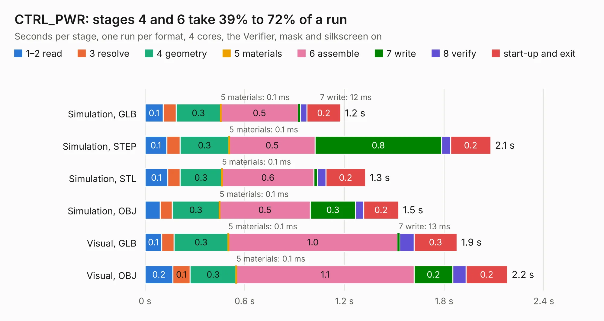

# 438. CTRL_PWR

Board 438 of the 3,129 of [Corpus Testing](../Corpus-Testing.md), on [Corpus Page 5](../CorpusTestingPages/Corpus-Testing-05.md#438-ctrl_pwr).

| Mode and format | 1–2 read | 3 resolve | 4 geometry | 5 materials | 6 assemble | 7 write | 8 verify | start-up and exit | Total |
|---|---:|---:|---:|---:|---:|---:|---:|---:|---:|
| Simulation, GLB | 0.1 | 78&nbsp;ms | 0.3 | 0.1&nbsp;ms | 0.5 | 12&nbsp;ms | 41&nbsp;ms | 0.2 | 1.2 |
| Simulation, STEP | 0.1 | 80&nbsp;ms | 0.3 | 0.1&nbsp;ms | 0.5 | 0.8 | 55&nbsp;ms | 0.2 | 2.1 |
| Simulation, STL | 0.1 | 73&nbsp;ms | 0.3 | 0.1&nbsp;ms | 0.6 | 23&nbsp;ms | 50&nbsp;ms | 0.2 | 1.3 |
| Simulation, OBJ | 90&nbsp;ms | 73&nbsp;ms | 0.3 | 0.1&nbsp;ms | 0.5 | 0.3 | 48&nbsp;ms | 0.2 | 1.5 |
| Visual, GLB | 0.1 | 73&nbsp;ms | 0.3 | 0.1&nbsp;ms | 1.0 | 13&nbsp;ms | 87&nbsp;ms | 0.3 | 1.9 |
| Visual, OBJ | 0.2 | 0.1 | 0.3 | 0.1&nbsp;ms | 1.1 | 0.2 | 79&nbsp;ms | 0.2 | 2.2 |

<table align="center"><tr><td valign="top">

| Board | Repo: [astronuat21/4ds](https://github.com/astronuat21/4ds) Board: `CTRL_PWR.kicad_pcb` |
|---|---|
| Folder | CTRL_PWR |
| Complexity | 137&nbsp;/&nbsp;1000 (size&nbsp;102, features&nbsp;35) |
| KESE&nbsp;features | through vias, filled zones |
| Tested | 9th November 2026 |
| Copper&nbsp;layers | 2 |
| File&nbsp;format | KiCad 10 (20260206) |
| Parts,&nbsp;tracks,&nbsp;vias | 4, 38, 8 |
| Triangles,&nbsp;simulation | 66,856 in 18 parts |
| Verifier | PASS in all six runs |

</td><td valign="top">

<table>
<tr><th>File type</th><th>File size</th><th>Peak memory used</th></tr>
<tr><th colspan="3" align="left">Simulation</th></tr>
<tr><td>GLB</td><td align="right">2.3&nbsp;MB</td><td align="right">171&nbsp;MB</td></tr>
<tr><td>STEP</td><td align="right">11&nbsp;MB</td><td align="right">177&nbsp;MB</td></tr>
<tr><td>STL</td><td align="right">3.3&nbsp;MB</td><td align="right">174&nbsp;MB</td></tr>
<tr><td>OBJ</td><td align="right">6.4&nbsp;MB</td><td align="right">169&nbsp;MB</td></tr>
<tr><th colspan="3" align="left">Visual</th></tr>
<tr><td>GLB</td><td align="right">1.8&nbsp;MB</td><td align="right">151&nbsp;MB</td></tr>
<tr><td>OBJ</td><td align="right">4.9&nbsp;MB</td><td align="right">152&nbsp;MB</td></tr>
</table>

</td></tr></table>

| Previous | Next |
|:---|---:|
| [437. CTRL_panelized](b0437b_4ds_CTRL-panelized.md) | [439. CTRL_R](b0439b_4ds_CTRL-R.md) |
