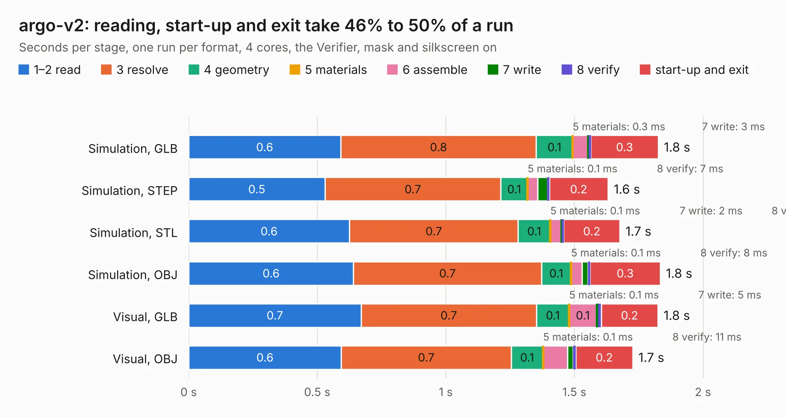

# 439. argo-v2

Board 439 of the 3,102 of [Corpus Testing](../Corpus-Testing.md), on [Corpus Page 5](../CorpusTestingPages/Corpus-Testing-05.md#439-argo-v2).

| Mode and format | 1–2 read | 3 resolve | 4 geometry | 5 materials | 6 assemble | 7 write | 8 verify | start-up and exit | Total |
|---|---:|---:|---:|---:|---:|---:|---:|---:|---:|
| Simulation, GLB | 0.6 | 0.8 | 0.1 | 0.3&nbsp;ms | 60&nbsp;ms | 3&nbsp;ms | 8&nbsp;ms | 0.3 | 1.8 |
| Simulation, STEP | 0.5 | 0.7 | 0.1 | 0.1&nbsp;ms | 39&nbsp;ms | 39&nbsp;ms | 7&nbsp;ms | 0.2 | 1.6 |
| Simulation, STL | 0.6 | 0.7 | 0.1 | 0.1&nbsp;ms | 43&nbsp;ms | 2&nbsp;ms | 7&nbsp;ms | 0.2 | 1.7 |
| Simulation, OBJ | 0.6 | 0.7 | 0.1 | 0.1&nbsp;ms | 43&nbsp;ms | 23&nbsp;ms | 8&nbsp;ms | 0.3 | 1.8 |
| Visual, GLB | 0.7 | 0.7 | 0.1 | 0.1&nbsp;ms | 0.1 | 5&nbsp;ms | 13&nbsp;ms | 0.2 | 1.8 |
| Visual, OBJ | 0.6 | 0.7 | 0.1 | 0.1&nbsp;ms | 95&nbsp;ms | 22&nbsp;ms | 11&nbsp;ms | 0.2 | 1.7 |

<table align="center"><tr><td valign="top">

| Board | Repo: [azlan-works/Argo](https://github.com/azlan-works/Argo) Board: `argo-v2.kicad_pcb` |
|---|---|
| Folder | KiCad |
| Complexity | 325&nbsp;/&nbsp;1000 (size&nbsp;225, features&nbsp;100) |
| KESE&nbsp;features | through vias, slotted holes, custom pads, arc tracks, filled zones, copper drawings, TrueType text |
| Tested | 9th November 2026 |
| Copper&nbsp;layers | 6 |
| File&nbsp;format | KiCad 10 (20260206) |
| Parts,&nbsp;tracks,&nbsp;vias | 79, 2,792, 316 |
| Triangles,&nbsp;simulation | 5,016 in 7 parts |
| Verifier | PASS in all six runs |

</td><td valign="top">

<table>
<tr><th>File type</th><th>File size</th><th>Peak memory used</th></tr>
<tr><th colspan="3" align="left">Simulation</th></tr>
<tr><td>GLB</td><td align="right">106&nbsp;kB</td><td align="right">98&nbsp;MB</td></tr>
<tr><td>STEP</td><td align="right">142&nbsp;kB</td><td align="right">98&nbsp;MB</td></tr>
<tr><td>STL</td><td align="right">251&nbsp;kB</td><td align="right">98&nbsp;MB</td></tr>
<tr><td>OBJ</td><td align="right">448&nbsp;kB</td><td align="right">98&nbsp;MB</td></tr>
<tr><th colspan="3" align="left">Visual</th></tr>
<tr><td>GLB</td><td align="right">113&nbsp;kB</td><td align="right">98&nbsp;MB</td></tr>
<tr><td>OBJ</td><td align="right">342&nbsp;kB</td><td align="right">98&nbsp;MB</td></tr>
</table>

</td></tr></table>

| Previous | Next |
|:---|---:|
| [438. esp32-s3-spectrum](b0438b_esp32-zxspectrum-hardware_esp32-s3-spectrum.md) | [440. entry-afe-characterization](b0440b_starshipraider_entry-afe-characterization.md) |
