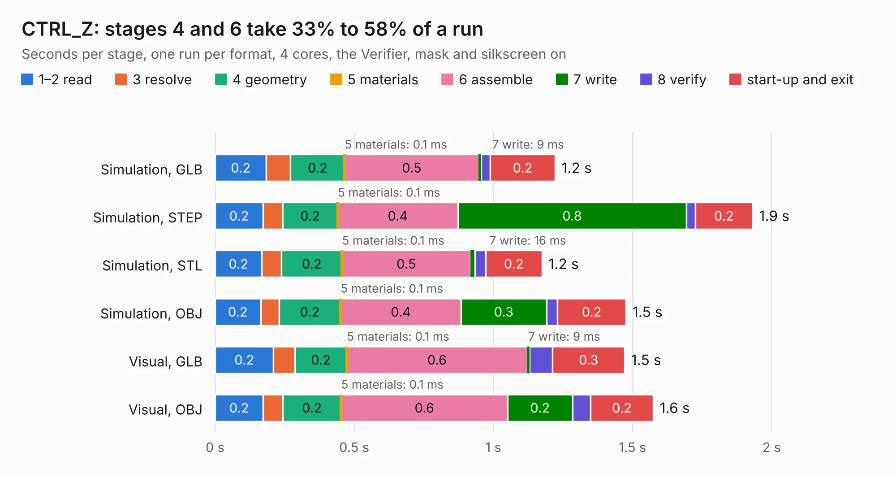

# 441. CTRL_Z

Board 441 of the 3,132 of [Corpus Testing](../Corpus-Testing.md), on [Corpus Page 5](../CorpusTestingPages/Corpus-Testing-05.md#441-ctrl_z).

| Mode and format | 1–2 read | 3 resolve | 4 geometry | 5 materials | 6 assemble | 7 write | 8 verify | start-up and exit | Total |
|---|---:|---:|---:|---:|---:|---:|---:|---:|---:|
| Simulation, GLB | 0.2 | 87&nbsp;ms | 0.2 | 0.1&nbsp;ms | 0.5 | 9&nbsp;ms | 33&nbsp;ms | 0.2 | 1.2 |
| Simulation, STEP | 0.2 | 69&nbsp;ms | 0.2 | 0.1&nbsp;ms | 0.4 | 0.8 | 31&nbsp;ms | 0.2 | 1.9 |
| Simulation, STL | 0.2 | 71&nbsp;ms | 0.2 | 0.1&nbsp;ms | 0.5 | 16&nbsp;ms | 39&nbsp;ms | 0.2 | 1.2 |
| Simulation, OBJ | 0.2 | 66&nbsp;ms | 0.2 | 0.1&nbsp;ms | 0.4 | 0.3 | 39&nbsp;ms | 0.2 | 1.5 |
| Visual, GLB | 0.2 | 76&nbsp;ms | 0.2 | 0.1&nbsp;ms | 0.6 | 9&nbsp;ms | 83&nbsp;ms | 0.3 | 1.5 |
| Visual, OBJ | 0.2 | 70&nbsp;ms | 0.2 | 0.1&nbsp;ms | 0.6 | 0.2 | 65&nbsp;ms | 0.2 | 1.6 |

<table align="center"><tr><td valign="top">

| Board | Repo: [astronuat21/4ds](https://github.com/astronuat21/4ds) Board: `CTRL_Z.kicad_pcb` |
|---|---|
| Folder | CTRL_Z |
| Complexity | 148&nbsp;/&nbsp;1000 (size&nbsp;103, features&nbsp;45) |
| KESE&nbsp;features | through vias, rounded, trapezoid or chamfered pads, filled zones |
| Tested | 9th November 2026 |
| Copper&nbsp;layers | 2 |
| File&nbsp;format | KiCad 10 (20260206) |
| Parts,&nbsp;tracks,&nbsp;vias | 7, 33, 5 |
| Triangles,&nbsp;simulation | 49,064 in 11 parts |
| Verifier | PASS in all six runs |

</td><td valign="top">

<table>
<tr><th>File type</th><th>File size</th><th>Peak memory used</th></tr>
<tr><th colspan="3" align="left">Simulation</th></tr>
<tr><td>GLB</td><td align="right">1.8&nbsp;MB</td><td align="right">75&nbsp;MB</td></tr>
<tr><td>STEP</td><td align="right">9.8&nbsp;MB</td><td align="right">185&nbsp;MB</td></tr>
<tr><td>STL</td><td align="right">2.5&nbsp;MB</td><td align="right">76&nbsp;MB</td></tr>
<tr><td>OBJ</td><td align="right">4.8&nbsp;MB</td><td align="right">87&nbsp;MB</td></tr>
<tr><th colspan="3" align="left">Visual</th></tr>
<tr><td>GLB</td><td align="right">1.6&nbsp;MB</td><td align="right">116&nbsp;MB</td></tr>
<tr><td>OBJ</td><td align="right">4.3&nbsp;MB</td><td align="right">114&nbsp;MB</td></tr>
</table>

</td></tr></table>

| Previous | Next |
|:---|---:|
| [440. CTRL_R](b0440b_4ds_CTRL-R.md) | [442. Motherboard](b0442b_4ds_Motherboard.md) |
