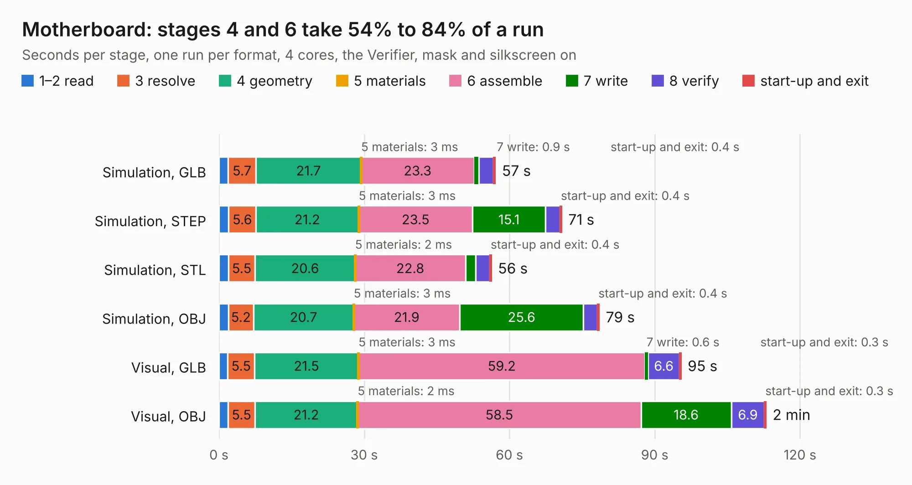

# 441. Motherboard

Board 441 of the 3,125 of [Corpus Testing](../Corpus-Testing.md), on [Corpus Page 5](../CorpusTestingPages/Corpus-Testing-05.md#441-motherboard).

| Mode and format | 1–2 read | 3 resolve | 4 geometry | 5 materials | 6 assemble | 7 write | 8 verify | start-up and exit | Total |
|---|---:|---:|---:|---:|---:|---:|---:|---:|---:|
| Simulation, GLB | 1.9 | 5.7 | 21.7 | 3&nbsp;ms | 23.3 | 0.9 | 3.1 | 0.4 | 57.1 |
| Simulation, STEP | 2.0 | 5.6 | 21.2 | 3&nbsp;ms | 23.5 | 15.1 | 3.0 | 0.4 | 70.8 |
| Simulation, STL | 1.9 | 5.5 | 20.6 | 2&nbsp;ms | 22.8 | 2.2 | 2.9 | 0.4 | 56.3 |
| Simulation, OBJ | 2.0 | 5.2 | 20.7 | 3&nbsp;ms | 21.9 | 25.6 | 2.9 | 0.4 | 78.6 |
| Visual, GLB | 1.8 | 5.5 | 21.5 | 3&nbsp;ms | 59.2 | 0.6 | 6.6 | 0.3 | 95.5 |
| Visual, OBJ | 1.9 | 5.5 | 21.2 | 2&nbsp;ms | 58.5 | 18.6 | 6.9 | 0.3 | 113.0 |

<table align="center"><tr><td valign="top">

| Board | Repo: [astronuat21/4ds](https://github.com/astronuat21/4ds) Board: `Motherboard.kicad_pcb` |
|---|---|
| Folder | Motherboard |
| Complexity | 435&nbsp;/&nbsp;1000 (size&nbsp;280, features&nbsp;155) |
| KESE&nbsp;features | through vias, slotted holes, custom pads, rounded, trapezoid or chamfered pads, arc tracks, filled zones, copper drawings, curved board outline, knockout text, stack-up, dielectric εr and tanδ, mask and silkscreen colours |
| Tested | 9th November 2026 |
| Copper&nbsp;layers | 4 |
| File&nbsp;format | KiCad 10 (20260206) |
| Parts,&nbsp;tracks,&nbsp;vias | 355, 4,274, 657 |
| Triangles,&nbsp;simulation | 5,230,646 in 623 parts |
| Verifier | PASS in all six runs |

</td><td valign="top">

<table>
<tr><th>File type</th><th>File size</th><th>Peak memory used</th></tr>
<tr><th colspan="3" align="left">Simulation</th></tr>
<tr><td>GLB</td><td align="right">181&nbsp;MB</td><td align="right">1.7&nbsp;GB</td></tr>
<tr><td>STEP</td><td align="right">920&nbsp;MB</td><td align="right">2.2&nbsp;GB</td></tr>
<tr><td>STL</td><td align="right">262&nbsp;MB</td><td align="right">1.7&nbsp;GB</td></tr>
<tr><td>OBJ</td><td align="right">566&nbsp;MB</td><td align="right">3.4&nbsp;GB</td></tr>
<tr><th colspan="3" align="left">Visual</th></tr>
<tr><td>GLB</td><td align="right">128&nbsp;MB</td><td align="right">2.1&nbsp;GB</td></tr>
<tr><td>OBJ</td><td align="right">414&nbsp;MB</td><td align="right">2.7&nbsp;GB</td></tr>
</table>

</td></tr></table>

| Previous | Next |
|:---|---:|
| [440. CTRL_Z](b0440b_4ds_CTRL-Z.md) | [442. usb-sniffer](b0442b_usb-sniffer_usb-sniffer.md) |
